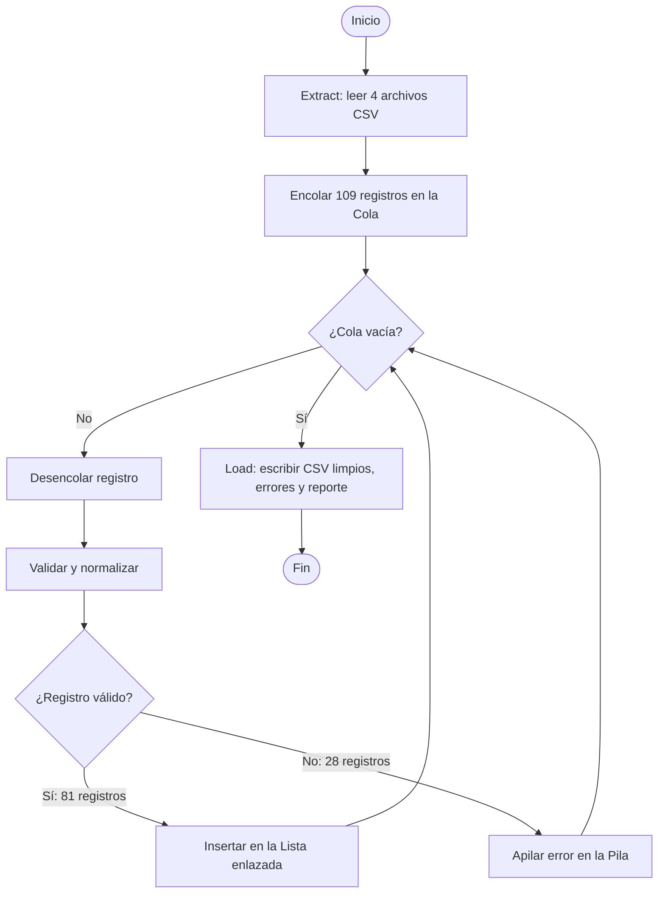

# Flujograma: ETL completo

**Origen:** Generador local (sin IA): Error HTTP 503: {
  "error": {
    "code": 503,
    "message": "This model is currently experiencing high demand. Spikes in demand are usually temporary. Please try again later.",
    "status": "UNAVAILABLE"
  }
}




## Descripción estructurada enviada a la IA

```text
Proceso ETL ejecutado con datos reales:
1. Extract: se leyeron 4 archivos CSV y se encolaron 109 registros en una Cola (FIFO).
2. Transform: mientras la cola no este vacia se desencola un registro y se valida (identificador, campos obligatorios, rangos, duplicados, referencias).
3. Si el registro es valido (81 casos) se inserta en una ListaEnlazada; si no (28 casos) se apila un ErrorETL en una Pila.
4. Load: al vaciarse la cola se escriben los CSV limpios, errores_etl.txt y reporte_etl.txt.
Errores por tipo: ID_INVALIDO=4 DATO_INCOMPLETO=5 FORMATO_INVALIDO=5 RANGO_INVALIDO=5 DUPLICADO=5 REFERENCIA_INVALIDA=4
```
