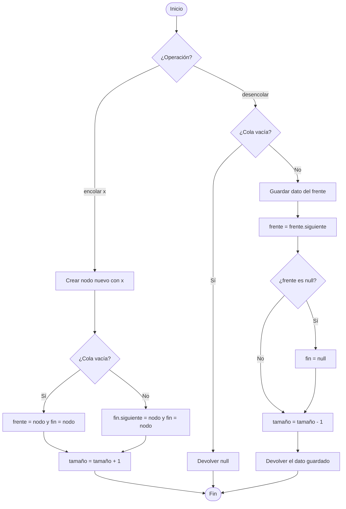

# Flujograma: Cola (encolar y desencolar)

**Origen:** Generador local (estructura fija: la IA se reserva para los flujogramas con datos reales)



## Descripción estructurada enviada a la IA

```text
Cola FIFO con nodos enlazados y referencias frente y fin.
encolar(x): crear nodo; si la cola esta vacia frente y fin apuntan al nodo; si no fin.siguiente = nodo y fin = nodo.
desencolar(): si esta vacia devolver null; guardar dato de frente; frente = frente.siguiente; si frente queda null entonces fin = null.
```
