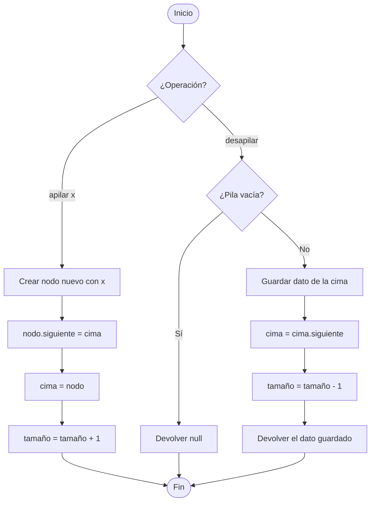

# Flujograma: Pila (apilar y desapilar)

**Origen:** Generador local



## Descripción estructurada enviada a la IA

```text
Pila LIFO con nodos enlazados y referencia cima.
apilar(x): crear nodo; nodo.siguiente = cima; cima = nodo.
desapilar(): si esta vacia devolver null; guardar dato de la cima; cima = cima.siguiente.
```
