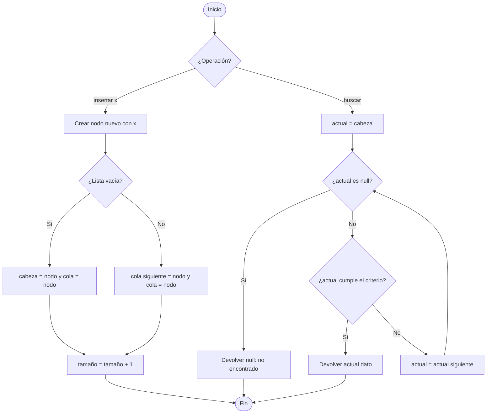

# Flujograma: Lista enlazada (insertar y buscar)

**Origen:** Generador local



## Descripción estructurada enviada a la IA

```text
Lista enlazada simple con referencias cabeza y cola.
insertar(x): crear nodo; si la lista esta vacia cabeza y cola apuntan al nodo; si no cola.siguiente = nodo y cola = nodo.
buscar(criterio): recorrer desde cabeza; si cumple devolver dato; al terminar devolver null.
```
