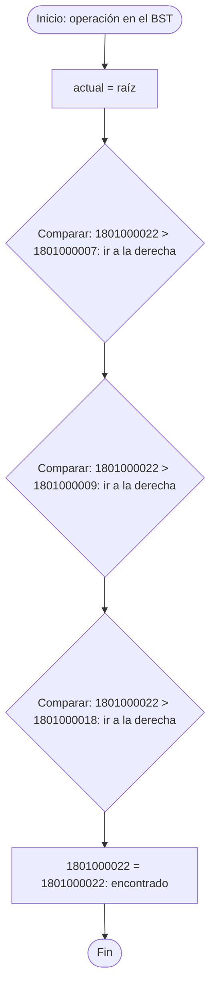

# Flujograma: BST (comparación de claves)

**Origen:** Generador local (sin IA): Error HTTP 429: {
  "error": {
    "code": 429,
    "message": "You exceeded your current quota, please check your plan and billing details. For more information on this error, head to: https://aistudio.google.com/docs/rate-limits. To monitor your current usage, head to: https://ai.dev/rate-limit. \n* Quota exceede



## Descripción estructurada enviada a la IA

```text
Operacion real sobre un BST de 22 nodos y altura 8. Cada paso compara la clave con el nodo actual:
1. 1801000022 > 1801000007: ir a la derecha
2. 1801000022 > 1801000009: ir a la derecha
3. 1801000022 > 1801000018: ir a la derecha
4. 1801000022 = 1801000022: encontrado
```
