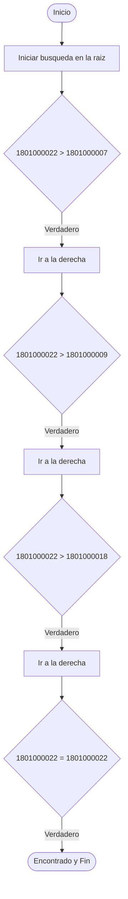

# Flujograma: BST (comparación de claves)

**Origen:** Generado con IA (gemini-3.5-flash-lite) a partir de datos reales de la ejecución



## Descripción estructurada enviada a la IA

```text
Operacion real sobre un BST de 22 nodos y altura 8. Cada paso compara la clave con el nodo actual:
1. 1801000022 > 1801000007: ir a la derecha
2. 1801000022 > 1801000009: ir a la derecha
3. 1801000022 > 1801000018: ir a la derecha
4. 1801000022 = 1801000022: encontrado
```
