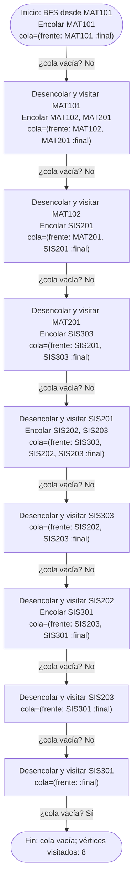

# Flujograma: Grafo + BFS

**Origen:** Generador local



## Descripción estructurada enviada a la IA

```text
Recorrido BFS sobre el grafo de prerrequisitos usando una cola. Eventos registrados en orden:
INICIO: BFS desde MAT101
ENCOLAR: MAT101 | cola=[frente: MAT101 :final]
DESENCOLAR: MAT101 | cola=[frente:  :final]
ENCOLAR: MAT102 | cola=[frente: MAT102 :final]
ENCOLAR: MAT201 | cola=[frente: MAT102, MAT201 :final]
DESENCOLAR: MAT102 | cola=[frente: MAT201 :final]
ENCOLAR: SIS201 | cola=[frente: MAT201, SIS201 :final]
DESENCOLAR: MAT201 | cola=[frente: SIS201 :final]
ENCOLAR: SIS303 | cola=[frente: SIS201, SIS303 :final]
DESENCOLAR: SIS201 | cola=[frente: SIS303 :final]
ENCOLAR: SIS202 | cola=[frente: SIS303, SIS202 :final]
ENCOLAR: SIS203 | cola=[frente: SIS303, SIS202, SIS203 :final]
DESENCOLAR: SIS303 | cola=[frente: SIS202, SIS203 :final]
DESENCOLAR: SIS202 | cola=[frente: SIS203 :final]
ENCOLAR: SIS301 | cola=[frente: SIS203, SIS301 :final]
DESENCOLAR: SIS203 | cola=[frente: SIS301 :final]
DESENCOLAR: SIS301 | cola=[frente:  :final]
FIN: cola vacía; vértices visitados: 8
```
