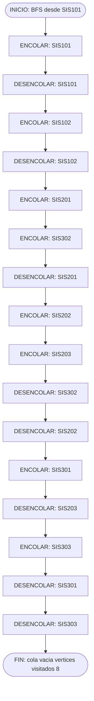

# Flujograma: Grafo + BFS

**Origen:** Generado con IA (gemini-3.5-flash-lite) a partir de datos reales de la ejecución



## Descripción estructurada enviada a la IA

```text
Recorrido BFS real sobre el grafo de prerrequisitos usando una cola. Eventos registrados en orden (con el contenido de la cola tras cada paso):
INICIO: BFS desde SIS101
ENCOLAR: SIS101 | cola=[frente: SIS101 :final]
DESENCOLAR: SIS101 | cola=[frente:  :final]
ENCOLAR: SIS102 | cola=[frente: SIS102 :final]
DESENCOLAR: SIS102 | cola=[frente:  :final]
ENCOLAR: SIS201 | cola=[frente: SIS201 :final]
ENCOLAR: SIS302 | cola=[frente: SIS201, SIS302 :final]
DESENCOLAR: SIS201 | cola=[frente: SIS302 :final]
ENCOLAR: SIS202 | cola=[frente: SIS302, SIS202 :final]
ENCOLAR: SIS203 | cola=[frente: SIS302, SIS202, SIS203 :final]
DESENCOLAR: SIS302 | cola=[frente: SIS202, SIS203 :final]
DESENCOLAR: SIS202 | cola=[frente: SIS203 :final]
ENCOLAR: SIS301 | cola=[frente: SIS203, SIS301 :final]
DESENCOLAR: SIS203 | cola=[frente: SIS301 :final]
ENCOLAR: SIS303 | cola=[frente: SIS301, SIS303 :final]
DESENCOLAR: SIS301 | cola=[frente: SIS303 :final]
DESENCOLAR: SIS303 | cola=[frente:  :final]
FIN: cola vacía; vértices visitados: 8
```
