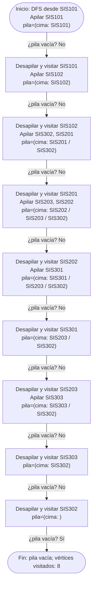

# Flujograma: Grafo + DFS

**Origen:** Generador local (sin IA): Error HTTP 429: {
  "error": {
    "code": 429,
    "message": "You exceeded your current quota, please check your plan and billing details. For more information on this error, head to: https://aistudio.google.com/docs/rate-limits. To monitor your current usage, head to: https://ai.dev/rate-limit. \n* Quota exceede



## Descripción estructurada enviada a la IA

```text
Recorrido DFS real sobre el grafo de prerrequisitos usando una pila. Eventos registrados en orden (con el contenido de la pila tras cada paso):
INICIO: DFS desde SIS101
APILAR: SIS101 | pila=[cima: SIS101]
VISITAR: SIS101 | pila=[cima: ]
APILAR: SIS102 | pila=[cima: SIS102]
VISITAR: SIS102 | pila=[cima: ]
APILAR: SIS302 | pila=[cima: SIS302]
APILAR: SIS201 | pila=[cima: SIS201 | SIS302]
VISITAR: SIS201 | pila=[cima: SIS302]
APILAR: SIS203 | pila=[cima: SIS203 | SIS302]
APILAR: SIS202 | pila=[cima: SIS202 | SIS203 | SIS302]
VISITAR: SIS202 | pila=[cima: SIS203 | SIS302]
APILAR: SIS301 | pila=[cima: SIS301 | SIS203 | SIS302]
VISITAR: SIS301 | pila=[cima: SIS203 | SIS302]
VISITAR: SIS203 | pila=[cima: SIS302]
APILAR: SIS303 | pila=[cima: SIS303 | SIS302]
VISITAR: SIS303 | pila=[cima: SIS302]
VISITAR: SIS302 | pila=[cima: ]
FIN: pila vacía; vértices visitados: 8
```
