## Flujograma: ETL completo
- Fecha: 2026-11-19 09:49:53
- Modelo: claude-sonnet-5-5
- Estado: Sin ANTHROPIC_API_KEY: se usó el generador local (sin IA)

**Instrucción de sistema:**

```text
Eres un asistente que convierte descripciones de algoritmos en diagramas Mermaid. Responde UNICAMENTE con un bloque de codigo mermaid que comience con 'flowchart TD'. Reglas: los ids de nodo son alfanumericos sin espacios; todo el texto de cada nodo va entre comillas dobles; usa ["..."] para procesos, {"..."} para decisiones y (["..."]) para inicio y fin; las etiquetas de flechas se escriben -->|"texto"|; no uses parentesis ni corchetes dentro del texto; no agregues explicaciones fuera del bloque.
```

**Prompt enviado:**

```text
Genera un flujograma Mermaid (flowchart TD) del proceso: ETL completo.

Descripcion estructurada generada por el programa (datos reales de la ejecucion):
Proceso ETL ejecutado con datos reales:
1. Extract: se leyeron 4 archivos CSV y se encolaron 109 registros en una Cola (FIFO).
2. Transform: mientras la cola no este vacia se desencola un registro y se valida (identificador, campos obligatorios, rangos, duplicados, referencias).
3. Si el registro es valido (81 casos) se inserta en una ListaEnlazada; si no (28 casos) se apila un ErrorETL en una Pila.
4. Load: al vaciarse la cola se escriben los CSV limpios, errores_etl.txt y reporte_etl.txt.
Errores por tipo: ID_INVALIDO=4 DATO_INCOMPLETO=5 FORMATO_INVALIDO=5 RANGO_INVALIDO=5 DUPLICADO=5 REFERENCIA_INVALIDA=4 


El diagrama debe reflejar fielmente estos pasos, con inicio, fin, decisiones y bucles cuando correspondan.
```

**Respuesta recibida:**

_(sin respuesta de la IA)_

---

## Flujograma: Cola (encolar y desencolar)
- Fecha: 2026-11-19 09:49:53
- Modelo: claude-sonnet-5-5
- Estado: Sin ANTHROPIC_API_KEY: se usó el generador local (sin IA)

**Instrucción de sistema:**

```text
Eres un asistente que convierte descripciones de algoritmos en diagramas Mermaid. Responde UNICAMENTE con un bloque de codigo mermaid que comience con 'flowchart TD'. Reglas: los ids de nodo son alfanumericos sin espacios; todo el texto de cada nodo va entre comillas dobles; usa ["..."] para procesos, {"..."} para decisiones y (["..."]) para inicio y fin; las etiquetas de flechas se escriben -->|"texto"|; no uses parentesis ni corchetes dentro del texto; no agregues explicaciones fuera del bloque.
```

**Prompt enviado:**

```text
Genera un flujograma Mermaid (flowchart TD) del proceso: Cola (encolar y desencolar).

Descripcion estructurada generada por el programa (datos reales de la ejecucion):
Cola FIFO con nodos enlazados y referencias frente y fin.
encolar(x): crear nodo; si la cola esta vacia frente y fin apuntan al nodo; si no fin.siguiente = nodo y fin = nodo.
desencolar(): si esta vacia devolver null; guardar dato de frente; frente = frente.siguiente; si frente queda null entonces fin = null.

El diagrama debe reflejar fielmente estos pasos, con inicio, fin, decisiones y bucles cuando correspondan.
```

**Respuesta recibida:**

_(sin respuesta de la IA)_

---

## Flujograma: Pila (apilar y desapilar)
- Fecha: 2026-11-19 09:49:53
- Modelo: claude-sonnet-5-5
- Estado: Sin ANTHROPIC_API_KEY: se usó el generador local (sin IA)

**Instrucción de sistema:**

```text
Eres un asistente que convierte descripciones de algoritmos en diagramas Mermaid. Responde UNICAMENTE con un bloque de codigo mermaid que comience con 'flowchart TD'. Reglas: los ids de nodo son alfanumericos sin espacios; todo el texto de cada nodo va entre comillas dobles; usa ["..."] para procesos, {"..."} para decisiones y (["..."]) para inicio y fin; las etiquetas de flechas se escriben -->|"texto"|; no uses parentesis ni corchetes dentro del texto; no agregues explicaciones fuera del bloque.
```

**Prompt enviado:**

```text
Genera un flujograma Mermaid (flowchart TD) del proceso: Pila (apilar y desapilar).

Descripcion estructurada generada por el programa (datos reales de la ejecucion):
Pila LIFO con nodos enlazados y referencia cima.
apilar(x): crear nodo; nodo.siguiente = cima; cima = nodo.
desapilar(): si esta vacia devolver null; guardar dato de la cima; cima = cima.siguiente.

El diagrama debe reflejar fielmente estos pasos, con inicio, fin, decisiones y bucles cuando correspondan.
```

**Respuesta recibida:**

_(sin respuesta de la IA)_

---

## Flujograma: Lista enlazada (insertar y buscar)
- Fecha: 2026-11-19 09:49:53
- Modelo: claude-sonnet-5-5
- Estado: Sin ANTHROPIC_API_KEY: se usó el generador local (sin IA)

**Instrucción de sistema:**

```text
Eres un asistente que convierte descripciones de algoritmos en diagramas Mermaid. Responde UNICAMENTE con un bloque de codigo mermaid que comience con 'flowchart TD'. Reglas: los ids de nodo son alfanumericos sin espacios; todo el texto de cada nodo va entre comillas dobles; usa ["..."] para procesos, {"..."} para decisiones y (["..."]) para inicio y fin; las etiquetas de flechas se escriben -->|"texto"|; no uses parentesis ni corchetes dentro del texto; no agregues explicaciones fuera del bloque.
```

**Prompt enviado:**

```text
Genera un flujograma Mermaid (flowchart TD) del proceso: Lista enlazada (insertar y buscar).

Descripcion estructurada generada por el programa (datos reales de la ejecucion):
Lista enlazada simple con referencias cabeza y cola.
insertar(x): crear nodo; si la lista esta vacia cabeza y cola apuntan al nodo; si no cola.siguiente = nodo y cola = nodo.
buscar(criterio): actual = cabeza; mientras actual no sea null: si cumple el criterio devolver el dato; avanzar actual = actual.siguiente; al terminar devolver null.

El diagrama debe reflejar fielmente estos pasos, con inicio, fin, decisiones y bucles cuando correspondan.
```

**Respuesta recibida:**

_(sin respuesta de la IA)_

---

## Flujograma: BST (comparación de claves)
- Fecha: 2026-11-19 09:49:53
- Modelo: claude-sonnet-5-5
- Estado: Sin ANTHROPIC_API_KEY: se usó el generador local (sin IA)

**Instrucción de sistema:**

```text
Eres un asistente que convierte descripciones de algoritmos en diagramas Mermaid. Responde UNICAMENTE con un bloque de codigo mermaid que comience con 'flowchart TD'. Reglas: los ids de nodo son alfanumericos sin espacios; todo el texto de cada nodo va entre comillas dobles; usa ["..."] para procesos, {"..."} para decisiones y (["..."]) para inicio y fin; las etiquetas de flechas se escriben -->|"texto"|; no uses parentesis ni corchetes dentro del texto; no agregues explicaciones fuera del bloque.
```

**Prompt enviado:**

```text
Genera un flujograma Mermaid (flowchart TD) del proceso: BST (comparación de claves).

Descripcion estructurada generada por el programa (datos reales de la ejecucion):
Operacion real sobre un BST de 22 nodos y altura 8. Cada paso compara la clave con el nodo actual:
1. 1801000022 > 1801000007: ir a la derecha
2. 1801000022 > 1801000009: ir a la derecha
3. 1801000022 > 1801000018: ir a la derecha
4. 1801000022 = 1801000022: encontrado


El diagrama debe reflejar fielmente estos pasos, con inicio, fin, decisiones y bucles cuando correspondan.
```

**Respuesta recibida:**

_(sin respuesta de la IA)_

---

## Flujograma: Grafo + BFS
- Fecha: 2026-11-19 09:49:53
- Modelo: claude-sonnet-5-5
- Estado: Sin ANTHROPIC_API_KEY: se usó el generador local (sin IA)

**Instrucción de sistema:**

```text
Eres un asistente que convierte descripciones de algoritmos en diagramas Mermaid. Responde UNICAMENTE con un bloque de codigo mermaid que comience con 'flowchart TD'. Reglas: los ids de nodo son alfanumericos sin espacios; todo el texto de cada nodo va entre comillas dobles; usa ["..."] para procesos, {"..."} para decisiones y (["..."]) para inicio y fin; las etiquetas de flechas se escriben -->|"texto"|; no uses parentesis ni corchetes dentro del texto; no agregues explicaciones fuera del bloque.
```

**Prompt enviado:**

```text
Genera un flujograma Mermaid (flowchart TD) del proceso: Grafo + BFS.

Descripcion estructurada generada por el programa (datos reales de la ejecucion):
Recorrido BFS real sobre el grafo de prerrequisitos usando una cola. Eventos registrados en orden (con el contenido de la cola tras cada paso):
INICIO: BFS desde SIS101
ENCOLAR: SIS101 | cola=[frente: SIS101 :final]
DESENCOLAR: SIS101 | cola=[frente:  :final]
ENCOLAR: SIS102 | cola=[frente: SIS102 :final]
DESENCOLAR: SIS102 | cola=[frente:  :final]
ENCOLAR: SIS201 | cola=[frente: SIS201 :final]
ENCOLAR: SIS302 | cola=[frente: SIS201, SIS302 :final]
DESENCOLAR: SIS201 | cola=[frente: SIS302 :final]
ENCOLAR: SIS202 | cola=[frente: SIS302, SIS202 :final]
ENCOLAR: SIS203 | cola=[frente: SIS302, SIS202, SIS203 :final]
DESENCOLAR: SIS302 | cola=[frente: SIS202, SIS203 :final]
DESENCOLAR: SIS202 | cola=[frente: SIS203 :final]
ENCOLAR: SIS301 | cola=[frente: SIS203, SIS301 :final]
DESENCOLAR: SIS203 | cola=[frente: SIS301 :final]
ENCOLAR: SIS303 | cola=[frente: SIS301, SIS303 :final]
DESENCOLAR: SIS301 | cola=[frente: SIS303 :final]
DESENCOLAR: SIS303 | cola=[frente:  :final]
FIN: cola vacía; vértices visitados: 8


El diagrama debe reflejar fielmente estos pasos, con inicio, fin, decisiones y bucles cuando correspondan.
```

**Respuesta recibida:**

_(sin respuesta de la IA)_

---

## Flujograma: Grafo + DFS
- Fecha: 2026-11-19 09:49:53
- Modelo: claude-sonnet-5-5
- Estado: Sin ANTHROPIC_API_KEY: se usó el generador local (sin IA)

**Instrucción de sistema:**

```text
Eres un asistente que convierte descripciones de algoritmos en diagramas Mermaid. Responde UNICAMENTE con un bloque de codigo mermaid que comience con 'flowchart TD'. Reglas: los ids de nodo son alfanumericos sin espacios; todo el texto de cada nodo va entre comillas dobles; usa ["..."] para procesos, {"..."} para decisiones y (["..."]) para inicio y fin; las etiquetas de flechas se escriben -->|"texto"|; no uses parentesis ni corchetes dentro del texto; no agregues explicaciones fuera del bloque.
```

**Prompt enviado:**

```text
Genera un flujograma Mermaid (flowchart TD) del proceso: Grafo + DFS.

Descripcion estructurada generada por el programa (datos reales de la ejecucion):
Recorrido DFS real sobre el grafo de prerrequisitos usando una pila. Eventos registrados en orden (con el contenido de la pila tras cada paso):
INICIO: DFS desde SIS101
APILAR: SIS101 | pila=[cima: SIS101]
VISITAR: SIS101 | pila=[cima: ]
APILAR: SIS102 | pila=[cima: SIS102]
VISITAR: SIS102 | pila=[cima: ]
APILAR: SIS302 | pila=[cima: SIS302]
APILAR: SIS201 | pila=[cima: SIS201 | SIS302]
VISITAR: SIS201 | pila=[cima: SIS302]
APILAR: SIS203 | pila=[cima: SIS203 | SIS302]
APILAR: SIS202 | pila=[cima: SIS202 | SIS203 | SIS302]
VISITAR: SIS202 | pila=[cima: SIS203 | SIS302]
APILAR: SIS301 | pila=[cima: SIS301 | SIS203 | SIS302]
VISITAR: SIS301 | pila=[cima: SIS203 | SIS302]
VISITAR: SIS203 | pila=[cima: SIS302]
APILAR: SIS303 | pila=[cima: SIS303 | SIS302]
VISITAR: SIS303 | pila=[cima: SIS302]
VISITAR: SIS302 | pila=[cima: ]
FIN: pila vacía; vértices visitados: 8


El diagrama debe reflejar fielmente estos pasos, con inicio, fin, decisiones y bucles cuando correspondan.
```

**Respuesta recibida:**

_(sin respuesta de la IA)_

---

## Documentación del sistema
- Fecha: 2026-11-19 09:49:53
- Modelo: claude-sonnet-5-5
- Estado: Sin ANTHROPIC_API_KEY: se usó el generador local (sin IA)

**Instrucción de sistema:**

```text
Eres un profesor de Estructuras de Datos de ingenieria de software. Explica en espanol, con tono tecnico pero claro, refiriendote a los nodos, claves y valores CONCRETOS que recibes, no a definiciones genericas. Maximo 250 palabras. No inventes datos que no esten en la entrada.
```

**Prompt enviado:**

```text
Redacta en espanol la documentacion tecnica breve (formato Markdown, maximo 400 palabras) del siguiente sistema, con las secciones: Proposito, Flujo de datos, Estructuras utilizadas y por que, Resultados de la ejecucion.

Registros procesados: 109 | válidos: 81 | inválidos: 28
Estudiantes válidos: 22 | Asignaturas: 12 | Matrículas: 34 | Prerrequisitos: 13
BST: 22 nodos, altura 8
Grafo: 12 vértices, 13 aristas
SIS201 -> SIS202 -> SIS301 -> SIS201
Total de registros procesados: 109
Registros válidos: 81
Total de errores: 28
Identificador incorrecto: 4
Datos incompletos: 5
Formato incorrecto: 5
Valor fuera de rango: 5
Registro duplicado: 5
Referencia inexistente / relación inconsistente: 4
Errores en estudiantes.csv: 12 de 34
Errores en asignaturas.csv: 5 de 17
Errores en matriculas.csv: 7 de 41
Errores en prerrequisitos.csv: 4 de 17

```

**Respuesta recibida:**

_(sin respuesta de la IA)_

---

## Explicación del BST
- Fecha: 2026-11-19 09:49:53
- Modelo: claude-sonnet-5-5
- Estado: Sin ANTHROPIC_API_KEY: se usó el generador local (sin IA)

**Instrucción de sistema:**

```text
Eres un profesor de Estructuras de Datos de ingenieria de software. Explica en espanol, con tono tecnico pero claro, refiriendote a los nodos, claves y valores CONCRETOS que recibes, no a definiciones genericas. Maximo 250 palabras. No inventes datos que no esten en la entrada.
```

**Prompt enviado:**

```text
Explica el siguiente arbol binario de busqueda (BST) real. Cada linea indica un nodo con sus hijos.

Raíz: 1801000007
1801000007 | izquierdo: 1801000003 | derecho: 1801000009
1801000003 | izquierdo: 1801000001 | derecho: 1801000005
1801000001 | izquierdo: - | derecho: 1801000002
1801000002 | izquierdo: - | derecho: -
1801000005 | izquierdo: 1801000004 | derecho: 1801000006
1801000004 | izquierdo: - | derecho: -
1801000006 | izquierdo: - | derecho: -
1801000009 | izquierdo: 1801000008 | derecho: 1801000018
1801000008 | izquierdo: - | derecho: -
1801000018 | izquierdo: 1801000012 | derecho: 1801000022
1801000012 | izquierdo: 1801000011 | derecho: 1801000016
1801000011 | izquierdo: 1801000010 | derecho: -
1801000010 | izquierdo: - | derecho: -
1801000016 | izquierdo: 1801000015 | derecho: 1801000017
1801000015 | izquierdo: 1801000013 | derecho: -
1801000013 | izquierdo: - | derecho: 1801000014
1801000014 | izquierdo: - | derecho: -
1801000017 | izquierdo: - | derecho: -
1801000022 | izquierdo: 1801000020 | derecho: -
1801000020 | izquierdo: 1801000019 | derecho: 1801000021
1801000019 | izquierdo: - | derecho: -
1801000021 | izquierdo: - | derecho: -

Nodos: 22. Altura: 8. Altura minima posible con ese numero de nodos: 5.

Indica cual es la raiz, como se cumple la propiedad BST en al menos dos nodos concretos y si el arbol esta balanceado o degenerado y que consecuencia tiene para la busqueda.
```

**Respuesta recibida:**

_(sin respuesta de la IA)_

---

## Explicación del grafo
- Fecha: 2026-11-19 09:49:53
- Modelo: claude-sonnet-5-5
- Estado: Sin ANTHROPIC_API_KEY: se usó el generador local (sin IA)

**Instrucción de sistema:**

```text
Eres un profesor de Estructuras de Datos de ingenieria de software. Explica en espanol, con tono tecnico pero claro, refiriendote a los nodos, claves y valores CONCRETOS que recibes, no a definiciones genericas. Maximo 250 palabras. No inventes datos que no esten en la entrada.
```

**Prompt enviado:**

```text
Explica el siguiente grafo dirigido real de prerrequisitos entre asignaturas. Cada linea es: asignatura -> asignaturas que dependen de ella.

SIS101 -> SIS102
SIS102 -> SIS201, SIS302
MAT101 -> MAT102, MAT201
FIS101 -> SIS302
MAT102 -> SIS201
SIS201 -> SIS202, SIS203
MAT201 -> SIS303
SIS202 -> SIS301
SIS203 -> SIS303
SIS301 -> SIS201
SIS302 -> (ninguno)
SIS303 -> (ninguno)

Vertices: 12. Aristas: 13.
Ciclos detectados: SIS201 -> SIS202 -> SIS301 -> SIS201

Indica que asignaturas no tienen prerrequisitos, cuales son las finales, la cadena de prerrequisitos mas larga que puedas identificar y que implica un ciclo para la malla.
```

**Respuesta recibida:**

_(sin respuesta de la IA)_

---

## Análisis de errores ETL
- Fecha: 2026-11-19 09:49:53
- Modelo: claude-sonnet-5-5
- Estado: Sin ANTHROPIC_API_KEY: se usó el generador local (sin IA)

**Instrucción de sistema:**

```text
Eres un profesor de Estructuras de Datos de ingenieria de software. Explica en espanol, con tono tecnico pero claro, refiriendote a los nodos, claves y valores CONCRETOS que recibes, no a definiciones genericas. Maximo 250 palabras. No inventes datos que no esten en la entrada.
```

**Prompt enviado:**

```text
El programa ETL calculo estas estadisticas agregadas de errores (no se envian registros individuales):

Total de registros procesados: 109
Registros válidos: 81
Total de errores: 28
Identificador incorrecto: 4
Datos incompletos: 5
Formato incorrecto: 5
Valor fuera de rango: 5
Registro duplicado: 5
Referencia inexistente / relación inconsistente: 4
Errores en estudiantes.csv: 12 de 34
Errores en asignaturas.csv: 5 de 17
Errores en matriculas.csv: 7 de 41
Errores en prerrequisitos.csv: 4 de 17

Redacta una interpretacion tecnica de los patrones observados: cual es la categoria dominante, que fuente de datos es la mas problematica y que reglas de validacion o acciones de limpieza recomiendas.
```

**Respuesta recibida:**

_(sin respuesta de la IA)_

---

## Flujograma: ETL completo
- Fecha: 2026-11-19 09:49:59
- Modelo: claude-sonnet-5-5
- Estado: Sin ANTHROPIC_API_KEY: se usó el generador local (sin IA)

**Instrucción de sistema:**

```text
Eres un asistente que convierte descripciones de algoritmos en diagramas Mermaid. Responde UNICAMENTE con un bloque de codigo mermaid que comience con 'flowchart TD'. Reglas: los ids de nodo son alfanumericos sin espacios; todo el texto de cada nodo va entre comillas dobles; usa ["..."] para procesos, {"..."} para decisiones y (["..."]) para inicio y fin; las etiquetas de flechas se escriben -->|"texto"|; no uses parentesis ni corchetes dentro del texto; no agregues explicaciones fuera del bloque.
```

**Prompt enviado:**

```text
Genera un flujograma Mermaid (flowchart TD) del proceso: ETL completo.

Descripcion estructurada generada por el programa (datos reales de la ejecucion):
Proceso ETL ejecutado con datos reales:
1. Extract: se leyeron 4 archivos CSV y se encolaron 109 registros en una Cola (FIFO).
2. Transform: mientras la cola no este vacia se desencola un registro y se valida (identificador, campos obligatorios, rangos, duplicados, referencias).
3. Si el registro es valido (81 casos) se inserta en una ListaEnlazada; si no (28 casos) se apila un ErrorETL en una Pila.
4. Load: al vaciarse la cola se escriben los CSV limpios, errores_etl.txt y reporte_etl.txt.
Errores por tipo: ID_INVALIDO=4 DATO_INCOMPLETO=5 FORMATO_INVALIDO=5 RANGO_INVALIDO=5 DUPLICADO=5 REFERENCIA_INVALIDA=4 


El diagrama debe reflejar fielmente estos pasos, con inicio, fin, decisiones y bucles cuando correspondan.
```

**Respuesta recibida:**

_(sin respuesta de la IA)_

---

## Flujograma: Cola (encolar y desencolar)
- Fecha: 2026-11-19 09:49:59
- Modelo: claude-sonnet-5-5
- Estado: Sin ANTHROPIC_API_KEY: se usó el generador local (sin IA)

**Instrucción de sistema:**

```text
Eres un asistente que convierte descripciones de algoritmos en diagramas Mermaid. Responde UNICAMENTE con un bloque de codigo mermaid que comience con 'flowchart TD'. Reglas: los ids de nodo son alfanumericos sin espacios; todo el texto de cada nodo va entre comillas dobles; usa ["..."] para procesos, {"..."} para decisiones y (["..."]) para inicio y fin; las etiquetas de flechas se escriben -->|"texto"|; no uses parentesis ni corchetes dentro del texto; no agregues explicaciones fuera del bloque.
```

**Prompt enviado:**

```text
Genera un flujograma Mermaid (flowchart TD) del proceso: Cola (encolar y desencolar).

Descripcion estructurada generada por el programa (datos reales de la ejecucion):
Cola FIFO con nodos enlazados y referencias frente y fin.
encolar(x): crear nodo; si la cola esta vacia frente y fin apuntan al nodo; si no fin.siguiente = nodo y fin = nodo.
desencolar(): si esta vacia devolver null; guardar dato de frente; frente = frente.siguiente; si frente queda null entonces fin = null.

El diagrama debe reflejar fielmente estos pasos, con inicio, fin, decisiones y bucles cuando correspondan.
```

**Respuesta recibida:**

_(sin respuesta de la IA)_

---

## Flujograma: Pila (apilar y desapilar)
- Fecha: 2026-11-19 09:49:59
- Modelo: claude-sonnet-5-5
- Estado: Sin ANTHROPIC_API_KEY: se usó el generador local (sin IA)

**Instrucción de sistema:**

```text
Eres un asistente que convierte descripciones de algoritmos en diagramas Mermaid. Responde UNICAMENTE con un bloque de codigo mermaid que comience con 'flowchart TD'. Reglas: los ids de nodo son alfanumericos sin espacios; todo el texto de cada nodo va entre comillas dobles; usa ["..."] para procesos, {"..."} para decisiones y (["..."]) para inicio y fin; las etiquetas de flechas se escriben -->|"texto"|; no uses parentesis ni corchetes dentro del texto; no agregues explicaciones fuera del bloque.
```

**Prompt enviado:**

```text
Genera un flujograma Mermaid (flowchart TD) del proceso: Pila (apilar y desapilar).

Descripcion estructurada generada por el programa (datos reales de la ejecucion):
Pila LIFO con nodos enlazados y referencia cima.
apilar(x): crear nodo; nodo.siguiente = cima; cima = nodo.
desapilar(): si esta vacia devolver null; guardar dato de la cima; cima = cima.siguiente.

El diagrama debe reflejar fielmente estos pasos, con inicio, fin, decisiones y bucles cuando correspondan.
```

**Respuesta recibida:**

_(sin respuesta de la IA)_

---

## Flujograma: Lista enlazada (insertar y buscar)
- Fecha: 2026-11-19 09:49:59
- Modelo: claude-sonnet-5-5
- Estado: Sin ANTHROPIC_API_KEY: se usó el generador local (sin IA)

**Instrucción de sistema:**

```text
Eres un asistente que convierte descripciones de algoritmos en diagramas Mermaid. Responde UNICAMENTE con un bloque de codigo mermaid que comience con 'flowchart TD'. Reglas: los ids de nodo son alfanumericos sin espacios; todo el texto de cada nodo va entre comillas dobles; usa ["..."] para procesos, {"..."} para decisiones y (["..."]) para inicio y fin; las etiquetas de flechas se escriben -->|"texto"|; no uses parentesis ni corchetes dentro del texto; no agregues explicaciones fuera del bloque.
```

**Prompt enviado:**

```text
Genera un flujograma Mermaid (flowchart TD) del proceso: Lista enlazada (insertar y buscar).

Descripcion estructurada generada por el programa (datos reales de la ejecucion):
Lista enlazada simple con referencias cabeza y cola.
insertar(x): crear nodo; si la lista esta vacia cabeza y cola apuntan al nodo; si no cola.siguiente = nodo y cola = nodo.
buscar(criterio): actual = cabeza; mientras actual no sea null: si cumple el criterio devolver el dato; avanzar actual = actual.siguiente; al terminar devolver null.

El diagrama debe reflejar fielmente estos pasos, con inicio, fin, decisiones y bucles cuando correspondan.
```

**Respuesta recibida:**

_(sin respuesta de la IA)_

---

## Flujograma: BST (comparación de claves)
- Fecha: 2026-11-19 09:49:59
- Modelo: claude-sonnet-5-5
- Estado: Sin ANTHROPIC_API_KEY: se usó el generador local (sin IA)

**Instrucción de sistema:**

```text
Eres un asistente que convierte descripciones de algoritmos en diagramas Mermaid. Responde UNICAMENTE con un bloque de codigo mermaid que comience con 'flowchart TD'. Reglas: los ids de nodo son alfanumericos sin espacios; todo el texto de cada nodo va entre comillas dobles; usa ["..."] para procesos, {"..."} para decisiones y (["..."]) para inicio y fin; las etiquetas de flechas se escriben -->|"texto"|; no uses parentesis ni corchetes dentro del texto; no agregues explicaciones fuera del bloque.
```

**Prompt enviado:**

```text
Genera un flujograma Mermaid (flowchart TD) del proceso: BST (comparación de claves).

Descripcion estructurada generada por el programa (datos reales de la ejecucion):
Operacion real sobre un BST de 22 nodos y altura 8. Cada paso compara la clave con el nodo actual:
1. 1801000022 > 1801000007: ir a la derecha
2. 1801000022 > 1801000009: ir a la derecha
3. 1801000022 > 1801000018: ir a la derecha
4. 1801000022 = 1801000022: encontrado


El diagrama debe reflejar fielmente estos pasos, con inicio, fin, decisiones y bucles cuando correspondan.
```

**Respuesta recibida:**

_(sin respuesta de la IA)_

---

## Flujograma: Grafo + BFS
- Fecha: 2026-11-19 09:49:59
- Modelo: claude-sonnet-5-5
- Estado: Sin ANTHROPIC_API_KEY: se usó el generador local (sin IA)

**Instrucción de sistema:**

```text
Eres un asistente que convierte descripciones de algoritmos en diagramas Mermaid. Responde UNICAMENTE con un bloque de codigo mermaid que comience con 'flowchart TD'. Reglas: los ids de nodo son alfanumericos sin espacios; todo el texto de cada nodo va entre comillas dobles; usa ["..."] para procesos, {"..."} para decisiones y (["..."]) para inicio y fin; las etiquetas de flechas se escriben -->|"texto"|; no uses parentesis ni corchetes dentro del texto; no agregues explicaciones fuera del bloque.
```

**Prompt enviado:**

```text
Genera un flujograma Mermaid (flowchart TD) del proceso: Grafo + BFS.

Descripcion estructurada generada por el programa (datos reales de la ejecucion):
Recorrido BFS real sobre el grafo de prerrequisitos usando una cola. Eventos registrados en orden (con el contenido de la cola tras cada paso):
INICIO: BFS desde SIS101
ENCOLAR: SIS101 | cola=[frente: SIS101 :final]
DESENCOLAR: SIS101 | cola=[frente:  :final]
ENCOLAR: SIS102 | cola=[frente: SIS102 :final]
DESENCOLAR: SIS102 | cola=[frente:  :final]
ENCOLAR: SIS201 | cola=[frente: SIS201 :final]
ENCOLAR: SIS302 | cola=[frente: SIS201, SIS302 :final]
DESENCOLAR: SIS201 | cola=[frente: SIS302 :final]
ENCOLAR: SIS202 | cola=[frente: SIS302, SIS202 :final]
ENCOLAR: SIS203 | cola=[frente: SIS302, SIS202, SIS203 :final]
DESENCOLAR: SIS302 | cola=[frente: SIS202, SIS203 :final]
DESENCOLAR: SIS202 | cola=[frente: SIS203 :final]
ENCOLAR: SIS301 | cola=[frente: SIS203, SIS301 :final]
DESENCOLAR: SIS203 | cola=[frente: SIS301 :final]
ENCOLAR: SIS303 | cola=[frente: SIS301, SIS303 :final]
DESENCOLAR: SIS301 | cola=[frente: SIS303 :final]
DESENCOLAR: SIS303 | cola=[frente:  :final]
FIN: cola vacía; vértices visitados: 8


El diagrama debe reflejar fielmente estos pasos, con inicio, fin, decisiones y bucles cuando correspondan.
```

**Respuesta recibida:**

_(sin respuesta de la IA)_

---

## Flujograma: Grafo + DFS
- Fecha: 2026-11-19 09:49:59
- Modelo: claude-sonnet-5-5
- Estado: Sin ANTHROPIC_API_KEY: se usó el generador local (sin IA)

**Instrucción de sistema:**

```text
Eres un asistente que convierte descripciones de algoritmos en diagramas Mermaid. Responde UNICAMENTE con un bloque de codigo mermaid que comience con 'flowchart TD'. Reglas: los ids de nodo son alfanumericos sin espacios; todo el texto de cada nodo va entre comillas dobles; usa ["..."] para procesos, {"..."} para decisiones y (["..."]) para inicio y fin; las etiquetas de flechas se escriben -->|"texto"|; no uses parentesis ni corchetes dentro del texto; no agregues explicaciones fuera del bloque.
```

**Prompt enviado:**

```text
Genera un flujograma Mermaid (flowchart TD) del proceso: Grafo + DFS.

Descripcion estructurada generada por el programa (datos reales de la ejecucion):
Recorrido DFS real sobre el grafo de prerrequisitos usando una pila. Eventos registrados en orden (con el contenido de la pila tras cada paso):
INICIO: DFS desde SIS101
APILAR: SIS101 | pila=[cima: SIS101]
VISITAR: SIS101 | pila=[cima: ]
APILAR: SIS102 | pila=[cima: SIS102]
VISITAR: SIS102 | pila=[cima: ]
APILAR: SIS302 | pila=[cima: SIS302]
APILAR: SIS201 | pila=[cima: SIS201 | SIS302]
VISITAR: SIS201 | pila=[cima: SIS302]
APILAR: SIS203 | pila=[cima: SIS203 | SIS302]
APILAR: SIS202 | pila=[cima: SIS202 | SIS203 | SIS302]
VISITAR: SIS202 | pila=[cima: SIS203 | SIS302]
APILAR: SIS301 | pila=[cima: SIS301 | SIS203 | SIS302]
VISITAR: SIS301 | pila=[cima: SIS203 | SIS302]
VISITAR: SIS203 | pila=[cima: SIS302]
APILAR: SIS303 | pila=[cima: SIS303 | SIS302]
VISITAR: SIS303 | pila=[cima: SIS302]
VISITAR: SIS302 | pila=[cima: ]
FIN: pila vacía; vértices visitados: 8


El diagrama debe reflejar fielmente estos pasos, con inicio, fin, decisiones y bucles cuando correspondan.
```

**Respuesta recibida:**

_(sin respuesta de la IA)_

---

## Documentación del sistema
- Fecha: 2026-11-19 09:49:59
- Modelo: claude-sonnet-5-5
- Estado: Sin ANTHROPIC_API_KEY: se usó el generador local (sin IA)

**Instrucción de sistema:**

```text
Eres un profesor de Estructuras de Datos de ingenieria de software. Explica en espanol, con tono tecnico pero claro, refiriendote a los nodos, claves y valores CONCRETOS que recibes, no a definiciones genericas. Maximo 250 palabras. No inventes datos que no esten en la entrada.
```

**Prompt enviado:**

```text
Redacta en espanol la documentacion tecnica breve (formato Markdown, maximo 400 palabras) del siguiente sistema, con las secciones: Proposito, Flujo de datos, Estructuras utilizadas y por que, Resultados de la ejecucion.

Registros procesados: 109 | válidos: 81 | inválidos: 28
Estudiantes válidos: 22 | Asignaturas: 12 | Matrículas: 34 | Prerrequisitos: 13
BST: 22 nodos, altura 8
Grafo: 12 vértices, 13 aristas
SIS201 -> SIS202 -> SIS301 -> SIS201
Total de registros procesados: 109
Registros válidos: 81
Total de errores: 28
Identificador incorrecto: 4
Datos incompletos: 5
Formato incorrecto: 5
Valor fuera de rango: 5
Registro duplicado: 5
Referencia inexistente / relación inconsistente: 4
Errores en estudiantes.csv: 12 de 34
Errores en asignaturas.csv: 5 de 17
Errores en matriculas.csv: 7 de 41
Errores en prerrequisitos.csv: 4 de 17

```

**Respuesta recibida:**

_(sin respuesta de la IA)_

---

## Explicación del BST
- Fecha: 2026-11-19 09:49:59
- Modelo: claude-sonnet-5-5
- Estado: Sin ANTHROPIC_API_KEY: se usó el generador local (sin IA)

**Instrucción de sistema:**

```text
Eres un profesor de Estructuras de Datos de ingenieria de software. Explica en espanol, con tono tecnico pero claro, refiriendote a los nodos, claves y valores CONCRETOS que recibes, no a definiciones genericas. Maximo 250 palabras. No inventes datos que no esten en la entrada.
```

**Prompt enviado:**

```text
Explica el siguiente arbol binario de busqueda (BST) real. Cada linea indica un nodo con sus hijos.

Raíz: 1801000007
1801000007 | izquierdo: 1801000003 | derecho: 1801000009
1801000003 | izquierdo: 1801000001 | derecho: 1801000005
1801000001 | izquierdo: - | derecho: 1801000002
1801000002 | izquierdo: - | derecho: -
1801000005 | izquierdo: 1801000004 | derecho: 1801000006
1801000004 | izquierdo: - | derecho: -
1801000006 | izquierdo: - | derecho: -
1801000009 | izquierdo: 1801000008 | derecho: 1801000018
1801000008 | izquierdo: - | derecho: -
1801000018 | izquierdo: 1801000012 | derecho: 1801000022
1801000012 | izquierdo: 1801000011 | derecho: 1801000016
1801000011 | izquierdo: 1801000010 | derecho: -
1801000010 | izquierdo: - | derecho: -
1801000016 | izquierdo: 1801000015 | derecho: 1801000017
1801000015 | izquierdo: 1801000013 | derecho: -
1801000013 | izquierdo: - | derecho: 1801000014
1801000014 | izquierdo: - | derecho: -
1801000017 | izquierdo: - | derecho: -
1801000022 | izquierdo: 1801000020 | derecho: -
1801000020 | izquierdo: 1801000019 | derecho: 1801000021
1801000019 | izquierdo: - | derecho: -
1801000021 | izquierdo: - | derecho: -

Nodos: 22. Altura: 8. Altura minima posible con ese numero de nodos: 5.

Indica cual es la raiz, como se cumple la propiedad BST en al menos dos nodos concretos y si el arbol esta balanceado o degenerado y que consecuencia tiene para la busqueda.
```

**Respuesta recibida:**

_(sin respuesta de la IA)_

---

## Explicación del grafo
- Fecha: 2026-11-19 09:49:59
- Modelo: claude-sonnet-5-5
- Estado: Sin ANTHROPIC_API_KEY: se usó el generador local (sin IA)

**Instrucción de sistema:**

```text
Eres un profesor de Estructuras de Datos de ingenieria de software. Explica en espanol, con tono tecnico pero claro, refiriendote a los nodos, claves y valores CONCRETOS que recibes, no a definiciones genericas. Maximo 250 palabras. No inventes datos que no esten en la entrada.
```

**Prompt enviado:**

```text
Explica el siguiente grafo dirigido real de prerrequisitos entre asignaturas. Cada linea es: asignatura -> asignaturas que dependen de ella.

SIS101 -> SIS102
SIS102 -> SIS201, SIS302
MAT101 -> MAT102, MAT201
FIS101 -> SIS302
MAT102 -> SIS201
SIS201 -> SIS202, SIS203
MAT201 -> SIS303
SIS202 -> SIS301
SIS203 -> SIS303
SIS301 -> SIS201
SIS302 -> (ninguno)
SIS303 -> (ninguno)

Vertices: 12. Aristas: 13.
Ciclos detectados: SIS201 -> SIS202 -> SIS301 -> SIS201

Indica que asignaturas no tienen prerrequisitos, cuales son las finales, la cadena de prerrequisitos mas larga que puedas identificar y que implica un ciclo para la malla.
```

**Respuesta recibida:**

_(sin respuesta de la IA)_

---

## Análisis de errores ETL
- Fecha: 2026-11-19 09:49:59
- Modelo: claude-sonnet-5-5
- Estado: Sin ANTHROPIC_API_KEY: se usó el generador local (sin IA)

**Instrucción de sistema:**

```text
Eres un profesor de Estructuras de Datos de ingenieria de software. Explica en espanol, con tono tecnico pero claro, refiriendote a los nodos, claves y valores CONCRETOS que recibes, no a definiciones genericas. Maximo 250 palabras. No inventes datos que no esten en la entrada.
```

**Prompt enviado:**

```text
El programa ETL calculo estas estadisticas agregadas de errores (no se envian registros individuales):

Total de registros procesados: 109
Registros válidos: 81
Total de errores: 28
Identificador incorrecto: 4
Datos incompletos: 5
Formato incorrecto: 5
Valor fuera de rango: 5
Registro duplicado: 5
Referencia inexistente / relación inconsistente: 4
Errores en estudiantes.csv: 12 de 34
Errores en asignaturas.csv: 5 de 17
Errores en matriculas.csv: 7 de 41
Errores en prerrequisitos.csv: 4 de 17

Redacta una interpretacion tecnica de los patrones observados: cual es la categoria dominante, que fuente de datos es la mas problematica y que reglas de validacion o acciones de limpieza recomiendas.
```

**Respuesta recibida:**

_(sin respuesta de la IA)_

---

## Flujograma: ETL completo
- Fecha: 2026-11-20 18:20:33
- Proveedor: Gemini
- Modelo: gemini-3.8-flash
- Estado: OK (Gemini, modelo gemini-3.8-flash)

**Instrucción de sistema:**

```text
Eres un asistente que convierte descripciones de algoritmos en diagramas Mermaid. Responde UNICAMENTE con un bloque de codigo mermaid que comience con 'flowchart TD'. Reglas: los ids de nodo son alfanumericos sin espacios; todo el texto de cada nodo va entre comillas dobles; usa ["..."] para procesos, {"..."} para decisiones y (["..."]) para inicio y fin; las etiquetas de flechas se escriben -->|"texto"|; no uses parentesis ni corchetes dentro del texto; no agregues explicaciones fuera del bloque.
```

**Prompt enviado:**

```text
Genera un flujograma Mermaid (flowchart TD) del proceso: ETL completo.

Descripcion estructurada generada por el programa (datos reales de la ejecucion):
Proceso ETL ejecutado con datos reales:
1. Extract: se leyeron 4 archivos CSV y se encolaron 109 registros en una Cola (FIFO).
2. Transform: mientras la cola no este vacia se desencola un registro y se valida (identificador, campos obligatorios, rangos, duplicados, referencias).
3. Si el registro es valido (81 casos) se inserta en una ListaEnlazada; si no (28 casos) se apila un ErrorETL en una Pila.
4. Load: al vaciarse la cola se escriben los CSV limpios, errores_etl.txt y reporte_etl.txt.
Errores por tipo: ID_INVALIDO=4 DATO_INCOMPLETO=5 FORMATO_INVALIDO=5 RANGO_INVALIDO=5 DUPLICADO=5 REFERENCIA_INVALIDA=4 


El diagrama debe reflejar fielmente estos pasos, con inicio, fin, decisiones y bucles cuando correspondan.
```

**Respuesta recibida:**

````text

````

---

## Flujograma: Cola (encolar y desencolar)
- Fecha: 2026-11-20 18:21:43
- Proveedor: Gemini
- Modelo: gemini-3.8-flash
- Estado: OK (Gemini, modelo gemini-3.8-flash)

**Instrucción de sistema:**

```text
Eres un asistente que convierte descripciones de algoritmos en diagramas Mermaid. Responde UNICAMENTE con un bloque de codigo mermaid que comience con 'flowchart TD'. Reglas: los ids de nodo son alfanumericos sin espacios; todo el texto de cada nodo va entre comillas dobles; usa ["..."] para procesos, {"..."} para decisiones y (["..."]) para inicio y fin; las etiquetas de flechas se escriben -->|"texto"|; no uses parentesis ni corchetes dentro del texto; no agregues explicaciones fuera del bloque.
```

**Prompt enviado:**

```text
Genera un flujograma Mermaid (flowchart TD) del proceso: Cola (encolar y desencolar).

Descripcion estructurada generada por el programa (datos reales de la ejecucion):
Cola FIFO con nodos enlazados y referencias frente y fin.
encolar(x): crear nodo; si la cola esta vacia frente y fin apuntan al nodo; si no fin.siguiente = nodo y fin = nodo.
desencolar(): si esta vacia devolver null; guardar dato de frente; frente = frente.siguiente; si frente queda null entonces fin = null.

El diagrama debe reflejar fielmente estos pasos, con inicio, fin, decisiones y bucles cuando correspondan.
```

**Respuesta recibida:**

````text
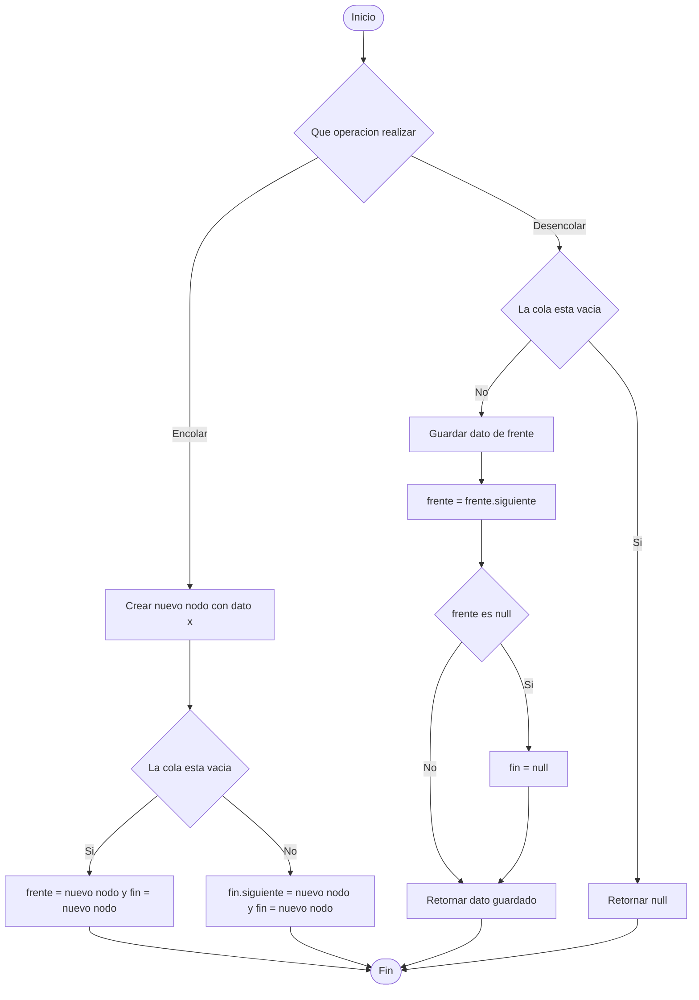
````

---

## Flujograma: Pila (apilar y desapilar)
- Fecha: 2026-11-20 18:23:42
- Proveedor: Gemini
- Modelo: gemini-3.8-flash
- Estado: No se pudo contactar la API: HttpTimeoutException request timed out

**Instrucción de sistema:**

```text
Eres un asistente que convierte descripciones de algoritmos en diagramas Mermaid. Responde UNICAMENTE con un bloque de codigo mermaid que comience con 'flowchart TD'. Reglas: los ids de nodo son alfanumericos sin espacios; todo el texto de cada nodo va entre comillas dobles; usa ["..."] para procesos, {"..."} para decisiones y (["..."]) para inicio y fin; las etiquetas de flechas se escriben -->|"texto"|; no uses parentesis ni corchetes dentro del texto; no agregues explicaciones fuera del bloque.
```

**Prompt enviado:**

```text
Genera un flujograma Mermaid (flowchart TD) del proceso: Pila (apilar y desapilar).

Descripcion estructurada generada por el programa (datos reales de la ejecucion):
Pila LIFO con nodos enlazados y referencia cima.
apilar(x): crear nodo; nodo.siguiente = cima; cima = nodo.
desapilar(): si esta vacia devolver null; guardar dato de la cima; cima = cima.siguiente.

El diagrama debe reflejar fielmente estos pasos, con inicio, fin, decisiones y bucles cuando correspondan.
```

**Respuesta recibida:**

_(sin respuesta de la IA)_

---

## Flujograma: Lista enlazada (insertar y buscar)
- Fecha: 2026-11-20 18:24:25
- Proveedor: Gemini
- Modelo: gemini-3.8-flash
- Estado: OK (Gemini, modelo gemini-3.8-flash)

**Instrucción de sistema:**

```text
Eres un asistente que convierte descripciones de algoritmos en diagramas Mermaid. Responde UNICAMENTE con un bloque de codigo mermaid que comience con 'flowchart TD'. Reglas: los ids de nodo son alfanumericos sin espacios; todo el texto de cada nodo va entre comillas dobles; usa ["..."] para procesos, {"..."} para decisiones y (["..."]) para inicio y fin; las etiquetas de flechas se escriben -->|"texto"|; no uses parentesis ni corchetes dentro del texto; no agregues explicaciones fuera del bloque.
```

**Prompt enviado:**

```text
Genera un flujograma Mermaid (flowchart TD) del proceso: Lista enlazada (insertar y buscar).

Descripcion estructurada generada por el programa (datos reales de la ejecucion):
Lista enlazada simple con referencias cabeza y cola.
insertar(x): crear nodo; si la lista esta vacia cabeza y cola apuntan al nodo; si no cola.siguiente = nodo y cola = nodo.
buscar(criterio): actual = cabeza; mientras actual no sea null: si cumple el criterio devolver el dato; avanzar actual = actual.siguiente; al terminar devolver null.

El diagrama debe reflejar fielmente estos pasos, con inicio, fin, decisiones y bucles cuando correspondan.
```

**Respuesta recibida:**

````text

````

---

## Flujograma: BST (comparación de claves)
- Fecha: 2026-11-20 18:26:16
- Proveedor: Gemini
- Modelo: gemini-3.8-flash
- Estado: No se pudo contactar la API: HttpTimeoutException request timed out

**Instrucción de sistema:**

```text
Eres un asistente que convierte descripciones de algoritmos en diagramas Mermaid. Responde UNICAMENTE con un bloque de codigo mermaid que comience con 'flowchart TD'. Reglas: los ids de nodo son alfanumericos sin espacios; todo el texto de cada nodo va entre comillas dobles; usa ["..."] para procesos, {"..."} para decisiones y (["..."]) para inicio y fin; las etiquetas de flechas se escriben -->|"texto"|; no uses parentesis ni corchetes dentro del texto; no agregues explicaciones fuera del bloque.
```

**Prompt enviado:**

```text
Genera un flujograma Mermaid (flowchart TD) del proceso: BST (comparación de claves).

Descripcion estructurada generada por el programa (datos reales de la ejecucion):
Operacion real sobre un BST de 22 nodos y altura 8. Cada paso compara la clave con el nodo actual:
1. 1801000022 > 1801000007: ir a la derecha
2. 1801000022 > 1801000009: ir a la derecha
3. 1801000022 > 1801000018: ir a la derecha
4. 1801000022 = 1801000022: encontrado


El diagrama debe reflejar fielmente estos pasos, con inicio, fin, decisiones y bucles cuando correspondan.
```

**Respuesta recibida:**

_(sin respuesta de la IA)_

---

## Flujograma: Grafo + BFS
- Fecha: 2026-11-20 18:27:30
- Proveedor: Gemini
- Modelo: gemini-3.8-flash
- Estado: OK (Gemini, modelo gemini-3.8-flash)

**Instrucción de sistema:**

```text
Eres un asistente que convierte descripciones de algoritmos en diagramas Mermaid. Responde UNICAMENTE con un bloque de codigo mermaid que comience con 'flowchart TD'. Reglas: los ids de nodo son alfanumericos sin espacios; todo el texto de cada nodo va entre comillas dobles; usa ["..."] para procesos, {"..."} para decisiones y (["..."]) para inicio y fin; las etiquetas de flechas se escriben -->|"texto"|; no uses parentesis ni corchetes dentro del texto; no agregues explicaciones fuera del bloque.
```

**Prompt enviado:**

```text
Genera un flujograma Mermaid (flowchart TD) del proceso: Grafo + BFS.

Descripcion estructurada generada por el programa (datos reales de la ejecucion):
Recorrido BFS real sobre el grafo de prerrequisitos usando una cola. Eventos registrados en orden (con el contenido de la cola tras cada paso):
INICIO: BFS desde SIS101
ENCOLAR: SIS101 | cola=[frente: SIS101 :final]
DESENCOLAR: SIS101 | cola=[frente:  :final]
ENCOLAR: SIS102 | cola=[frente: SIS102 :final]
DESENCOLAR: SIS102 | cola=[frente:  :final]
ENCOLAR: SIS201 | cola=[frente: SIS201 :final]
ENCOLAR: SIS302 | cola=[frente: SIS201, SIS302 :final]
DESENCOLAR: SIS201 | cola=[frente: SIS302 :final]
ENCOLAR: SIS202 | cola=[frente: SIS302, SIS202 :final]
ENCOLAR: SIS203 | cola=[frente: SIS302, SIS202, SIS203 :final]
DESENCOLAR: SIS302 | cola=[frente: SIS202, SIS203 :final]
DESENCOLAR: SIS202 | cola=[frente: SIS203 :final]
ENCOLAR: SIS301 | cola=[frente: SIS203, SIS301 :final]
DESENCOLAR: SIS203 | cola=[frente: SIS301 :final]
ENCOLAR: SIS303 | cola=[frente: SIS301, SIS303 :final]
DESENCOLAR: SIS301 | cola=[frente: SIS303 :final]
DESENCOLAR: SIS303 | cola=[frente:  :final]
FIN: cola vacía; vértices visitados: 8


El diagrama debe reflejar fielmente estos pasos, con inicio, fin, decisiones y bucles cuando correspondan.
```

**Respuesta recibida:**

````text
```mermaid
flowchart TD
    inicio(["Inicio: BFS desde SIS101"])
    enc1["Encolar SIS101"]
    q1{"Cola vacia?"}
    des1["Desencolar SIS101"]
    enc2["Encolar SIS102"]
    q2{"Cola vacia?"}
    des2["Desencolar SIS102"]
    enc3["Encolar SIS201"]
    enc4["Encolar SIS302"]
    q3{"Cola vacia?"}
    des3["Desencolar SIS201"]
    enc5["Encolar SIS202"]
    enc6["En
````

---

## Flujograma: ETL completo
- Fecha: 2026-11-20 18:39:15
- Proveedor: Gemini
- Modelo: gemini-3.8-flash
- Estado: OK (Gemini, modelo gemini-3.8-flash)

**Instrucción de sistema:**

```text
Eres un asistente que convierte descripciones de algoritmos en diagramas Mermaid. Responde UNICAMENTE con un bloque de codigo mermaid que comience con 'flowchart TD'. Reglas: los ids de nodo son alfanumericos sin espacios; todo el texto de cada nodo va entre comillas dobles; usa ["..."] para procesos, {"..."} para decisiones y (["..."]) para inicio y fin; las etiquetas de flechas se escriben -->|"texto"|; no uses parentesis ni corchetes dentro del texto; no agregues explicaciones fuera del bloque.
```

**Prompt enviado:**

```text
Genera un flujograma Mermaid (flowchart TD) del proceso: ETL completo.

Descripcion estructurada generada por el programa (datos reales de la ejecucion):
Proceso ETL ejecutado con datos reales:
1. Extract: se leyeron 4 archivos CSV y se encolaron 109 registros en una Cola (FIFO).
2. Transform: mientras la cola no este vacia se desencola un registro y se valida (identificador, campos obligatorios, rangos, duplicados, referencias).
3. Si el registro es valido (81 casos) se inserta en una ListaEnlazada; si no (28 casos) se apila un ErrorETL en una Pila.
4. Load: al vaciarse la cola se escriben los CSV limpios, errores_etl.txt y reporte_etl.txt.
Errores por tipo: ID_INVALIDO=4 DATO_INCOMPLETO=5 FORMATO_INVALIDO=5 RANGO_INVALIDO=5 DUPLICADO=5 REFERENCIA_INVALIDA=4 


El diagrama debe reflejar fielmente estos pasos, con inicio, fin, decisiones y bucles cuando correspondan.
```

**Respuesta recibida:**

````text
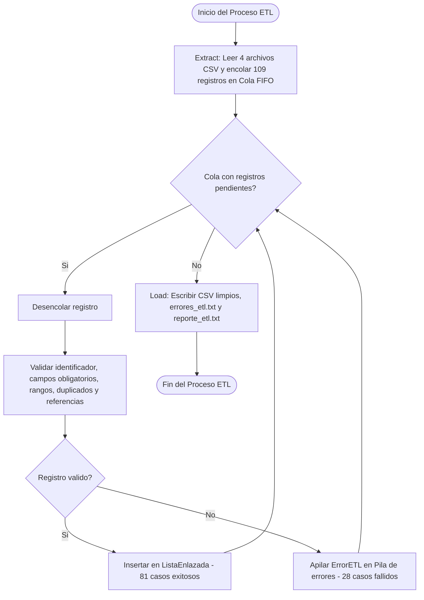
````

---

## Flujograma: Cola (encolar y desencolar)
- Fecha: 2026-11-20 18:40:38
- Proveedor: Gemini
- Modelo: gemini-3.8-flash
- Estado: OK (Gemini, modelo gemini-3.8-flash)

**Instrucción de sistema:**

```text
Eres un asistente que convierte descripciones de algoritmos en diagramas Mermaid. Responde UNICAMENTE con un bloque de codigo mermaid que comience con 'flowchart TD'. Reglas: los ids de nodo son alfanumericos sin espacios; todo el texto de cada nodo va entre comillas dobles; usa ["..."] para procesos, {"..."} para decisiones y (["..."]) para inicio y fin; las etiquetas de flechas se escriben -->|"texto"|; no uses parentesis ni corchetes dentro del texto; no agregues explicaciones fuera del bloque.
```

**Prompt enviado:**

```text
Genera un flujograma Mermaid (flowchart TD) del proceso: Cola (encolar y desencolar).

Descripcion estructurada generada por el programa (datos reales de la ejecucion):
Cola FIFO con nodos enlazados y referencias frente y fin.
encolar(x): crear nodo; si la cola esta vacia frente y fin apuntan al nodo; si no fin.siguiente = nodo y fin = nodo.
desencolar(): si esta vacia devolver null; guardar dato de frente; frente = frente.siguiente; si frente queda null entonces fin = null.

El diagrama debe reflejar fielmente estos pasos, con inicio, fin, decisiones y bucles cuando correspondan.
```

**Respuesta recibida:**

````text
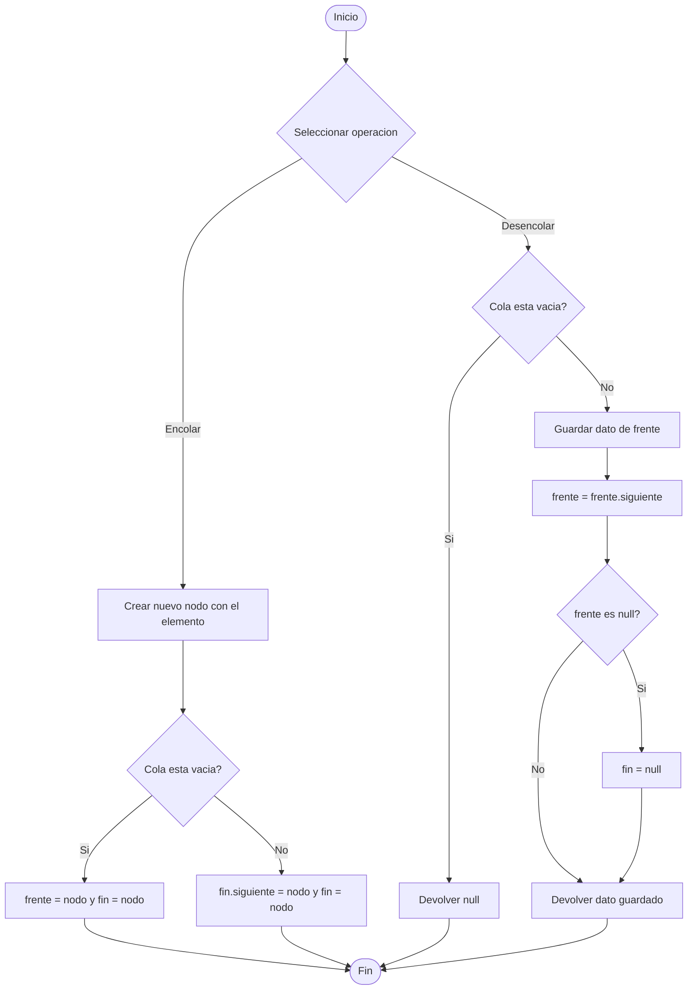
````

---

## Flujograma: BST (comparación de claves)
- Fecha: 2026-11-20 18:41:36
- Proveedor: Gemini
- Modelo: gemini-3.8-flash
- Estado: OK (Gemini, modelo gemini-3.8-flash)

**Instrucción de sistema:**

```text
Eres un asistente que convierte descripciones de algoritmos en diagramas Mermaid. Responde UNICAMENTE con un bloque de codigo mermaid que comience con 'flowchart TD'. Reglas: los ids de nodo son alfanumericos sin espacios; todo el texto de cada nodo va entre comillas dobles; usa ["..."] para procesos, {"..."} para decisiones y (["..."]) para inicio y fin; las etiquetas de flechas se escriben -->|"texto"|; no uses parentesis ni corchetes dentro del texto; no agregues explicaciones fuera del bloque.
```

**Prompt enviado:**

```text
Genera un flujograma Mermaid (flowchart TD) del proceso: BST (comparación de claves).

Descripcion estructurada generada por el programa (datos reales de la ejecucion):
Operacion real sobre un BST de 22 nodos y altura 8. Cada paso compara la clave con el nodo actual:
1. 1801000017 > 1801000007: ir a la derecha
2. 1801000017 > 1801000009: ir a la derecha
3. 1801000017 < 1801000018: ir a la izquierda
4. 1801000017 > 1801000012: ir a la derecha
5. 1801000017 > 1801000016: ir a la derecha
6. 1801000017 = 1801000017: encontrado


El diagrama debe reflejar fielmente estos pasos, con inicio, fin, decisiones y bucles cuando correspondan.
```

**Respuesta recibida:**

````text
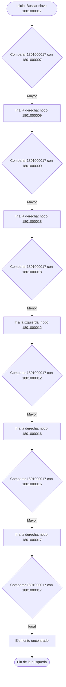
````

---

## Flujograma: Grafo + BFS
- Fecha: 2026-11-20 18:43:00
- Proveedor: Gemini
- Modelo: gemini-3.8-flash
- Estado: OK (Gemini, modelo gemini-3.8-flash)

**Instrucción de sistema:**

```text
Eres un asistente que convierte descripciones de algoritmos en diagramas Mermaid. Responde UNICAMENTE con un bloque de codigo mermaid que comience con 'flowchart TD'. Reglas: los ids de nodo son alfanumericos sin espacios; todo el texto de cada nodo va entre comillas dobles; usa ["..."] para procesos, {"..."} para decisiones y (["..."]) para inicio y fin; las etiquetas de flechas se escriben -->|"texto"|; no uses parentesis ni corchetes dentro del texto; no agregues explicaciones fuera del bloque.
```

**Prompt enviado:**

```text
Genera un flujograma Mermaid (flowchart TD) del proceso: Grafo + BFS.

Descripcion estructurada generada por el programa (datos reales de la ejecucion):
Recorrido BFS real sobre el grafo de prerrequisitos usando una cola. Eventos registrados en orden (con el contenido de la cola tras cada paso):
INICIO: BFS desde SIS101
ENCOLAR: SIS101 | cola=[frente: SIS101 :final]
DESENCOLAR: SIS101 | cola=[frente:  :final]
ENCOLAR: SIS102 | cola=[frente: SIS102 :final]
DESENCOLAR: SIS102 | cola=[frente:  :final]
ENCOLAR: SIS201 | cola=[frente: SIS201 :final]
ENCOLAR: SIS302 | cola=[frente: SIS201, SIS302 :final]
DESENCOLAR: SIS201 | cola=[frente: SIS302 :final]
ENCOLAR: SIS202 | cola=[frente: SIS302, SIS202 :final]
ENCOLAR: SIS203 | cola=[frente: SIS302, SIS202, SIS203 :final]
DESENCOLAR: SIS302 | cola=[frente: SIS202, SIS203 :final]
DESENCOLAR: SIS202 | cola=[frente: SIS203 :final]
ENCOLAR: SIS301 | cola=[frente: SIS203, SIS301 :final]
DESENCOLAR: SIS203 | cola=[frente: SIS301 :final]
ENCOLAR: SIS303 | cola=[frente: SIS301, SIS303 :final]
DESENCOLAR: SIS301 | cola=[frente: SIS303 :final]
DESENCOLAR: SIS303 | cola=[frente:  :final]
FIN: cola vacía; vértices visitados: 8


El diagrama debe reflejar fielmente estos pasos, con inicio, fin, decisiones y bucles cuando correspondan.
```

**Respuesta recibida:**

````text
```mermaid
flowchart TD
    inicio(["Inicio: BFS desde SIS101"])
    enc1["Encolar SIS101"]
    dec1{"Cola vacia?"}
    des1["Desencolar SIS101"]
    enc2["Encolar SIS102"]
    dec2{"Cola vacia?"}
    des2["Desencolar SIS102"]
    enc3["Encolar SIS201"]
    enc4["Encolar SIS302"]
    dec3{"Cola vacia?"}
    des3["Desencolar SIS201"]
    enc5["Encolar SIS202"]
    enc6["Encolar SIS2
````

---

## Flujograma: ETL completo
- Fecha: 2026-11-23 09:52:15
- Proveedor: Gemini
- Modelo: gemini-3.8-flash
- Estado: Error HTTP 503: {
  "error": {
    "code": 503,
    "message": "This model is currently experiencing high demand. Spikes in demand are usually temporary. Please try again later.",
    "status": "UNAVAILABLE"
  }
}


**Instrucción de sistema:**

```text
Eres un asistente que convierte descripciones de algoritmos en diagramas Mermaid. Responde UNICAMENTE con un bloque de codigo mermaid que comience con 'flowchart TD'. Reglas: los ids de nodo son alfanumericos sin espacios; todo el texto de cada nodo va entre comillas dobles; usa ["..."] para procesos, {"..."} para decisiones y (["..."]) para inicio y fin; las etiquetas de flechas se escriben -->|"texto"|; no uses parentesis ni corchetes dentro del texto; no agregues explicaciones fuera del bloque.
```

**Prompt enviado:**

```text
Genera un flujograma Mermaid (flowchart TD) del proceso: ETL completo.

Descripcion estructurada generada por el programa (datos reales de la ejecucion):
Proceso ETL ejecutado con datos reales:
1. Extract: se leyeron 4 archivos CSV y se encolaron 109 registros en una Cola (FIFO).
2. Transform: mientras la cola no este vacia se desencola un registro y se valida (identificador, campos obligatorios, rangos, duplicados, referencias).
3. Si el registro es valido (81 casos) se inserta en una ListaEnlazada; si no (28 casos) se apila un ErrorETL en una Pila.
4. Load: al vaciarse la cola se escriben los CSV limpios, errores_etl.txt y reporte_etl.txt.
Errores por tipo: ID_INVALIDO=4 DATO_INCOMPLETO=5 FORMATO_INVALIDO=5 RANGO_INVALIDO=5 DUPLICADO=5 REFERENCIA_INVALIDA=4 


El diagrama debe reflejar fielmente estos pasos, con inicio, fin, decisiones y bucles cuando correspondan.
```

**Respuesta recibida:**

_(sin respuesta de la IA)_

---

## Flujograma: ETL completo
- Fecha: 2026-11-23 09:57:35
- Proveedor: Gemini
- Modelo: gemini-3.8-flash
- Estado: Error HTTP 503: {
  "error": {
    "code": 503,
    "message": "This model is currently experiencing high demand. Spikes in demand are usually temporary. Please try again later.",
    "status": "UNAVAILABLE"
  }
}


**Instrucción de sistema:**

```text
Eres un asistente que convierte descripciones de algoritmos en diagramas Mermaid. Responde UNICAMENTE con un bloque de codigo mermaid que comience con 'flowchart TD'. Reglas: los ids de nodo son alfanumericos sin espacios; todo el texto de cada nodo va entre comillas dobles; usa ["..."] para procesos, {"..."} para decisiones y (["..."]) para inicio y fin; las etiquetas de flechas se escriben -->|"texto"|; no uses parentesis ni corchetes dentro del texto; no agregues explicaciones fuera del bloque.
```

**Prompt enviado:**

```text
Genera un flujograma Mermaid (flowchart TD) del proceso: ETL completo.

Descripcion estructurada generada por el programa (datos reales de la ejecucion):
Proceso ETL ejecutado con datos reales:
1. Extract: se leyeron 4 archivos CSV y se encolaron 109 registros en una Cola (FIFO).
2. Transform: mientras la cola no este vacia se desencola un registro y se valida (identificador, campos obligatorios, rangos, duplicados, referencias).
3. Si el registro es valido (81 casos) se inserta en una ListaEnlazada; si no (28 casos) se apila un ErrorETL en una Pila.
4. Load: al vaciarse la cola se escriben los CSV limpios, errores_etl.txt y reporte_etl.txt.
Errores por tipo: ID_INVALIDO=4 DATO_INCOMPLETO=5 FORMATO_INVALIDO=5 RANGO_INVALIDO=5 DUPLICADO=5 REFERENCIA_INVALIDA=4 


El diagrama debe reflejar fielmente estos pasos, con inicio, fin, decisiones y bucles cuando correspondan.
```

**Respuesta recibida:**

_(sin respuesta de la IA)_

---

## Flujograma: Cola (encolar y desencolar)
- Fecha: 2026-11-23 09:59:04
- Proveedor: Gemini
- Modelo: gemini-3.8-flash
- Estado: Error HTTP 503: {
  "error": {
    "code": 503,
    "message": "This model is currently experiencing high demand. Spikes in demand are usually temporary. Please try again later.",
    "status": "UNAVAILABLE"
  }
}


**Instrucción de sistema:**

```text
Eres un asistente que convierte descripciones de algoritmos en diagramas Mermaid. Responde UNICAMENTE con un bloque de codigo mermaid que comience con 'flowchart TD'. Reglas: los ids de nodo son alfanumericos sin espacios; todo el texto de cada nodo va entre comillas dobles; usa ["..."] para procesos, {"..."} para decisiones y (["..."]) para inicio y fin; las etiquetas de flechas se escriben -->|"texto"|; no uses parentesis ni corchetes dentro del texto; no agregues explicaciones fuera del bloque.
```

**Prompt enviado:**

```text
Genera un flujograma Mermaid (flowchart TD) del proceso: Cola (encolar y desencolar).

Descripcion estructurada generada por el programa (datos reales de la ejecucion):
Cola FIFO con nodos enlazados y referencias frente y fin.
encolar(x): crear nodo; si la cola esta vacia frente y fin apuntan al nodo; si no fin.siguiente = nodo y fin = nodo.
desencolar(): si esta vacia devolver null; guardar dato de frente; frente = frente.siguiente; si frente queda null entonces fin = null.

El diagrama debe reflejar fielmente estos pasos, con inicio, fin, decisiones y bucles cuando correspondan.
```

**Respuesta recibida:**

_(sin respuesta de la IA)_

---

## Flujograma: ETL completo
- Fecha: 2026-11-23 11:42:48
- Proveedor: Gemini
- Modelo: gemini-3.8-flash
- Estado: Error HTTP 503: {
  "error": {
    "code": 503,
    "message": "This model is currently experiencing high demand. Spikes in demand are usually temporary. Please try again later.",
    "status": "UNAVAILABLE"
  }
}


**Instrucción de sistema:**

```text
Eres un asistente que convierte descripciones de algoritmos en diagramas Mermaid. Responde UNICAMENTE con un bloque de codigo mermaid que comience con 'flowchart TD'. Reglas: los ids de nodo son alfanumericos sin espacios; todo el texto de cada nodo va entre comillas dobles; usa ["..."] para procesos, {"..."} para decisiones y (["..."]) para inicio y fin; las etiquetas de flechas se escriben -->|"texto"|; no uses parentesis ni corchetes dentro del texto; no agregues explicaciones fuera del bloque.
```

**Prompt enviado:**

```text
Genera un flujograma Mermaid (flowchart TD) del proceso: ETL completo.

Descripcion estructurada generada por el programa (datos reales de la ejecucion):
Proceso ETL ejecutado con datos reales:
1. Extract: se leyeron 4 archivos CSV y se encolaron 109 registros en una Cola (FIFO).
2. Transform: mientras la cola no este vacia se desencola un registro y se valida (identificador, campos obligatorios, rangos, duplicados, referencias).
3. Si el registro es valido (81 casos) se inserta en una ListaEnlazada; si no (28 casos) se apila un ErrorETL en una Pila.
4. Load: al vaciarse la cola se escriben los CSV limpios, errores_etl.txt y reporte_etl.txt.
Errores por tipo: ID_INVALIDO=4 DATO_INCOMPLETO=5 FORMATO_INVALIDO=5 RANGO_INVALIDO=5 DUPLICADO=5 REFERENCIA_INVALIDA=4 


El diagrama debe reflejar fielmente estos pasos, con inicio, fin, decisiones y bucles cuando correspondan.
```

**Respuesta recibida:**

_(sin respuesta de la IA)_

---

## Flujograma: Cola (encolar y desencolar)
- Fecha: 2026-11-23 11:44:30
- Proveedor: Gemini
- Modelo: gemini-3.8-flash
- Estado: Error HTTP 503: {
  "error": {
    "code": 503,
    "message": "This model is currently experiencing high demand. Spikes in demand are usually temporary. Please try again later.",
    "status": "UNAVAILABLE"
  }
}


**Instrucción de sistema:**

```text
Eres un asistente que convierte descripciones de algoritmos en diagramas Mermaid. Responde UNICAMENTE con un bloque de codigo mermaid que comience con 'flowchart TD'. Reglas: los ids de nodo son alfanumericos sin espacios; todo el texto de cada nodo va entre comillas dobles; usa ["..."] para procesos, {"..."} para decisiones y (["..."]) para inicio y fin; las etiquetas de flechas se escriben -->|"texto"|; no uses parentesis ni corchetes dentro del texto; no agregues explicaciones fuera del bloque.
```

**Prompt enviado:**

```text
Genera un flujograma Mermaid (flowchart TD) del proceso: Cola (encolar y desencolar).

Descripcion estructurada generada por el programa (datos reales de la ejecucion):
Cola FIFO con nodos enlazados y referencias frente y fin.
encolar(x): crear nodo; si la cola esta vacia frente y fin apuntan al nodo; si no fin.siguiente = nodo y fin = nodo.
desencolar(): si esta vacia devolver null; guardar dato de frente; frente = frente.siguiente; si frente queda null entonces fin = null.

El diagrama debe reflejar fielmente estos pasos, con inicio, fin, decisiones y bucles cuando correspondan.
```

**Respuesta recibida:**

_(sin respuesta de la IA)_

---

## Análisis de errores ETL
- Fecha: 2026-11-23 11:45:52
- Proveedor: Gemini
- Modelo: gemini-3.8-flash
- Estado: Error HTTP 503: {
  "error": {
    "code": 503,
    "message": "This model is currently experiencing high demand. Spikes in demand are usually temporary. Please try again later.",
    "status": "UNAVAILABLE"
  }
}


**Instrucción de sistema:**

```text
Eres un profesor de Estructuras de Datos de ingenieria de software. Explica en espanol, con tono tecnico pero claro, refiriendote a los nodos, claves y valores CONCRETOS que recibes, no a definiciones genericas. Maximo 250 palabras. No inventes datos que no esten en la entrada.
```

**Prompt enviado:**

```text
El programa ETL calculo estas estadisticas agregadas de errores (no se envian registros individuales):

Total de registros procesados: 109
Registros válidos: 81
Total de errores: 28
Identificador incorrecto: 4
Datos incompletos: 5
Formato incorrecto: 5
Valor fuera de rango: 5
Registro duplicado: 5
Referencia inexistente / relación inconsistente: 4
Errores en estudiantes.csv: 12 de 34
Errores en asignaturas.csv: 5 de 17
Errores en matriculas.csv: 7 de 41
Errores en prerrequisitos.csv: 4 de 17

Redacta una interpretacion tecnica de los patrones observados: cual es la categoria dominante, que fuente de datos es la mas problematica y que reglas de validacion o acciones de limpieza recomiendas.
```

**Respuesta recibida:**

_(sin respuesta de la IA)_

---

## Flujograma: ETL completo
- Fecha: 2026-11-23 11:47:23
- Proveedor: Gemini
- Modelo: gemini-3.8-flash
- Estado: Error HTTP 429: {
  "error": {
    "code": 429,
    "message": "You exceeded your current quota, please check your plan and billing details. For more information on this error, head to: https://aistudio.google.com/docs/rate-limits. To monitor your current usage, head to: https://ai.dev/rate-limit. \n* Quota exceede

**Instrucción de sistema:**

```text
Eres un asistente que convierte descripciones de algoritmos en diagramas Mermaid. Responde UNICAMENTE con un bloque de codigo mermaid que comience con 'flowchart TD'. Reglas: los ids de nodo son alfanumericos sin espacios; todo el texto de cada nodo va entre comillas dobles; usa ["..."] para procesos, {"..."} para decisiones y (["..."]) para inicio y fin; las etiquetas de flechas se escriben -->|"texto"|; no uses parentesis ni corchetes dentro del texto; no agregues explicaciones fuera del bloque.
```

**Prompt enviado:**

```text
Genera un flujograma Mermaid (flowchart TD) del proceso: ETL completo.

Descripcion estructurada generada por el programa (datos reales de la ejecucion):
Proceso ETL ejecutado con datos reales:
1. Extract: se leyeron 4 archivos CSV y se encolaron 109 registros en una Cola (FIFO).
2. Transform: mientras la cola no este vacia se desencola un registro y se valida (identificador, campos obligatorios, rangos, duplicados, referencias).
3. Si el registro es valido (81 casos) se inserta en una ListaEnlazada; si no (28 casos) se apila un ErrorETL en una Pila.
4. Load: al vaciarse la cola se escriben los CSV limpios, errores_etl.txt y reporte_etl.txt.
Errores por tipo: ID_INVALIDO=4 DATO_INCOMPLETO=5 FORMATO_INVALIDO=5 RANGO_INVALIDO=5 DUPLICADO=5 REFERENCIA_INVALIDA=4 


El diagrama debe reflejar fielmente estos pasos, con inicio, fin, decisiones y bucles cuando correspondan.
```

**Respuesta recibida:**

_(sin respuesta de la IA)_

---

## Flujograma: Cola (encolar y desencolar)
- Fecha: 2026-11-23 11:48:26
- Proveedor: Gemini
- Modelo: gemini-3.8-flash
- Estado: Error HTTP 429: {
  "error": {
    "code": 429,
    "message": "You exceeded your current quota, please check your plan and billing details. For more information on this error, head to: https://aistudio.google.com/docs/rate-limits. To monitor your current usage, head to: https://ai.dev/rate-limit. \n* Quota exceede

**Instrucción de sistema:**

```text
Eres un asistente que convierte descripciones de algoritmos en diagramas Mermaid. Responde UNICAMENTE con un bloque de codigo mermaid que comience con 'flowchart TD'. Reglas: los ids de nodo son alfanumericos sin espacios; todo el texto de cada nodo va entre comillas dobles; usa ["..."] para procesos, {"..."} para decisiones y (["..."]) para inicio y fin; las etiquetas de flechas se escriben -->|"texto"|; no uses parentesis ni corchetes dentro del texto; no agregues explicaciones fuera del bloque.
```

**Prompt enviado:**

```text
Genera un flujograma Mermaid (flowchart TD) del proceso: Cola (encolar y desencolar).

Descripcion estructurada generada por el programa (datos reales de la ejecucion):
Cola FIFO con nodos enlazados y referencias frente y fin.
encolar(x): crear nodo; si la cola esta vacia frente y fin apuntan al nodo; si no fin.siguiente = nodo y fin = nodo.
desencolar(): si esta vacia devolver null; guardar dato de frente; frente = frente.siguiente; si frente queda null entonces fin = null.

El diagrama debe reflejar fielmente estos pasos, con inicio, fin, decisiones y bucles cuando correspondan.
```

**Respuesta recibida:**

_(sin respuesta de la IA)_

---

## Flujograma: Pila (apilar y desapilar)
- Fecha: 2026-11-23 11:49:28
- Proveedor: Gemini
- Modelo: gemini-3.8-flash
- Estado: Error HTTP 503: {
  "error": {
    "code": 503,
    "message": "This model is currently experiencing high demand. Spikes in demand are usually temporary. Please try again later.",
    "status": "UNAVAILABLE"
  }
}


**Instrucción de sistema:**

```text
Eres un asistente que convierte descripciones de algoritmos en diagramas Mermaid. Responde UNICAMENTE con un bloque de codigo mermaid que comience con 'flowchart TD'. Reglas: los ids de nodo son alfanumericos sin espacios; todo el texto de cada nodo va entre comillas dobles; usa ["..."] para procesos, {"..."} para decisiones y (["..."]) para inicio y fin; las etiquetas de flechas se escriben -->|"texto"|; no uses parentesis ni corchetes dentro del texto; no agregues explicaciones fuera del bloque.
```

**Prompt enviado:**

```text
Genera un flujograma Mermaid (flowchart TD) del proceso: Pila (apilar y desapilar).

Descripcion estructurada generada por el programa (datos reales de la ejecucion):
Pila LIFO con nodos enlazados y referencia cima.
apilar(x): crear nodo; nodo.siguiente = cima; cima = nodo.
desapilar(): si esta vacia devolver null; guardar dato de la cima; cima = cima.siguiente.

El diagrama debe reflejar fielmente estos pasos, con inicio, fin, decisiones y bucles cuando correspondan.
```

**Respuesta recibida:**

_(sin respuesta de la IA)_

---

## Flujograma: Lista enlazada (insertar y buscar)
- Fecha: 2026-11-23 11:50:30
- Proveedor: Gemini
- Modelo: gemini-3.8-flash
- Estado: Error HTTP 429: {
  "error": {
    "code": 429,
    "message": "You exceeded your current quota, please check your plan and billing details. For more information on this error, head to: https://aistudio.google.com/docs/rate-limits. To monitor your current usage, head to: https://ai.dev/rate-limit. \n* Quota exceede

**Instrucción de sistema:**

```text
Eres un asistente que convierte descripciones de algoritmos en diagramas Mermaid. Responde UNICAMENTE con un bloque de codigo mermaid que comience con 'flowchart TD'. Reglas: los ids de nodo son alfanumericos sin espacios; todo el texto de cada nodo va entre comillas dobles; usa ["..."] para procesos, {"..."} para decisiones y (["..."]) para inicio y fin; las etiquetas de flechas se escriben -->|"texto"|; no uses parentesis ni corchetes dentro del texto; no agregues explicaciones fuera del bloque.
```

**Prompt enviado:**

```text
Genera un flujograma Mermaid (flowchart TD) del proceso: Lista enlazada (insertar y buscar).

Descripcion estructurada generada por el programa (datos reales de la ejecucion):
Lista enlazada simple con referencias cabeza y cola.
insertar(x): crear nodo; si la lista esta vacia cabeza y cola apuntan al nodo; si no cola.siguiente = nodo y cola = nodo.
buscar(criterio): actual = cabeza; mientras actual no sea null: si cumple el criterio devolver el dato; avanzar actual = actual.siguiente; al terminar devolver null.

El diagrama debe reflejar fielmente estos pasos, con inicio, fin, decisiones y bucles cuando correspondan.
```

**Respuesta recibida:**

_(sin respuesta de la IA)_

---

## Flujograma: BST (comparación de claves)
- Fecha: 2026-11-23 11:51:32
- Proveedor: Gemini
- Modelo: gemini-3.8-flash
- Estado: Error HTTP 429: {
  "error": {
    "code": 429,
    "message": "You exceeded your current quota, please check your plan and billing details. For more information on this error, head to: https://aistudio.google.com/docs/rate-limits. To monitor your current usage, head to: https://ai.dev/rate-limit. \n* Quota exceede

**Instrucción de sistema:**

```text
Eres un asistente que convierte descripciones de algoritmos en diagramas Mermaid. Responde UNICAMENTE con un bloque de codigo mermaid que comience con 'flowchart TD'. Reglas: los ids de nodo son alfanumericos sin espacios; todo el texto de cada nodo va entre comillas dobles; usa ["..."] para procesos, {"..."} para decisiones y (["..."]) para inicio y fin; las etiquetas de flechas se escriben -->|"texto"|; no uses parentesis ni corchetes dentro del texto; no agregues explicaciones fuera del bloque.
```

**Prompt enviado:**

```text
Genera un flujograma Mermaid (flowchart TD) del proceso: BST (comparación de claves).

Descripcion estructurada generada por el programa (datos reales de la ejecucion):
Operacion real sobre un BST de 22 nodos y altura 8. Cada paso compara la clave con el nodo actual:
1. 1801000022 > 1801000007: ir a la derecha
2. 1801000022 > 1801000009: ir a la derecha
3. 1801000022 > 1801000018: ir a la derecha
4. 1801000022 = 1801000022: encontrado


El diagrama debe reflejar fielmente estos pasos, con inicio, fin, decisiones y bucles cuando correspondan.
```

**Respuesta recibida:**

_(sin respuesta de la IA)_

---

## Flujograma: Grafo + BFS
- Fecha: 2026-11-23 11:52:34
- Proveedor: Gemini
- Modelo: gemini-3.8-flash
- Estado: Error HTTP 429: {
  "error": {
    "code": 429,
    "message": "You exceeded your current quota, please check your plan and billing details. For more information on this error, head to: https://aistudio.google.com/docs/rate-limits. To monitor your current usage, head to: https://ai.dev/rate-limit. \n* Quota exceede

**Instrucción de sistema:**

```text
Eres un asistente que convierte descripciones de algoritmos en diagramas Mermaid. Responde UNICAMENTE con un bloque de codigo mermaid que comience con 'flowchart TD'. Reglas: los ids de nodo son alfanumericos sin espacios; todo el texto de cada nodo va entre comillas dobles; usa ["..."] para procesos, {"..."} para decisiones y (["..."]) para inicio y fin; las etiquetas de flechas se escriben -->|"texto"|; no uses parentesis ni corchetes dentro del texto; no agregues explicaciones fuera del bloque.
```

**Prompt enviado:**

```text
Genera un flujograma Mermaid (flowchart TD) del proceso: Grafo + BFS.

Descripcion estructurada generada por el programa (datos reales de la ejecucion):
Recorrido BFS real sobre el grafo de prerrequisitos usando una cola. Eventos registrados en orden (con el contenido de la cola tras cada paso):
INICIO: BFS desde SIS101
ENCOLAR: SIS101 | cola=[frente: SIS101 :final]
DESENCOLAR: SIS101 | cola=[frente:  :final]
ENCOLAR: SIS102 | cola=[frente: SIS102 :final]
DESENCOLAR: SIS102 | cola=[frente:  :final]
ENCOLAR: SIS201 | cola=[frente: SIS201 :final]
ENCOLAR: SIS302 | cola=[frente: SIS201, SIS302 :final]
DESENCOLAR: SIS201 | cola=[frente: SIS302 :final]
ENCOLAR: SIS202 | cola=[frente: SIS302, SIS202 :final]
ENCOLAR: SIS203 | cola=[frente: SIS302, SIS202, SIS203 :final]
DESENCOLAR: SIS302 | cola=[frente: SIS202, SIS203 :final]
DESENCOLAR: SIS202 | cola=[frente: SIS203 :final]
ENCOLAR: SIS301 | cola=[frente: SIS203, SIS301 :final]
DESENCOLAR: SIS203 | cola=[frente: SIS301 :final]
ENCOLAR: SIS303 | cola=[frente: SIS301, SIS303 :final]
DESENCOLAR: SIS301 | cola=[frente: SIS303 :final]
DESENCOLAR: SIS303 | cola=[frente:  :final]
FIN: cola vacía; vértices visitados: 8


El diagrama debe reflejar fielmente estos pasos, con inicio, fin, decisiones y bucles cuando correspondan.
```

**Respuesta recibida:**

_(sin respuesta de la IA)_

---

## Flujograma: Grafo + DFS
- Fecha: 2026-11-23 11:53:37
- Proveedor: Gemini
- Modelo: gemini-3.8-flash
- Estado: Error HTTP 503: {
  "error": {
    "code": 503,
    "message": "This model is currently experiencing high demand. Spikes in demand are usually temporary. Please try again later.",
    "status": "UNAVAILABLE"
  }
}


**Instrucción de sistema:**

```text
Eres un asistente que convierte descripciones de algoritmos en diagramas Mermaid. Responde UNICAMENTE con un bloque de codigo mermaid que comience con 'flowchart TD'. Reglas: los ids de nodo son alfanumericos sin espacios; todo el texto de cada nodo va entre comillas dobles; usa ["..."] para procesos, {"..."} para decisiones y (["..."]) para inicio y fin; las etiquetas de flechas se escriben -->|"texto"|; no uses parentesis ni corchetes dentro del texto; no agregues explicaciones fuera del bloque.
```

**Prompt enviado:**

```text
Genera un flujograma Mermaid (flowchart TD) del proceso: Grafo + DFS.

Descripcion estructurada generada por el programa (datos reales de la ejecucion):
Recorrido DFS real sobre el grafo de prerrequisitos usando una pila. Eventos registrados en orden (con el contenido de la pila tras cada paso):
INICIO: DFS desde SIS101
APILAR: SIS101 | pila=[cima: SIS101]
VISITAR: SIS101 | pila=[cima: ]
APILAR: SIS102 | pila=[cima: SIS102]
VISITAR: SIS102 | pila=[cima: ]
APILAR: SIS302 | pila=[cima: SIS302]
APILAR: SIS201 | pila=[cima: SIS201 | SIS302]
VISITAR: SIS201 | pila=[cima: SIS302]
APILAR: SIS203 | pila=[cima: SIS203 | SIS302]
APILAR: SIS202 | pila=[cima: SIS202 | SIS203 | SIS302]
VISITAR: SIS202 | pila=[cima: SIS203 | SIS302]
APILAR: SIS301 | pila=[cima: SIS301 | SIS203 | SIS302]
VISITAR: SIS301 | pila=[cima: SIS203 | SIS302]
VISITAR: SIS203 | pila=[cima: SIS302]
APILAR: SIS303 | pila=[cima: SIS303 | SIS302]
VISITAR: SIS303 | pila=[cima: SIS302]
VISITAR: SIS302 | pila=[cima: ]
FIN: pila vacía; vértices visitados: 8


El diagrama debe reflejar fielmente estos pasos, con inicio, fin, decisiones y bucles cuando correspondan.
```

**Respuesta recibida:**

_(sin respuesta de la IA)_

---

## Documentación del sistema
- Fecha: 2026-11-23 11:54:38
- Proveedor: Gemini
- Modelo: gemini-3.8-flash
- Estado: Error HTTP 503: {
  "error": {
    "code": 503,
    "message": "This model is currently experiencing high demand. Spikes in demand are usually temporary. Please try again later.",
    "status": "UNAVAILABLE"
  }
}


**Instrucción de sistema:**

```text
Eres un profesor de Estructuras de Datos de ingenieria de software. Explica en espanol, con tono tecnico pero claro, refiriendote a los nodos, claves y valores CONCRETOS que recibes, no a definiciones genericas. Maximo 250 palabras. No inventes datos que no esten en la entrada.
```

**Prompt enviado:**

```text
Redacta en espanol la documentacion tecnica breve (formato Markdown, maximo 400 palabras) del siguiente sistema, con las secciones: Proposito, Flujo de datos, Estructuras utilizadas y por que, Resultados de la ejecucion.

Registros procesados: 109 | válidos: 81 | inválidos: 28
Estudiantes válidos: 22 | Asignaturas: 12 | Matrículas: 34 | Prerrequisitos: 13
BST: 22 nodos, altura 8
Grafo: 12 vértices, 13 aristas
SIS201 -> SIS202 -> SIS301 -> SIS201
Total de registros procesados: 109
Registros válidos: 81
Total de errores: 28
Identificador incorrecto: 4
Datos incompletos: 5
Formato incorrecto: 5
Valor fuera de rango: 5
Registro duplicado: 5
Referencia inexistente / relación inconsistente: 4
Errores en estudiantes.csv: 12 de 34
Errores en asignaturas.csv: 5 de 17
Errores en matriculas.csv: 7 de 41
Errores en prerrequisitos.csv: 4 de 17

```

**Respuesta recibida:**

_(sin respuesta de la IA)_

---

## Flujograma: ETL completo
- Fecha: 2026-11-23 11:56:01
- Proveedor: Gemini
- Modelo: gemini-3.8-flash
- Estado: Error HTTP 503: {
  "error": {
    "code": 503,
    "message": "This model is currently experiencing high demand. Spikes in demand are usually temporary. Please try again later.",
    "status": "UNAVAILABLE"
  }
}


**Instrucción de sistema:**

```text
Eres un asistente que convierte descripciones de algoritmos en diagramas Mermaid. Responde UNICAMENTE con un bloque de codigo mermaid que comience con 'flowchart TD'. Reglas: los ids de nodo son alfanumericos sin espacios; todo el texto de cada nodo va entre comillas dobles; usa ["..."] para procesos, {"..."} para decisiones y (["..."]) para inicio y fin; las etiquetas de flechas se escriben -->|"texto"|; no uses parentesis ni corchetes dentro del texto; no agregues explicaciones fuera del bloque.
```

**Prompt enviado:**

```text
Genera un flujograma Mermaid (flowchart TD) del proceso: ETL completo.

Descripcion estructurada generada por el programa (datos reales de la ejecucion):
Proceso ETL ejecutado con datos reales:
1. Extract: se leyeron 4 archivos CSV y se encolaron 109 registros en una Cola (FIFO).
2. Transform: mientras la cola no este vacia se desencola un registro y se valida (identificador, campos obligatorios, rangos, duplicados, referencias).
3. Si el registro es valido (81 casos) se inserta en una ListaEnlazada; si no (28 casos) se apila un ErrorETL en una Pila.
4. Load: al vaciarse la cola se escriben los CSV limpios, errores_etl.txt y reporte_etl.txt.
Errores por tipo: ID_INVALIDO=4 DATO_INCOMPLETO=5 FORMATO_INVALIDO=5 RANGO_INVALIDO=5 DUPLICADO=5 REFERENCIA_INVALIDA=4 


El diagrama debe reflejar fielmente estos pasos, con inicio, fin, decisiones y bucles cuando correspondan.
```

**Respuesta recibida:**

_(sin respuesta de la IA)_

---

## Flujograma: Cola (encolar y desencolar)
- Fecha: 2026-11-23 11:57:02
- Proveedor: Gemini
- Modelo: gemini-3.8-flash
- Estado: Error HTTP 429: {
  "error": {
    "code": 429,
    "message": "You exceeded your current quota, please check your plan and billing details. For more information on this error, head to: https://aistudio.google.com/docs/rate-limits. To monitor your current usage, head to: https://ai.dev/rate-limit. \n* Quota exceede

**Instrucción de sistema:**

```text
Eres un asistente que convierte descripciones de algoritmos en diagramas Mermaid. Responde UNICAMENTE con un bloque de codigo mermaid que comience con 'flowchart TD'. Reglas: los ids de nodo son alfanumericos sin espacios; todo el texto de cada nodo va entre comillas dobles; usa ["..."] para procesos, {"..."} para decisiones y (["..."]) para inicio y fin; las etiquetas de flechas se escriben -->|"texto"|; no uses parentesis ni corchetes dentro del texto; no agregues explicaciones fuera del bloque.
```

**Prompt enviado:**

```text
Genera un flujograma Mermaid (flowchart TD) del proceso: Cola (encolar y desencolar).

Descripcion estructurada generada por el programa (datos reales de la ejecucion):
Cola FIFO con nodos enlazados y referencias frente y fin.
encolar(x): crear nodo; si la cola esta vacia frente y fin apuntan al nodo; si no fin.siguiente = nodo y fin = nodo.
desencolar(): si esta vacia devolver null; guardar dato de frente; frente = frente.siguiente; si frente queda null entonces fin = null.

El diagrama debe reflejar fielmente estos pasos, con inicio, fin, decisiones y bucles cuando correspondan.
```

**Respuesta recibida:**

_(sin respuesta de la IA)_

---

## Flujograma: Pila (apilar y desapilar)
- Fecha: 2026-11-23 11:58:04
- Proveedor: Gemini
- Modelo: gemini-3.8-flash
- Estado: Error HTTP 429: {
  "error": {
    "code": 429,
    "message": "You exceeded your current quota, please check your plan and billing details. For more information on this error, head to: https://aistudio.google.com/docs/rate-limits. To monitor your current usage, head to: https://ai.dev/rate-limit. \n* Quota exceede

**Instrucción de sistema:**

```text
Eres un asistente que convierte descripciones de algoritmos en diagramas Mermaid. Responde UNICAMENTE con un bloque de codigo mermaid que comience con 'flowchart TD'. Reglas: los ids de nodo son alfanumericos sin espacios; todo el texto de cada nodo va entre comillas dobles; usa ["..."] para procesos, {"..."} para decisiones y (["..."]) para inicio y fin; las etiquetas de flechas se escriben -->|"texto"|; no uses parentesis ni corchetes dentro del texto; no agregues explicaciones fuera del bloque.
```

**Prompt enviado:**

```text
Genera un flujograma Mermaid (flowchart TD) del proceso: Pila (apilar y desapilar).

Descripcion estructurada generada por el programa (datos reales de la ejecucion):
Pila LIFO con nodos enlazados y referencia cima.
apilar(x): crear nodo; nodo.siguiente = cima; cima = nodo.
desapilar(): si esta vacia devolver null; guardar dato de la cima; cima = cima.siguiente.

El diagrama debe reflejar fielmente estos pasos, con inicio, fin, decisiones y bucles cuando correspondan.
```

**Respuesta recibida:**

_(sin respuesta de la IA)_

---

## Flujograma: Lista enlazada (insertar y buscar)
- Fecha: 2026-11-23 11:59:05
- Proveedor: Gemini
- Modelo: gemini-3.8-flash
- Estado: Error HTTP 429: {
  "error": {
    "code": 429,
    "message": "You exceeded your current quota, please check your plan and billing details. For more information on this error, head to: https://aistudio.google.com/docs/rate-limits. To monitor your current usage, head to: https://ai.dev/rate-limit. \n* Quota exceede

**Instrucción de sistema:**

```text
Eres un asistente que convierte descripciones de algoritmos en diagramas Mermaid. Responde UNICAMENTE con un bloque de codigo mermaid que comience con 'flowchart TD'. Reglas: los ids de nodo son alfanumericos sin espacios; todo el texto de cada nodo va entre comillas dobles; usa ["..."] para procesos, {"..."} para decisiones y (["..."]) para inicio y fin; las etiquetas de flechas se escriben -->|"texto"|; no uses parentesis ni corchetes dentro del texto; no agregues explicaciones fuera del bloque.
```

**Prompt enviado:**

```text
Genera un flujograma Mermaid (flowchart TD) del proceso: Lista enlazada (insertar y buscar).

Descripcion estructurada generada por el programa (datos reales de la ejecucion):
Lista enlazada simple con referencias cabeza y cola.
insertar(x): crear nodo; si la lista esta vacia cabeza y cola apuntan al nodo; si no cola.siguiente = nodo y cola = nodo.
buscar(criterio): actual = cabeza; mientras actual no sea null: si cumple el criterio devolver el dato; avanzar actual = actual.siguiente; al terminar devolver null.

El diagrama debe reflejar fielmente estos pasos, con inicio, fin, decisiones y bucles cuando correspondan.
```

**Respuesta recibida:**

_(sin respuesta de la IA)_

---

## Flujograma: BST (comparación de claves)
- Fecha: 2026-11-23 12:00:06
- Proveedor: Gemini
- Modelo: gemini-3.8-flash
- Estado: Error HTTP 429: {
  "error": {
    "code": 429,
    "message": "You exceeded your current quota, please check your plan and billing details. For more information on this error, head to: https://aistudio.google.com/docs/rate-limits. To monitor your current usage, head to: https://ai.dev/rate-limit. \n* Quota exceede

**Instrucción de sistema:**

```text
Eres un asistente que convierte descripciones de algoritmos en diagramas Mermaid. Responde UNICAMENTE con un bloque de codigo mermaid que comience con 'flowchart TD'. Reglas: los ids de nodo son alfanumericos sin espacios; todo el texto de cada nodo va entre comillas dobles; usa ["..."] para procesos, {"..."} para decisiones y (["..."]) para inicio y fin; las etiquetas de flechas se escriben -->|"texto"|; no uses parentesis ni corchetes dentro del texto; no agregues explicaciones fuera del bloque.
```

**Prompt enviado:**

```text
Genera un flujograma Mermaid (flowchart TD) del proceso: BST (comparación de claves).

Descripcion estructurada generada por el programa (datos reales de la ejecucion):
Operacion real sobre un BST de 22 nodos y altura 8. Cada paso compara la clave con el nodo actual:
1. 1801000022 > 1801000007: ir a la derecha
2. 1801000022 > 1801000009: ir a la derecha
3. 1801000022 > 1801000018: ir a la derecha
4. 1801000022 = 1801000022: encontrado


El diagrama debe reflejar fielmente estos pasos, con inicio, fin, decisiones y bucles cuando correspondan.
```

**Respuesta recibida:**

_(sin respuesta de la IA)_

---

## Flujograma: Grafo + BFS
- Fecha: 2026-11-23 12:01:08
- Proveedor: Gemini
- Modelo: gemini-3.8-flash
- Estado: Error HTTP 429: {
  "error": {
    "code": 429,
    "message": "You exceeded your current quota, please check your plan and billing details. For more information on this error, head to: https://aistudio.google.com/docs/rate-limits. To monitor your current usage, head to: https://ai.dev/rate-limit. \n* Quota exceede

**Instrucción de sistema:**

```text
Eres un asistente que convierte descripciones de algoritmos en diagramas Mermaid. Responde UNICAMENTE con un bloque de codigo mermaid que comience con 'flowchart TD'. Reglas: los ids de nodo son alfanumericos sin espacios; todo el texto de cada nodo va entre comillas dobles; usa ["..."] para procesos, {"..."} para decisiones y (["..."]) para inicio y fin; las etiquetas de flechas se escriben -->|"texto"|; no uses parentesis ni corchetes dentro del texto; no agregues explicaciones fuera del bloque.
```

**Prompt enviado:**

```text
Genera un flujograma Mermaid (flowchart TD) del proceso: Grafo + BFS.

Descripcion estructurada generada por el programa (datos reales de la ejecucion):
Recorrido BFS real sobre el grafo de prerrequisitos usando una cola. Eventos registrados en orden (con el contenido de la cola tras cada paso):
INICIO: BFS desde SIS101
ENCOLAR: SIS101 | cola=[frente: SIS101 :final]
DESENCOLAR: SIS101 | cola=[frente:  :final]
ENCOLAR: SIS102 | cola=[frente: SIS102 :final]
DESENCOLAR: SIS102 | cola=[frente:  :final]
ENCOLAR: SIS201 | cola=[frente: SIS201 :final]
ENCOLAR: SIS302 | cola=[frente: SIS201, SIS302 :final]
DESENCOLAR: SIS201 | cola=[frente: SIS302 :final]
ENCOLAR: SIS202 | cola=[frente: SIS302, SIS202 :final]
ENCOLAR: SIS203 | cola=[frente: SIS302, SIS202, SIS203 :final]
DESENCOLAR: SIS302 | cola=[frente: SIS202, SIS203 :final]
DESENCOLAR: SIS202 | cola=[frente: SIS203 :final]
ENCOLAR: SIS301 | cola=[frente: SIS203, SIS301 :final]
DESENCOLAR: SIS203 | cola=[frente: SIS301 :final]
ENCOLAR: SIS303 | cola=[frente: SIS301, SIS303 :final]
DESENCOLAR: SIS301 | cola=[frente: SIS303 :final]
DESENCOLAR: SIS303 | cola=[frente:  :final]
FIN: cola vacía; vértices visitados: 8


El diagrama debe reflejar fielmente estos pasos, con inicio, fin, decisiones y bucles cuando correspondan.
```

**Respuesta recibida:**

_(sin respuesta de la IA)_

---

## Flujograma: Grafo + DFS
- Fecha: 2026-11-23 12:02:09
- Proveedor: Gemini
- Modelo: gemini-3.8-flash
- Estado: Error HTTP 429: {
  "error": {
    "code": 429,
    "message": "You exceeded your current quota, please check your plan and billing details. For more information on this error, head to: https://aistudio.google.com/docs/rate-limits. To monitor your current usage, head to: https://ai.dev/rate-limit. \n* Quota exceede

**Instrucción de sistema:**

```text
Eres un asistente que convierte descripciones de algoritmos en diagramas Mermaid. Responde UNICAMENTE con un bloque de codigo mermaid que comience con 'flowchart TD'. Reglas: los ids de nodo son alfanumericos sin espacios; todo el texto de cada nodo va entre comillas dobles; usa ["..."] para procesos, {"..."} para decisiones y (["..."]) para inicio y fin; las etiquetas de flechas se escriben -->|"texto"|; no uses parentesis ni corchetes dentro del texto; no agregues explicaciones fuera del bloque.
```

**Prompt enviado:**

```text
Genera un flujograma Mermaid (flowchart TD) del proceso: Grafo + DFS.

Descripcion estructurada generada por el programa (datos reales de la ejecucion):
Recorrido DFS real sobre el grafo de prerrequisitos usando una pila. Eventos registrados en orden (con el contenido de la pila tras cada paso):
INICIO: DFS desde SIS101
APILAR: SIS101 | pila=[cima: SIS101]
VISITAR: SIS101 | pila=[cima: ]
APILAR: SIS102 | pila=[cima: SIS102]
VISITAR: SIS102 | pila=[cima: ]
APILAR: SIS302 | pila=[cima: SIS302]
APILAR: SIS201 | pila=[cima: SIS201 | SIS302]
VISITAR: SIS201 | pila=[cima: SIS302]
APILAR: SIS203 | pila=[cima: SIS203 | SIS302]
APILAR: SIS202 | pila=[cima: SIS202 | SIS203 | SIS302]
VISITAR: SIS202 | pila=[cima: SIS203 | SIS302]
APILAR: SIS301 | pila=[cima: SIS301 | SIS203 | SIS302]
VISITAR: SIS301 | pila=[cima: SIS203 | SIS302]
VISITAR: SIS203 | pila=[cima: SIS302]
APILAR: SIS303 | pila=[cima: SIS303 | SIS302]
VISITAR: SIS303 | pila=[cima: SIS302]
VISITAR: SIS302 | pila=[cima: ]
FIN: pila vacía; vértices visitados: 8


El diagrama debe reflejar fielmente estos pasos, con inicio, fin, decisiones y bucles cuando correspondan.
```

**Respuesta recibida:**

_(sin respuesta de la IA)_

---

## Documentación del sistema
- Fecha: 2026-11-23 12:03:10
- Proveedor: Gemini
- Modelo: gemini-3.8-flash
- Estado: Error HTTP 429: {
  "error": {
    "code": 429,
    "message": "You exceeded your current quota, please check your plan and billing details. For more information on this error, head to: https://aistudio.google.com/docs/rate-limits. To monitor your current usage, head to: https://ai.dev/rate-limit. \n* Quota exceede

**Instrucción de sistema:**

```text
Eres un profesor de Estructuras de Datos de ingenieria de software. Explica en espanol, con tono tecnico pero claro, refiriendote a los nodos, claves y valores CONCRETOS que recibes, no a definiciones genericas. Maximo 250 palabras. No inventes datos que no esten en la entrada.
```

**Prompt enviado:**

```text
Redacta en espanol la documentacion tecnica breve (formato Markdown, maximo 400 palabras) del siguiente sistema, con las secciones: Proposito, Flujo de datos, Estructuras utilizadas y por que, Resultados de la ejecucion.

Registros procesados: 109 | válidos: 81 | inválidos: 28
Estudiantes válidos: 22 | Asignaturas: 12 | Matrículas: 34 | Prerrequisitos: 13
BST: 22 nodos, altura 8
Grafo: 12 vértices, 13 aristas
SIS201 -> SIS202 -> SIS301 -> SIS201
Total de registros procesados: 109
Registros válidos: 81
Total de errores: 28
Identificador incorrecto: 4
Datos incompletos: 5
Formato incorrecto: 5
Valor fuera de rango: 5
Registro duplicado: 5
Referencia inexistente / relación inconsistente: 4
Errores en estudiantes.csv: 12 de 34
Errores en asignaturas.csv: 5 de 17
Errores en matriculas.csv: 7 de 41
Errores en prerrequisitos.csv: 4 de 17

```

**Respuesta recibida:**

_(sin respuesta de la IA)_

---

## Flujograma: ETL completo
- Fecha: 2026-11-23 15:23:22
- Proveedor: Gemini
- Modelo: gemini-3.8-flash
- Estado: Error HTTP 503: {
  "error": {
    "code": 503,
    "message": "This model is currently experiencing high demand. Spikes in demand are usually temporary. Please try again later.",
    "status": "UNAVAILABLE"
  }
}


**Instrucción de sistema:**

```text
Eres un asistente que convierte descripciones de algoritmos en diagramas Mermaid. Responde UNICAMENTE con un bloque de codigo mermaid que comience con 'flowchart TD'. Reglas: los ids de nodo son alfanumericos sin espacios; todo el texto de cada nodo va entre comillas dobles; usa ["..."] para procesos, {"..."} para decisiones y (["..."]) para inicio y fin; las etiquetas de flechas se escriben -->|"texto"|; no uses parentesis ni corchetes dentro del texto; no agregues explicaciones fuera del bloque.
```

**Prompt enviado:**

```text
Genera un flujograma Mermaid (flowchart TD) del proceso: ETL completo.

Descripcion estructurada generada por el programa (datos reales de la ejecucion):
Proceso ETL ejecutado con datos reales:
1. Extract: se leyeron 4 archivos CSV y se encolaron 109 registros en una Cola (FIFO).
2. Transform: mientras la cola no este vacia se desencola un registro y se valida (identificador, campos obligatorios, rangos, duplicados, referencias).
3. Si el registro es valido (81 casos) se inserta en una ListaEnlazada; si no (28 casos) se apila un ErrorETL en una Pila.
4. Load: al vaciarse la cola se escriben los CSV limpios, errores_etl.txt y reporte_etl.txt.
Errores por tipo: ID_INVALIDO=4 DATO_INCOMPLETO=5 FORMATO_INVALIDO=5 RANGO_INVALIDO=5 DUPLICADO=5 REFERENCIA_INVALIDA=4 


El diagrama debe reflejar fielmente estos pasos, con inicio, fin, decisiones y bucles cuando correspondan.
```

**Respuesta recibida:**

_(sin respuesta de la IA)_

---

## Flujograma: ETL completo
- Fecha: 2026-11-23 15:24:46
- Proveedor: Gemini
- Modelo: gemini-3.8-flash
- Estado: Error HTTP 503: {
  "error": {
    "code": 503,
    "message": "This model is currently experiencing high demand. Spikes in demand are usually temporary. Please try again later.",
    "status": "UNAVAILABLE"
  }
}


**Instrucción de sistema:**

```text
Eres un asistente que convierte descripciones de algoritmos en diagramas Mermaid. Responde UNICAMENTE con un bloque de codigo mermaid que comience con 'flowchart TD'. Reglas: los ids de nodo son alfanumericos sin espacios; todo el texto de cada nodo va entre comillas dobles; usa ["..."] para procesos, {"..."} para decisiones y (["..."]) para inicio y fin; las etiquetas de flechas se escriben -->|"texto"|; no uses parentesis ni corchetes dentro del texto; no agregues explicaciones fuera del bloque.
```

**Prompt enviado:**

```text
Genera un flujograma Mermaid (flowchart TD) del proceso: ETL completo.

Descripcion estructurada generada por el programa (datos reales de la ejecucion):
Proceso ETL ejecutado con datos reales:
1. Extract: se leyeron 4 archivos CSV y se encolaron 109 registros en una Cola (FIFO).
2. Transform: mientras la cola no este vacia se desencola un registro y se valida (identificador, campos obligatorios, rangos, duplicados, referencias).
3. Si el registro es valido (81 casos) se inserta en una ListaEnlazada; si no (28 casos) se apila un ErrorETL en una Pila.
4. Load: al vaciarse la cola se escriben los CSV limpios, errores_etl.txt y reporte_etl.txt.
Errores por tipo: ID_INVALIDO=4 DATO_INCOMPLETO=5 FORMATO_INVALIDO=5 RANGO_INVALIDO=5 DUPLICADO=5 REFERENCIA_INVALIDA=4 


El diagrama debe reflejar fielmente estos pasos, con inicio, fin, decisiones y bucles cuando correspondan.
```

**Respuesta recibida:**

_(sin respuesta de la IA)_

---

## Flujograma: BST (comparación de claves)
- Fecha: 2026-11-23 15:25:47
- Proveedor: Gemini
- Modelo: gemini-3.8-flash
- Estado: Error HTTP 429: {
  "error": {
    "code": 429,
    "message": "You exceeded your current quota, please check your plan and billing details. For more information on this error, head to: https://aistudio.google.com/docs/rate-limits. To monitor your current usage, head to: https://ai.dev/rate-limit. \n* Quota exceede

**Instrucción de sistema:**

```text
Eres un asistente que convierte descripciones de algoritmos en diagramas Mermaid. Responde UNICAMENTE con un bloque de codigo mermaid que comience con 'flowchart TD'. Reglas: los ids de nodo son alfanumericos sin espacios; todo el texto de cada nodo va entre comillas dobles; usa ["..."] para procesos, {"..."} para decisiones y (["..."]) para inicio y fin; las etiquetas de flechas se escriben -->|"texto"|; no uses parentesis ni corchetes dentro del texto; no agregues explicaciones fuera del bloque.
```

**Prompt enviado:**

```text
Genera un flujograma Mermaid (flowchart TD) del proceso: BST (comparación de claves).

Descripcion estructurada generada por el programa (datos reales de la ejecucion):
Operacion real sobre un BST de 22 nodos y altura 8. Cada paso compara la clave con el nodo actual:
1. 1801000022 > 1801000007: ir a la derecha
2. 1801000022 > 1801000009: ir a la derecha
3. 1801000022 > 1801000018: ir a la derecha
4. 1801000022 = 1801000022: encontrado


El diagrama debe reflejar fielmente estos pasos, con inicio, fin, decisiones y bucles cuando correspondan.
```

**Respuesta recibida:**

_(sin respuesta de la IA)_

---

## Flujograma: Grafo + BFS
- Fecha: 2026-11-23 15:26:49
- Proveedor: Gemini
- Modelo: gemini-3.8-flash
- Estado: Error HTTP 503: {
  "error": {
    "code": 503,
    "message": "This model is currently experiencing high demand. Spikes in demand are usually temporary. Please try again later.",
    "status": "UNAVAILABLE"
  }
}


**Instrucción de sistema:**

```text
Eres un asistente que convierte descripciones de algoritmos en diagramas Mermaid. Responde UNICAMENTE con un bloque de codigo mermaid que comience con 'flowchart TD'. Reglas: los ids de nodo son alfanumericos sin espacios; todo el texto de cada nodo va entre comillas dobles; usa ["..."] para procesos, {"..."} para decisiones y (["..."]) para inicio y fin; las etiquetas de flechas se escriben -->|"texto"|; no uses parentesis ni corchetes dentro del texto; no agregues explicaciones fuera del bloque.
```

**Prompt enviado:**

```text
Genera un flujograma Mermaid (flowchart TD) del proceso: Grafo + BFS.

Descripcion estructurada generada por el programa (datos reales de la ejecucion):
Recorrido BFS real sobre el grafo de prerrequisitos usando una cola. Eventos registrados en orden (con el contenido de la cola tras cada paso):
INICIO: BFS desde SIS101
ENCOLAR: SIS101 | cola=[frente: SIS101 :final]
DESENCOLAR: SIS101 | cola=[frente:  :final]
ENCOLAR: SIS102 | cola=[frente: SIS102 :final]
DESENCOLAR: SIS102 | cola=[frente:  :final]
ENCOLAR: SIS201 | cola=[frente: SIS201 :final]
ENCOLAR: SIS302 | cola=[frente: SIS201, SIS302 :final]
DESENCOLAR: SIS201 | cola=[frente: SIS302 :final]
ENCOLAR: SIS202 | cola=[frente: SIS302, SIS202 :final]
ENCOLAR: SIS203 | cola=[frente: SIS302, SIS202, SIS203 :final]
DESENCOLAR: SIS302 | cola=[frente: SIS202, SIS203 :final]
DESENCOLAR: SIS202 | cola=[frente: SIS203 :final]
ENCOLAR: SIS301 | cola=[frente: SIS203, SIS301 :final]
DESENCOLAR: SIS203 | cola=[frente: SIS301 :final]
ENCOLAR: SIS303 | cola=[frente: SIS301, SIS303 :final]
DESENCOLAR: SIS301 | cola=[frente: SIS303 :final]
DESENCOLAR: SIS303 | cola=[frente:  :final]
FIN: cola vacía; vértices visitados: 8


El diagrama debe reflejar fielmente estos pasos, con inicio, fin, decisiones y bucles cuando correspondan.
```

**Respuesta recibida:**

_(sin respuesta de la IA)_

---

## Flujograma: Grafo + DFS
- Fecha: 2026-11-23 15:27:50
- Proveedor: Gemini
- Modelo: gemini-3.8-flash
- Estado: Error HTTP 429: {
  "error": {
    "code": 429,
    "message": "You exceeded your current quota, please check your plan and billing details. For more information on this error, head to: https://aistudio.google.com/docs/rate-limits. To monitor your current usage, head to: https://ai.dev/rate-limit. \n* Quota exceede

**Instrucción de sistema:**

```text
Eres un asistente que convierte descripciones de algoritmos en diagramas Mermaid. Responde UNICAMENTE con un bloque de codigo mermaid que comience con 'flowchart TD'. Reglas: los ids de nodo son alfanumericos sin espacios; todo el texto de cada nodo va entre comillas dobles; usa ["..."] para procesos, {"..."} para decisiones y (["..."]) para inicio y fin; las etiquetas de flechas se escriben -->|"texto"|; no uses parentesis ni corchetes dentro del texto; no agregues explicaciones fuera del bloque.
```

**Prompt enviado:**

```text
Genera un flujograma Mermaid (flowchart TD) del proceso: Grafo + DFS.

Descripcion estructurada generada por el programa (datos reales de la ejecucion):
Recorrido DFS real sobre el grafo de prerrequisitos usando una pila. Eventos registrados en orden (con el contenido de la pila tras cada paso):
INICIO: DFS desde SIS101
APILAR: SIS101 | pila=[cima: SIS101]
VISITAR: SIS101 | pila=[cima: ]
APILAR: SIS102 | pila=[cima: SIS102]
VISITAR: SIS102 | pila=[cima: ]
APILAR: SIS302 | pila=[cima: SIS302]
APILAR: SIS201 | pila=[cima: SIS201 | SIS302]
VISITAR: SIS201 | pila=[cima: SIS302]
APILAR: SIS203 | pila=[cima: SIS203 | SIS302]
APILAR: SIS202 | pila=[cima: SIS202 | SIS203 | SIS302]
VISITAR: SIS202 | pila=[cima: SIS203 | SIS302]
APILAR: SIS301 | pila=[cima: SIS301 | SIS203 | SIS302]
VISITAR: SIS301 | pila=[cima: SIS203 | SIS302]
VISITAR: SIS203 | pila=[cima: SIS302]
APILAR: SIS303 | pila=[cima: SIS303 | SIS302]
VISITAR: SIS303 | pila=[cima: SIS302]
VISITAR: SIS302 | pila=[cima: ]
FIN: pila vacía; vértices visitados: 8


El diagrama debe reflejar fielmente estos pasos, con inicio, fin, decisiones y bucles cuando correspondan.
```

**Respuesta recibida:**

_(sin respuesta de la IA)_

---

## Documentación del sistema
- Fecha: 2026-11-23 15:28:51
- Proveedor: Gemini
- Modelo: gemini-3.8-flash
- Estado: Error HTTP 429: {
  "error": {
    "code": 429,
    "message": "You exceeded your current quota, please check your plan and billing details. For more information on this error, head to: https://aistudio.google.com/docs/rate-limits. To monitor your current usage, head to: https://ai.dev/rate-limit. \n* Quota exceede

**Instrucción de sistema:**

```text
Eres un profesor de Estructuras de Datos de ingenieria de software. Explica en espanol, con tono tecnico pero claro, refiriendote a los nodos, claves y valores CONCRETOS que recibes, no a definiciones genericas. Maximo 250 palabras. No inventes datos que no esten en la entrada.
```

**Prompt enviado:**

```text
Redacta en espanol la documentacion tecnica breve (formato Markdown, maximo 400 palabras) del siguiente sistema, con las secciones: Proposito, Flujo de datos, Estructuras utilizadas y por que, Resultados de la ejecucion.

Registros procesados: 109 | válidos: 81 | inválidos: 28
Estudiantes válidos: 22 | Asignaturas: 12 | Matrículas: 34 | Prerrequisitos: 13
BST: 22 nodos, altura 8
Grafo: 12 vértices, 13 aristas
SIS201 -> SIS202 -> SIS301 -> SIS201
Total de registros procesados: 109
Registros válidos: 81
Total de errores: 28
Identificador incorrecto: 4
Datos incompletos: 5
Formato incorrecto: 5
Valor fuera de rango: 5
Registro duplicado: 5
Referencia inexistente / relación inconsistente: 4
Errores en estudiantes.csv: 12 de 34
Errores en asignaturas.csv: 5 de 17
Errores en matriculas.csv: 7 de 41
Errores en prerrequisitos.csv: 4 de 17

```

**Respuesta recibida:**

_(sin respuesta de la IA)_

---

## Flujograma: ETL completo
- Fecha: 2026-11-23 15:31:44
- Proveedor: Gemini
- Modelo: gemini-3.5-flash-lite
- Estado: OK (Gemini, modelo gemini-3.5-flash-lite)

**Instrucción de sistema:**

```text
Eres un asistente que convierte descripciones de algoritmos en diagramas Mermaid. Responde UNICAMENTE con un bloque de codigo mermaid que comience con 'flowchart TD'. Reglas: los ids de nodo son alfanumericos sin espacios; todo el texto de cada nodo va entre comillas dobles; usa ["..."] para procesos, {"..."} para decisiones y (["..."]) para inicio y fin; las etiquetas de flechas se escriben -->|"texto"|; no uses parentesis ni corchetes dentro del texto; no agregues explicaciones fuera del bloque.
```

**Prompt enviado:**

```text
Genera un flujograma Mermaid (flowchart TD) del proceso: ETL completo.

Descripcion estructurada generada por el programa (datos reales de la ejecucion):
Proceso ETL ejecutado con datos reales:
1. Extract: se leyeron 4 archivos CSV y se encolaron 109 registros en una Cola (FIFO).
2. Transform: mientras la cola no este vacia se desencola un registro y se valida (identificador, campos obligatorios, rangos, duplicados, referencias).
3. Si el registro es valido (81 casos) se inserta en una ListaEnlazada; si no (28 casos) se apila un ErrorETL en una Pila.
4. Load: al vaciarse la cola se escriben los CSV limpios, errores_etl.txt y reporte_etl.txt.
Errores por tipo: ID_INVALIDO=4 DATO_INCOMPLETO=5 FORMATO_INVALIDO=5 RANGO_INVALIDO=5 DUPLICADO=5 REFERENCIA_INVALIDA=4 


El diagrama debe reflejar fielmente estos pasos, con inicio, fin, decisiones y bucles cuando correspondan.
```

**Respuesta recibida:**

````text
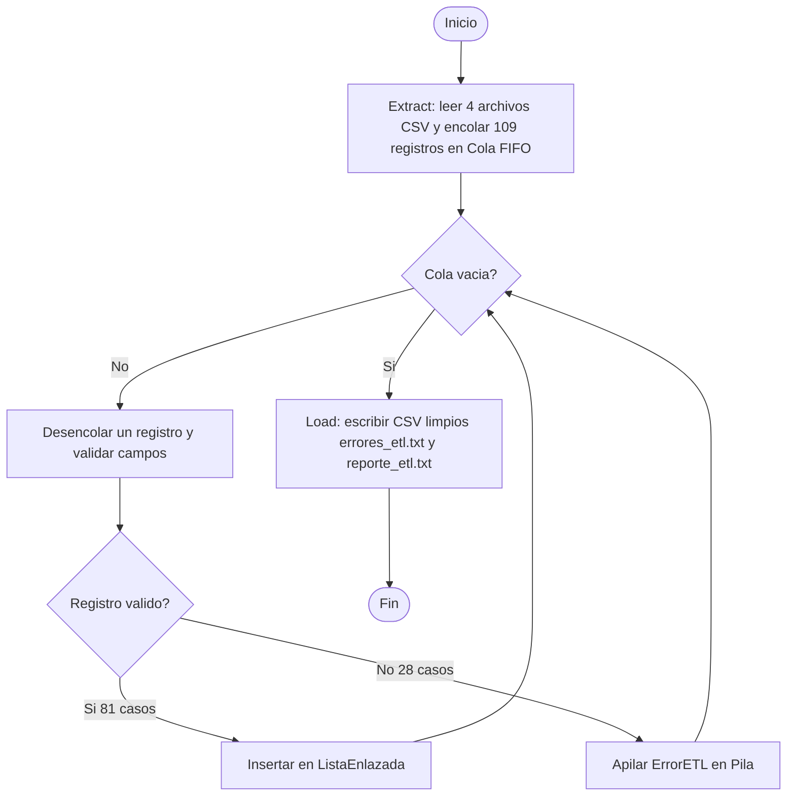
````

---

## Flujograma: ETL completo
- Fecha: 2026-11-23 15:31:51
- Proveedor: Gemini
- Modelo: gemini-3.5-flash-lite
- Estado: OK (Gemini, modelo gemini-3.5-flash-lite)

**Instrucción de sistema:**

```text
Eres un asistente que convierte descripciones de algoritmos en diagramas Mermaid. Responde UNICAMENTE con un bloque de codigo mermaid que comience con 'flowchart TD'. Reglas: los ids de nodo son alfanumericos sin espacios; todo el texto de cada nodo va entre comillas dobles; usa ["..."] para procesos, {"..."} para decisiones y (["..."]) para inicio y fin; las etiquetas de flechas se escriben -->|"texto"|; no uses parentesis ni corchetes dentro del texto; no agregues explicaciones fuera del bloque.
```

**Prompt enviado:**

```text
Genera un flujograma Mermaid (flowchart TD) del proceso: ETL completo.

Descripcion estructurada generada por el programa (datos reales de la ejecucion):
Proceso ETL ejecutado con datos reales:
1. Extract: se leyeron 4 archivos CSV y se encolaron 109 registros en una Cola (FIFO).
2. Transform: mientras la cola no este vacia se desencola un registro y se valida (identificador, campos obligatorios, rangos, duplicados, referencias).
3. Si el registro es valido (81 casos) se inserta en una ListaEnlazada; si no (28 casos) se apila un ErrorETL en una Pila.
4. Load: al vaciarse la cola se escriben los CSV limpios, errores_etl.txt y reporte_etl.txt.
Errores por tipo: ID_INVALIDO=4 DATO_INCOMPLETO=5 FORMATO_INVALIDO=5 RANGO_INVALIDO=5 DUPLICADO=5 REFERENCIA_INVALIDA=4 


El diagrama debe reflejar fielmente estos pasos, con inicio, fin, decisiones y bucles cuando correspondan.
```

**Respuesta recibida:**

````text
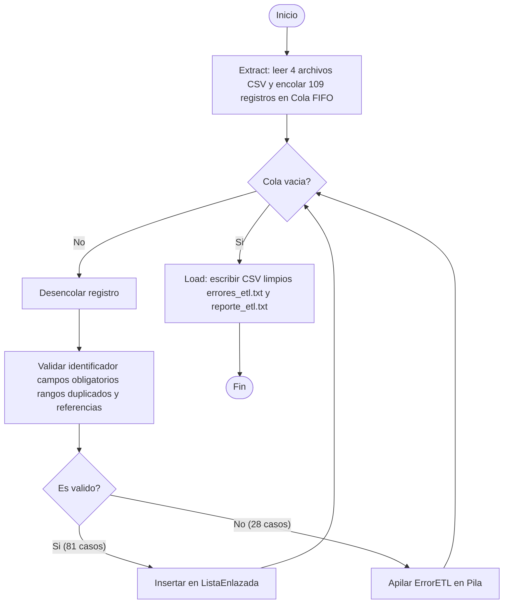
````

---

## Flujograma: BST (comparación de claves)
- Fecha: 2026-11-23 15:31:57
- Proveedor: Gemini
- Modelo: gemini-3.5-flash-lite
- Estado: OK (Gemini, modelo gemini-3.5-flash-lite)

**Instrucción de sistema:**

```text
Eres un asistente que convierte descripciones de algoritmos en diagramas Mermaid. Responde UNICAMENTE con un bloque de codigo mermaid que comience con 'flowchart TD'. Reglas: los ids de nodo son alfanumericos sin espacios; todo el texto de cada nodo va entre comillas dobles; usa ["..."] para procesos, {"..."} para decisiones y (["..."]) para inicio y fin; las etiquetas de flechas se escriben -->|"texto"|; no uses parentesis ni corchetes dentro del texto; no agregues explicaciones fuera del bloque.
```

**Prompt enviado:**

```text
Genera un flujograma Mermaid (flowchart TD) del proceso: BST (comparación de claves).

Descripcion estructurada generada por el programa (datos reales de la ejecucion):
Operacion real sobre un BST de 22 nodos y altura 8. Cada paso compara la clave con el nodo actual:
1. 1801000022 > 1801000007: ir a la derecha
2. 1801000022 > 1801000009: ir a la derecha
3. 1801000022 > 1801000018: ir a la derecha
4. 1801000022 = 1801000022: encontrado


El diagrama debe reflejar fielmente estos pasos, con inicio, fin, decisiones y bucles cuando correspondan.
```

**Respuesta recibida:**

````text
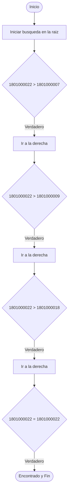
````

---

## Flujograma: Grafo + BFS
- Fecha: 2026-11-23 15:32:03
- Proveedor: Gemini
- Modelo: gemini-3.5-flash-lite
- Estado: OK (Gemini, modelo gemini-3.5-flash-lite)

**Instrucción de sistema:**

```text
Eres un asistente que convierte descripciones de algoritmos en diagramas Mermaid. Responde UNICAMENTE con un bloque de codigo mermaid que comience con 'flowchart TD'. Reglas: los ids de nodo son alfanumericos sin espacios; todo el texto de cada nodo va entre comillas dobles; usa ["..."] para procesos, {"..."} para decisiones y (["..."]) para inicio y fin; las etiquetas de flechas se escriben -->|"texto"|; no uses parentesis ni corchetes dentro del texto; no agregues explicaciones fuera del bloque.
```

**Prompt enviado:**

```text
Genera un flujograma Mermaid (flowchart TD) del proceso: Grafo + BFS.

Descripcion estructurada generada por el programa (datos reales de la ejecucion):
Recorrido BFS real sobre el grafo de prerrequisitos usando una cola. Eventos registrados en orden (con el contenido de la cola tras cada paso):
INICIO: BFS desde SIS101
ENCOLAR: SIS101 | cola=[frente: SIS101 :final]
DESENCOLAR: SIS101 | cola=[frente:  :final]
ENCOLAR: SIS102 | cola=[frente: SIS102 :final]
DESENCOLAR: SIS102 | cola=[frente:  :final]
ENCOLAR: SIS201 | cola=[frente: SIS201 :final]
ENCOLAR: SIS302 | cola=[frente: SIS201, SIS302 :final]
DESENCOLAR: SIS201 | cola=[frente: SIS302 :final]
ENCOLAR: SIS202 | cola=[frente: SIS302, SIS202 :final]
ENCOLAR: SIS203 | cola=[frente: SIS302, SIS202, SIS203 :final]
DESENCOLAR: SIS302 | cola=[frente: SIS202, SIS203 :final]
DESENCOLAR: SIS202 | cola=[frente: SIS203 :final]
ENCOLAR: SIS301 | cola=[frente: SIS203, SIS301 :final]
DESENCOLAR: SIS203 | cola=[frente: SIS301 :final]
ENCOLAR: SIS303 | cola=[frente: SIS301, SIS303 :final]
DESENCOLAR: SIS301 | cola=[frente: SIS303 :final]
DESENCOLAR: SIS303 | cola=[frente:  :final]
FIN: cola vacía; vértices visitados: 8


El diagrama debe reflejar fielmente estos pasos, con inicio, fin, decisiones y bucles cuando correspondan.
```

**Respuesta recibida:**

````text
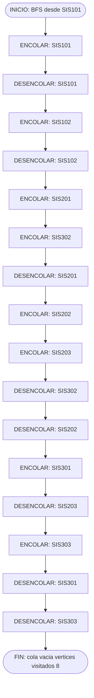
````

---

## Flujograma: Grafo + DFS
- Fecha: 2026-11-23 15:32:09
- Proveedor: Gemini
- Modelo: gemini-3.5-flash-lite
- Estado: OK (Gemini, modelo gemini-3.5-flash-lite)

**Instrucción de sistema:**

```text
Eres un asistente que convierte descripciones de algoritmos en diagramas Mermaid. Responde UNICAMENTE con un bloque de codigo mermaid que comience con 'flowchart TD'. Reglas: los ids de nodo son alfanumericos sin espacios; todo el texto de cada nodo va entre comillas dobles; usa ["..."] para procesos, {"..."} para decisiones y (["..."]) para inicio y fin; las etiquetas de flechas se escriben -->|"texto"|; no uses parentesis ni corchetes dentro del texto; no agregues explicaciones fuera del bloque.
```

**Prompt enviado:**

```text
Genera un flujograma Mermaid (flowchart TD) del proceso: Grafo + DFS.

Descripcion estructurada generada por el programa (datos reales de la ejecucion):
Recorrido DFS real sobre el grafo de prerrequisitos usando una pila. Eventos registrados en orden (con el contenido de la pila tras cada paso):
INICIO: DFS desde SIS101
APILAR: SIS101 | pila=[cima: SIS101]
VISITAR: SIS101 | pila=[cima: ]
APILAR: SIS102 | pila=[cima: SIS102]
VISITAR: SIS102 | pila=[cima: ]
APILAR: SIS302 | pila=[cima: SIS302]
APILAR: SIS201 | pila=[cima: SIS201 | SIS302]
VISITAR: SIS201 | pila=[cima: SIS302]
APILAR: SIS203 | pila=[cima: SIS203 | SIS302]
APILAR: SIS202 | pila=[cima: SIS202 | SIS203 | SIS302]
VISITAR: SIS202 | pila=[cima: SIS203 | SIS302]
APILAR: SIS301 | pila=[cima: SIS301 | SIS203 | SIS302]
VISITAR: SIS301 | pila=[cima: SIS203 | SIS302]
VISITAR: SIS203 | pila=[cima: SIS302]
APILAR: SIS303 | pila=[cima: SIS303 | SIS302]
VISITAR: SIS303 | pila=[cima: SIS302]
VISITAR: SIS302 | pila=[cima: ]
FIN: pila vacía; vértices visitados: 8


El diagrama debe reflejar fielmente estos pasos, con inicio, fin, decisiones y bucles cuando correspondan.
```

**Respuesta recibida:**

````text
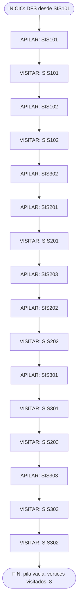
````

---

## Documentación del sistema
- Fecha: 2026-11-23 15:32:15
- Proveedor: Gemini
- Modelo: gemini-3.5-flash-lite
- Estado: OK (Gemini, modelo gemini-3.5-flash-lite)

**Instrucción de sistema:**

```text
Eres un profesor de Estructuras de Datos de ingenieria de software. Explica en espanol, con tono tecnico pero claro, refiriendote a los nodos, claves y valores CONCRETOS que recibes, no a definiciones genericas. Maximo 250 palabras. No inventes datos que no esten en la entrada.
```

**Prompt enviado:**

```text
Redacta en espanol la documentacion tecnica breve (formato Markdown, maximo 400 palabras) del siguiente sistema, con las secciones: Proposito, Flujo de datos, Estructuras utilizadas y por que, Resultados de la ejecucion.

Registros procesados: 109 | válidos: 81 | inválidos: 28
Estudiantes válidos: 22 | Asignaturas: 12 | Matrículas: 34 | Prerrequisitos: 13
BST: 22 nodos, altura 8
Grafo: 12 vértices, 13 aristas
SIS201 -> SIS202 -> SIS301 -> SIS201
Total de registros procesados: 109
Registros válidos: 81
Total de errores: 28
Identificador incorrecto: 4
Datos incompletos: 5
Formato incorrecto: 5
Valor fuera de rango: 5
Registro duplicado: 5
Referencia inexistente / relación inconsistente: 4
Errores en estudiantes.csv: 12 de 34
Errores en asignaturas.csv: 5 de 17
Errores en matriculas.csv: 7 de 41
Errores en prerrequisitos.csv: 4 de 17

```

**Respuesta recibida:**

````text
### Propósito
Documentar el procesamiento de 109 registros del sistema académico (81 válidos, 28 errores), validando entidades y dependencias curriculares.

### Flujo de datos
Se ingieren 109 registros totales. Tras la validación, se descartaron 28 errores (4 identificadores incorrectos, 5 incompletos, 5 de formato, 5 fuera de rango, 5 duplicados y 4 referencias inconsistentes), distribuidos en `estudiantes.csv` (12), `asignaturas.csv` (5), `matriculas.csv` (7) y `prerrequisitos.csv` (4). Los 81 registros válidos alimentan las estructuras de datos.

### Estructuras utilizadas y por qué
*   **BST (Árbol Binario de Búsqueda):** Contiene exactamente 22 nodos (altura 8) para almacenar los 22 estudiantes válidos. Se usa por su eficiencia $O(\log n)$ en búsquedas de claves individuales.
*   **Grafo:** Modela las 12 asignaturas como vértices y los 13 prerrequisitos como aristas dirigidas. Permite analizar dependencias. Se detectó el ciclo concreto: `SIS201 -> SIS202 -> SIS301 -> SIS201`.

### Resultados de la ejecución
Se procesaron 109 registros (81 válidos, 28 errores). Se estructuraron 22 nodos en el BST y 12 vértices con 13 aristas en el grafo. El análisis detectó una anomalía crítica en el grafo: un ciclo de prerrequisitos (`SIS201 -> SIS202 -> SIS301 -> SIS201`), lo que impide una ordenación topológica válida para las 12 asignaturas y 34 matrículas.
````

---

## Flujograma: ETL completo
- Fecha: 2026-11-24 05:58:04
- Proveedor: local
- Modelo: generador local
- Estado: Sin GEMINI_API_KEY ni ANTHROPIC_API_KEY: se usó el generador local (sin IA)

**Instrucción de sistema:**

```text
Eres un asistente que convierte descripciones de algoritmos en diagramas Mermaid. Responde UNICAMENTE con un bloque de codigo mermaid que comience con 'flowchart TD'. Reglas: los ids de nodo son alfanumericos sin espacios; todo el texto de cada nodo va entre comillas dobles; usa ["..."] para procesos, {"..."} para decisiones y (["..."]) para inicio y fin; las etiquetas de flechas se escriben -->|"texto"|; no uses parentesis ni corchetes dentro del texto; no agregues explicaciones fuera del bloque.
```

**Prompt enviado:**

```text
Genera un flujograma Mermaid (flowchart TD) del proceso: ETL completo.

Descripcion estructurada generada por el programa (datos reales de la ejecucion):
Proceso ETL ejecutado con datos reales:
1. Extract: se leyeron 4 archivos CSV y se encolaron 109 registros en una Cola (FIFO).
2. Transform: mientras la cola no este vacia se desencola un registro y se valida (identificador, campos obligatorios, rangos, duplicados, referencias).
3. Si el registro es valido (81 casos) se inserta en una ListaEnlazada; si no (28 casos) se apila un ErrorETL en una Pila.
4. Load: al vaciarse la cola se escriben los CSV limpios, errores_etl.txt y reporte_etl.txt.
Errores por tipo: ID_INVALIDO=4 DATO_INCOMPLETO=5 FORMATO_INVALIDO=5 RANGO_INVALIDO=5 DUPLICADO=5 REFERENCIA_INVALIDA=4 


El diagrama debe reflejar fielmente estos pasos, con inicio, fin, decisiones y bucles cuando correspondan.
```

**Respuesta recibida:**

_(sin respuesta de la IA)_

---

## Flujograma: Cola (encolar y desencolar)
- Fecha: 2026-11-24 05:58:54
- Proveedor: local
- Modelo: generador local
- Estado: Sin GEMINI_API_KEY ni ANTHROPIC_API_KEY: se usó el generador local (sin IA)

**Instrucción de sistema:**

```text
Eres un asistente que convierte descripciones de algoritmos en diagramas Mermaid. Responde UNICAMENTE con un bloque de codigo mermaid que comience con 'flowchart TD'. Reglas: los ids de nodo son alfanumericos sin espacios; todo el texto de cada nodo va entre comillas dobles; usa ["..."] para procesos, {"..."} para decisiones y (["..."]) para inicio y fin; las etiquetas de flechas se escriben -->|"texto"|; no uses parentesis ni corchetes dentro del texto; no agregues explicaciones fuera del bloque.
```

**Prompt enviado:**

```text
Genera un flujograma Mermaid (flowchart TD) del proceso: Cola (encolar y desencolar).

Descripcion estructurada generada por el programa (datos reales de la ejecucion):
Cola FIFO con nodos enlazados y referencias frente y fin.
encolar(x): crear nodo; si la cola esta vacia frente y fin apuntan al nodo; si no fin.siguiente = nodo y fin = nodo.
desencolar(): si esta vacia devolver null; guardar dato de frente; frente = frente.siguiente; si frente queda null entonces fin = null.

El diagrama debe reflejar fielmente estos pasos, con inicio, fin, decisiones y bucles cuando correspondan.
```

**Respuesta recibida:**

_(sin respuesta de la IA)_

---

## Flujograma: Grafo + BFS
- Fecha: 2026-11-24 05:59:12
- Proveedor: local
- Modelo: generador local
- Estado: Sin GEMINI_API_KEY ni ANTHROPIC_API_KEY: se usó el generador local (sin IA)

**Instrucción de sistema:**

```text
Eres un asistente que convierte descripciones de algoritmos en diagramas Mermaid. Responde UNICAMENTE con un bloque de codigo mermaid que comience con 'flowchart TD'. Reglas: los ids de nodo son alfanumericos sin espacios; todo el texto de cada nodo va entre comillas dobles; usa ["..."] para procesos, {"..."} para decisiones y (["..."]) para inicio y fin; las etiquetas de flechas se escriben -->|"texto"|; no uses parentesis ni corchetes dentro del texto; no agregues explicaciones fuera del bloque.
```

**Prompt enviado:**

```text
Genera un flujograma Mermaid (flowchart TD) del proceso: Grafo + BFS.

Descripcion estructurada generada por el programa (datos reales de la ejecucion):
Recorrido BFS real sobre el grafo de prerrequisitos usando una cola. Eventos registrados en orden (con el contenido de la cola tras cada paso):
INICIO: BFS desde SIS101
ENCOLAR: SIS101 | cola=[frente: SIS101 :final]
DESENCOLAR: SIS101 | cola=[frente:  :final]
ENCOLAR: SIS102 | cola=[frente: SIS102 :final]
DESENCOLAR: SIS102 | cola=[frente:  :final]
ENCOLAR: SIS201 | cola=[frente: SIS201 :final]
ENCOLAR: SIS302 | cola=[frente: SIS201, SIS302 :final]
DESENCOLAR: SIS201 | cola=[frente: SIS302 :final]
ENCOLAR: SIS202 | cola=[frente: SIS302, SIS202 :final]
ENCOLAR: SIS203 | cola=[frente: SIS302, SIS202, SIS203 :final]
DESENCOLAR: SIS302 | cola=[frente: SIS202, SIS203 :final]
DESENCOLAR: SIS202 | cola=[frente: SIS203 :final]
ENCOLAR: SIS301 | cola=[frente: SIS203, SIS301 :final]
DESENCOLAR: SIS203 | cola=[frente: SIS301 :final]
ENCOLAR: SIS303 | cola=[frente: SIS301, SIS303 :final]
DESENCOLAR: SIS301 | cola=[frente: SIS303 :final]
DESENCOLAR: SIS303 | cola=[frente:  :final]
FIN: cola vacía; vértices visitados: 8


El diagrama debe reflejar fielmente estos pasos, con inicio, fin, decisiones y bucles cuando correspondan.
```

**Respuesta recibida:**

_(sin respuesta de la IA)_

---

## Flujograma: Grafo + DFS
- Fecha: 2026-11-24 05:59:18
- Proveedor: local
- Modelo: generador local
- Estado: Sin GEMINI_API_KEY ni ANTHROPIC_API_KEY: se usó el generador local (sin IA)

**Instrucción de sistema:**

```text
Eres un asistente que convierte descripciones de algoritmos en diagramas Mermaid. Responde UNICAMENTE con un bloque de codigo mermaid que comience con 'flowchart TD'. Reglas: los ids de nodo son alfanumericos sin espacios; todo el texto de cada nodo va entre comillas dobles; usa ["..."] para procesos, {"..."} para decisiones y (["..."]) para inicio y fin; las etiquetas de flechas se escriben -->|"texto"|; no uses parentesis ni corchetes dentro del texto; no agregues explicaciones fuera del bloque.
```

**Prompt enviado:**

```text
Genera un flujograma Mermaid (flowchart TD) del proceso: Grafo + DFS.

Descripcion estructurada generada por el programa (datos reales de la ejecucion):
Recorrido DFS real sobre el grafo de prerrequisitos usando una pila. Eventos registrados en orden (con el contenido de la pila tras cada paso):
INICIO: DFS desde SIS101
APILAR: SIS101 | pila=[cima: SIS101]
VISITAR: SIS101 | pila=[cima: ]
APILAR: SIS102 | pila=[cima: SIS102]
VISITAR: SIS102 | pila=[cima: ]
APILAR: SIS302 | pila=[cima: SIS302]
APILAR: SIS201 | pila=[cima: SIS201 | SIS302]
VISITAR: SIS201 | pila=[cima: SIS302]
APILAR: SIS203 | pila=[cima: SIS203 | SIS302]
APILAR: SIS202 | pila=[cima: SIS202 | SIS203 | SIS302]
VISITAR: SIS202 | pila=[cima: SIS203 | SIS302]
APILAR: SIS301 | pila=[cima: SIS301 | SIS203 | SIS302]
VISITAR: SIS301 | pila=[cima: SIS203 | SIS302]
VISITAR: SIS203 | pila=[cima: SIS302]
APILAR: SIS303 | pila=[cima: SIS303 | SIS302]
VISITAR: SIS303 | pila=[cima: SIS302]
VISITAR: SIS302 | pila=[cima: ]
FIN: pila vacía; vértices visitados: 8


El diagrama debe reflejar fielmente estos pasos, con inicio, fin, decisiones y bucles cuando correspondan.
```

**Respuesta recibida:**

_(sin respuesta de la IA)_

---

## Explicación del BST
- Fecha: 2026-11-24 05:59:23
- Proveedor: local
- Modelo: generador local
- Estado: Sin GEMINI_API_KEY ni ANTHROPIC_API_KEY: se usó el generador local (sin IA)

**Instrucción de sistema:**

```text
Eres un profesor de Estructuras de Datos de ingenieria de software. Explica en espanol, con tono tecnico pero claro, refiriendote a los nodos, claves y valores CONCRETOS que recibes, no a definiciones genericas. Maximo 250 palabras. No inventes datos que no esten en la entrada.
```

**Prompt enviado:**

```text
Explica el siguiente arbol binario de busqueda (BST) real. Cada linea indica un nodo con sus hijos.

Raíz: 1801000007
1801000007 | izquierdo: 1801000003 | derecho: 1801000009
1801000003 | izquierdo: 1801000001 | derecho: 1801000005
1801000001 | izquierdo: - | derecho: 1801000002
1801000002 | izquierdo: - | derecho: -
1801000005 | izquierdo: 1801000004 | derecho: 1801000006
1801000004 | izquierdo: - | derecho: -
1801000006 | izquierdo: - | derecho: -
1801000009 | izquierdo: 1801000008 | derecho: 1801000018
1801000008 | izquierdo: - | derecho: -
1801000018 | izquierdo: 1801000012 | derecho: 1801000022
1801000012 | izquierdo: 1801000011 | derecho: 1801000016
1801000011 | izquierdo: 1801000010 | derecho: -
1801000010 | izquierdo: - | derecho: -
1801000016 | izquierdo: 1801000015 | derecho: 1801000017
1801000015 | izquierdo: 1801000013 | derecho: -
1801000013 | izquierdo: - | derecho: 1801000014
1801000014 | izquierdo: - | derecho: -
1801000017 | izquierdo: - | derecho: -
1801000022 | izquierdo: 1801000020 | derecho: -
1801000020 | izquierdo: 1801000019 | derecho: 1801000021
1801000019 | izquierdo: - | derecho: -
1801000021 | izquierdo: - | derecho: -

Nodos: 22. Altura: 8. Altura minima posible con ese numero de nodos: 5.

Indica cual es la raiz, como se cumple la propiedad BST en al menos dos nodos concretos y si el arbol esta balanceado o degenerado y que consecuencia tiene para la busqueda.
```

**Respuesta recibida:**

_(sin respuesta de la IA)_

---

## Flujograma: ETL completo
- Fecha: 2026-11-24 05:59:35
- Proveedor: local
- Modelo: generador local
- Estado: Sin GEMINI_API_KEY ni ANTHROPIC_API_KEY: se usó el generador local (sin IA)

**Instrucción de sistema:**

```text
Eres un asistente que convierte descripciones de algoritmos en diagramas Mermaid. Responde UNICAMENTE con un bloque de codigo mermaid que comience con 'flowchart TD'. Reglas: los ids de nodo son alfanumericos sin espacios; todo el texto de cada nodo va entre comillas dobles; usa ["..."] para procesos, {"..."} para decisiones y (["..."]) para inicio y fin; las etiquetas de flechas se escriben -->|"texto"|; no uses parentesis ni corchetes dentro del texto; no agregues explicaciones fuera del bloque.
```

**Prompt enviado:**

```text
Genera un flujograma Mermaid (flowchart TD) del proceso: ETL completo.

Descripcion estructurada generada por el programa (datos reales de la ejecucion):
Proceso ETL ejecutado con datos reales:
1. Extract: se leyeron 4 archivos CSV y se encolaron 109 registros en una Cola (FIFO).
2. Transform: mientras la cola no este vacia se desencola un registro y se valida (identificador, campos obligatorios, rangos, duplicados, referencias).
3. Si el registro es valido (81 casos) se inserta en una ListaEnlazada; si no (28 casos) se apila un ErrorETL en una Pila.
4. Load: al vaciarse la cola se escriben los CSV limpios, errores_etl.txt y reporte_etl.txt.
Errores por tipo: ID_INVALIDO=4 DATO_INCOMPLETO=5 FORMATO_INVALIDO=5 RANGO_INVALIDO=5 DUPLICADO=5 REFERENCIA_INVALIDA=4 


El diagrama debe reflejar fielmente estos pasos, con inicio, fin, decisiones y bucles cuando correspondan.
```

**Respuesta recibida:**

_(sin respuesta de la IA)_

---

## Flujograma: BST (comparación de claves)
- Fecha: 2026-11-24 05:59:35
- Proveedor: local
- Modelo: generador local
- Estado: Sin GEMINI_API_KEY ni ANTHROPIC_API_KEY: se usó el generador local (sin IA)

**Instrucción de sistema:**

```text
Eres un asistente que convierte descripciones de algoritmos en diagramas Mermaid. Responde UNICAMENTE con un bloque de codigo mermaid que comience con 'flowchart TD'. Reglas: los ids de nodo son alfanumericos sin espacios; todo el texto de cada nodo va entre comillas dobles; usa ["..."] para procesos, {"..."} para decisiones y (["..."]) para inicio y fin; las etiquetas de flechas se escriben -->|"texto"|; no uses parentesis ni corchetes dentro del texto; no agregues explicaciones fuera del bloque.
```

**Prompt enviado:**

```text
Genera un flujograma Mermaid (flowchart TD) del proceso: BST (comparación de claves).

Descripcion estructurada generada por el programa (datos reales de la ejecucion):
Operacion real sobre un BST de 22 nodos y altura 8. Cada paso compara la clave con el nodo actual:
1. 1801000022 > 1801000007: ir a la derecha
2. 1801000022 > 1801000009: ir a la derecha
3. 1801000022 > 1801000018: ir a la derecha
4. 1801000022 = 1801000022: encontrado


El diagrama debe reflejar fielmente estos pasos, con inicio, fin, decisiones y bucles cuando correspondan.
```

**Respuesta recibida:**

_(sin respuesta de la IA)_

---

## Flujograma: Grafo + BFS
- Fecha: 2026-11-24 05:59:35
- Proveedor: local
- Modelo: generador local
- Estado: Sin GEMINI_API_KEY ni ANTHROPIC_API_KEY: se usó el generador local (sin IA)

**Instrucción de sistema:**

```text
Eres un asistente que convierte descripciones de algoritmos en diagramas Mermaid. Responde UNICAMENTE con un bloque de codigo mermaid que comience con 'flowchart TD'. Reglas: los ids de nodo son alfanumericos sin espacios; todo el texto de cada nodo va entre comillas dobles; usa ["..."] para procesos, {"..."} para decisiones y (["..."]) para inicio y fin; las etiquetas de flechas se escriben -->|"texto"|; no uses parentesis ni corchetes dentro del texto; no agregues explicaciones fuera del bloque.
```

**Prompt enviado:**

```text
Genera un flujograma Mermaid (flowchart TD) del proceso: Grafo + BFS.

Descripcion estructurada generada por el programa (datos reales de la ejecucion):
Recorrido BFS real sobre el grafo de prerrequisitos usando una cola. Eventos registrados en orden (con el contenido de la cola tras cada paso):
INICIO: BFS desde SIS101
ENCOLAR: SIS101 | cola=[frente: SIS101 :final]
DESENCOLAR: SIS101 | cola=[frente:  :final]
ENCOLAR: SIS102 | cola=[frente: SIS102 :final]
DESENCOLAR: SIS102 | cola=[frente:  :final]
ENCOLAR: SIS201 | cola=[frente: SIS201 :final]
ENCOLAR: SIS302 | cola=[frente: SIS201, SIS302 :final]
DESENCOLAR: SIS201 | cola=[frente: SIS302 :final]
ENCOLAR: SIS202 | cola=[frente: SIS302, SIS202 :final]
ENCOLAR: SIS203 | cola=[frente: SIS302, SIS202, SIS203 :final]
DESENCOLAR: SIS302 | cola=[frente: SIS202, SIS203 :final]
DESENCOLAR: SIS202 | cola=[frente: SIS203 :final]
ENCOLAR: SIS301 | cola=[frente: SIS203, SIS301 :final]
DESENCOLAR: SIS203 | cola=[frente: SIS301 :final]
ENCOLAR: SIS303 | cola=[frente: SIS301, SIS303 :final]
DESENCOLAR: SIS301 | cola=[frente: SIS303 :final]
DESENCOLAR: SIS303 | cola=[frente:  :final]
FIN: cola vacía; vértices visitados: 8


El diagrama debe reflejar fielmente estos pasos, con inicio, fin, decisiones y bucles cuando correspondan.
```

**Respuesta recibida:**

_(sin respuesta de la IA)_

---

## Flujograma: Grafo + DFS
- Fecha: 2026-11-24 05:59:35
- Proveedor: local
- Modelo: generador local
- Estado: Sin GEMINI_API_KEY ni ANTHROPIC_API_KEY: se usó el generador local (sin IA)

**Instrucción de sistema:**

```text
Eres un asistente que convierte descripciones de algoritmos en diagramas Mermaid. Responde UNICAMENTE con un bloque de codigo mermaid que comience con 'flowchart TD'. Reglas: los ids de nodo son alfanumericos sin espacios; todo el texto de cada nodo va entre comillas dobles; usa ["..."] para procesos, {"..."} para decisiones y (["..."]) para inicio y fin; las etiquetas de flechas se escriben -->|"texto"|; no uses parentesis ni corchetes dentro del texto; no agregues explicaciones fuera del bloque.
```

**Prompt enviado:**

```text
Genera un flujograma Mermaid (flowchart TD) del proceso: Grafo + DFS.

Descripcion estructurada generada por el programa (datos reales de la ejecucion):
Recorrido DFS real sobre el grafo de prerrequisitos usando una pila. Eventos registrados en orden (con el contenido de la pila tras cada paso):
INICIO: DFS desde SIS101
APILAR: SIS101 | pila=[cima: SIS101]
VISITAR: SIS101 | pila=[cima: ]
APILAR: SIS102 | pila=[cima: SIS102]
VISITAR: SIS102 | pila=[cima: ]
APILAR: SIS302 | pila=[cima: SIS302]
APILAR: SIS201 | pila=[cima: SIS201 | SIS302]
VISITAR: SIS201 | pila=[cima: SIS302]
APILAR: SIS203 | pila=[cima: SIS203 | SIS302]
APILAR: SIS202 | pila=[cima: SIS202 | SIS203 | SIS302]
VISITAR: SIS202 | pila=[cima: SIS203 | SIS302]
APILAR: SIS301 | pila=[cima: SIS301 | SIS203 | SIS302]
VISITAR: SIS301 | pila=[cima: SIS203 | SIS302]
VISITAR: SIS203 | pila=[cima: SIS302]
APILAR: SIS303 | pila=[cima: SIS303 | SIS302]
VISITAR: SIS303 | pila=[cima: SIS302]
VISITAR: SIS302 | pila=[cima: ]
FIN: pila vacía; vértices visitados: 8


El diagrama debe reflejar fielmente estos pasos, con inicio, fin, decisiones y bucles cuando correspondan.
```

**Respuesta recibida:**

_(sin respuesta de la IA)_

---

## Documentación del sistema
- Fecha: 2026-11-24 05:59:35
- Proveedor: local
- Modelo: generador local
- Estado: Sin GEMINI_API_KEY ni ANTHROPIC_API_KEY: se usó el generador local (sin IA)

**Instrucción de sistema:**

```text
Eres un profesor de Estructuras de Datos de ingenieria de software. Explica en espanol, con tono tecnico pero claro, refiriendote a los nodos, claves y valores CONCRETOS que recibes, no a definiciones genericas. Maximo 250 palabras. No inventes datos que no esten en la entrada.
```

**Prompt enviado:**

```text
Redacta en espanol la documentacion tecnica breve (formato Markdown, maximo 400 palabras) del siguiente sistema, con las secciones: Proposito, Flujo de datos, Estructuras utilizadas y por que, Resultados de la ejecucion.

Registros procesados: 109 | válidos: 81 | inválidos: 28
Estudiantes válidos: 22 | Asignaturas: 12 | Matrículas: 34 | Prerrequisitos: 13
BST: 22 nodos, altura 8
Grafo: 12 vértices, 13 aristas
SIS201 -> SIS202 -> SIS301 -> SIS201
Total de registros procesados: 109
Registros válidos: 81
Total de errores: 28
Identificador incorrecto: 4
Datos incompletos: 5
Formato incorrecto: 5
Valor fuera de rango: 5
Registro duplicado: 5
Referencia inexistente / relación inconsistente: 4
Errores en estudiantes.csv: 12 de 34
Errores en asignaturas.csv: 5 de 17
Errores en matriculas.csv: 7 de 41
Errores en prerrequisitos.csv: 4 de 17

```

**Respuesta recibida:**

_(sin respuesta de la IA)_

---

## Flujograma: ETL completo
- Fecha: 2026-11-24 09:55:00
- Proveedor: local
- Modelo: generador local
- Estado: Sin GEMINI_API_KEY ni ANTHROPIC_API_KEY: se usó el generador local (sin IA)

**Instrucción de sistema:**

```text
Eres un asistente que convierte descripciones de algoritmos en diagramas Mermaid. Responde UNICAMENTE con un bloque de codigo mermaid que comience con 'flowchart TD'. Reglas: los ids de nodo son alfanumericos sin espacios; todo el texto de cada nodo va entre comillas dobles; usa ["..."] para procesos, {"..."} para decisiones y (["..."]) para inicio y fin; las etiquetas de flechas se escriben -->|"texto"|; no uses parentesis ni corchetes dentro del texto; no agregues explicaciones fuera del bloque.
```

**Prompt enviado:**

```text
Genera un flujograma Mermaid (flowchart TD) del proceso: ETL completo.

Descripcion estructurada generada por el programa (datos reales de la ejecucion):
Proceso ETL ejecutado con datos reales:
1. Extract: se leyeron 4 archivos CSV y se encolaron 109 registros en una Cola (FIFO).
2. Transform: mientras la cola no este vacia se desencola un registro y se valida (identificador, campos obligatorios, rangos, duplicados, referencias).
3. Si el registro es valido (81 casos) se inserta en una ListaEnlazada; si no (28 casos) se apila un ErrorETL en una Pila.
4. Load: al vaciarse la cola se escriben los CSV limpios, errores_etl.txt y reporte_etl.txt.
Errores por tipo: ID_INVALIDO=4 DATO_INCOMPLETO=5 FORMATO_INVALIDO=5 RANGO_INVALIDO=5 DUPLICADO=5 REFERENCIA_INVALIDA=4 


El diagrama debe reflejar fielmente estos pasos, con inicio, fin, decisiones y bucles cuando correspondan.
```

**Respuesta recibida:**

_(sin respuesta de la IA)_

---

## Flujograma: Cola (encolar y desencolar)
- Fecha: 2026-11-24 09:55:11
- Proveedor: local
- Modelo: generador local
- Estado: Sin GEMINI_API_KEY ni ANTHROPIC_API_KEY: se usó el generador local (sin IA)

**Instrucción de sistema:**

```text
Eres un asistente que convierte descripciones de algoritmos en diagramas Mermaid. Responde UNICAMENTE con un bloque de codigo mermaid que comience con 'flowchart TD'. Reglas: los ids de nodo son alfanumericos sin espacios; todo el texto de cada nodo va entre comillas dobles; usa ["..."] para procesos, {"..."} para decisiones y (["..."]) para inicio y fin; las etiquetas de flechas se escriben -->|"texto"|; no uses parentesis ni corchetes dentro del texto; no agregues explicaciones fuera del bloque.
```

**Prompt enviado:**

```text
Genera un flujograma Mermaid (flowchart TD) del proceso: Cola (encolar y desencolar).

Descripcion estructurada generada por el programa (datos reales de la ejecucion):
Cola FIFO con nodos enlazados y referencias frente y fin.
encolar(x): crear nodo; si la cola esta vacia frente y fin apuntan al nodo; si no fin.siguiente = nodo y fin = nodo.
desencolar(): si esta vacia devolver null; guardar dato de frente; frente = frente.siguiente; si frente queda null entonces fin = null.

El diagrama debe reflejar fielmente estos pasos, con inicio, fin, decisiones y bucles cuando correspondan.
```

**Respuesta recibida:**

_(sin respuesta de la IA)_

---

## Explicación del BST
- Fecha: 2026-11-24 09:55:19
- Proveedor: local
- Modelo: generador local
- Estado: Sin GEMINI_API_KEY ni ANTHROPIC_API_KEY: se usó el generador local (sin IA)

**Instrucción de sistema:**

```text
Eres un profesor de Estructuras de Datos de ingenieria de software. Explica en espanol, con tono tecnico pero claro, refiriendote a los nodos, claves y valores CONCRETOS que recibes, no a definiciones genericas. Maximo 250 palabras. No inventes datos que no esten en la entrada.
```

**Prompt enviado:**

```text
Explica el siguiente arbol binario de busqueda (BST) real. Cada linea indica un nodo con sus hijos.

Raíz: 1801000007
1801000007 | izquierdo: 1801000003 | derecho: 1801000009
1801000003 | izquierdo: 1801000001 | derecho: 1801000005
1801000001 | izquierdo: - | derecho: 1801000002
1801000002 | izquierdo: - | derecho: -
1801000005 | izquierdo: 1801000004 | derecho: 1801000006
1801000004 | izquierdo: - | derecho: -
1801000006 | izquierdo: - | derecho: -
1801000009 | izquierdo: 1801000008 | derecho: 1801000018
1801000008 | izquierdo: - | derecho: -
1801000018 | izquierdo: 1801000012 | derecho: 1801000022
1801000012 | izquierdo: 1801000011 | derecho: 1801000016
1801000011 | izquierdo: 1801000010 | derecho: -
1801000010 | izquierdo: - | derecho: -
1801000016 | izquierdo: 1801000015 | derecho: 1801000017
1801000015 | izquierdo: 1801000013 | derecho: -
1801000013 | izquierdo: - | derecho: 1801000014
1801000014 | izquierdo: - | derecho: -
1801000017 | izquierdo: - | derecho: -
1801000022 | izquierdo: 1801000020 | derecho: -
1801000020 | izquierdo: 1801000019 | derecho: 1801000021
1801000019 | izquierdo: - | derecho: -
1801000021 | izquierdo: - | derecho: -

Nodos: 22. Altura: 8. Altura minima posible con ese numero de nodos: 5.

Indica cual es la raiz, como se cumple la propiedad BST en al menos dos nodos concretos y si el arbol esta balanceado o degenerado y que consecuencia tiene para la busqueda.
```

**Respuesta recibida:**

_(sin respuesta de la IA)_

---

## Flujograma: ETL completo
- Fecha: 2026-11-24 09:55:33
- Proveedor: local
- Modelo: generador local
- Estado: Sin GEMINI_API_KEY ni ANTHROPIC_API_KEY: se usó el generador local (sin IA)

**Instrucción de sistema:**

```text
Eres un asistente que convierte descripciones de algoritmos en diagramas Mermaid. Responde UNICAMENTE con un bloque de codigo mermaid que comience con 'flowchart TD'. Reglas: los ids de nodo son alfanumericos sin espacios; todo el texto de cada nodo va entre comillas dobles; usa ["..."] para procesos, {"..."} para decisiones y (["..."]) para inicio y fin; las etiquetas de flechas se escriben -->|"texto"|; no uses parentesis ni corchetes dentro del texto; no agregues explicaciones fuera del bloque.
```

**Prompt enviado:**

```text
Genera un flujograma Mermaid (flowchart TD) del proceso: ETL completo.

Descripcion estructurada generada por el programa (datos reales de la ejecucion):
Proceso ETL ejecutado con datos reales:
1. Extract: se leyeron 4 archivos CSV y se encolaron 109 registros en una Cola (FIFO).
2. Transform: mientras la cola no este vacia se desencola un registro y se valida (identificador, campos obligatorios, rangos, duplicados, referencias).
3. Si el registro es valido (81 casos) se inserta en una ListaEnlazada; si no (28 casos) se apila un ErrorETL en una Pila.
4. Load: al vaciarse la cola se escriben los CSV limpios, errores_etl.txt y reporte_etl.txt.
Errores por tipo: ID_INVALIDO=4 DATO_INCOMPLETO=5 FORMATO_INVALIDO=5 RANGO_INVALIDO=5 DUPLICADO=5 REFERENCIA_INVALIDA=4 


El diagrama debe reflejar fielmente estos pasos, con inicio, fin, decisiones y bucles cuando correspondan.
```

**Respuesta recibida:**

_(sin respuesta de la IA)_

---

## Flujograma: BST (comparación de claves)
- Fecha: 2026-11-24 09:55:33
- Proveedor: local
- Modelo: generador local
- Estado: Sin GEMINI_API_KEY ni ANTHROPIC_API_KEY: se usó el generador local (sin IA)

**Instrucción de sistema:**

```text
Eres un asistente que convierte descripciones de algoritmos en diagramas Mermaid. Responde UNICAMENTE con un bloque de codigo mermaid que comience con 'flowchart TD'. Reglas: los ids de nodo son alfanumericos sin espacios; todo el texto de cada nodo va entre comillas dobles; usa ["..."] para procesos, {"..."} para decisiones y (["..."]) para inicio y fin; las etiquetas de flechas se escriben -->|"texto"|; no uses parentesis ni corchetes dentro del texto; no agregues explicaciones fuera del bloque.
```

**Prompt enviado:**

```text
Genera un flujograma Mermaid (flowchart TD) del proceso: BST (comparación de claves).

Descripcion estructurada generada por el programa (datos reales de la ejecucion):
Operacion real sobre un BST de 22 nodos y altura 8. Cada paso compara la clave con el nodo actual:
1. 1801000022 > 1801000007: ir a la derecha
2. 1801000022 > 1801000009: ir a la derecha
3. 1801000022 > 1801000018: ir a la derecha
4. 1801000022 = 1801000022: encontrado


El diagrama debe reflejar fielmente estos pasos, con inicio, fin, decisiones y bucles cuando correspondan.
```

**Respuesta recibida:**

_(sin respuesta de la IA)_

---

## Flujograma: Grafo + BFS
- Fecha: 2026-11-24 09:55:33
- Proveedor: local
- Modelo: generador local
- Estado: Sin GEMINI_API_KEY ni ANTHROPIC_API_KEY: se usó el generador local (sin IA)

**Instrucción de sistema:**

```text
Eres un asistente que convierte descripciones de algoritmos en diagramas Mermaid. Responde UNICAMENTE con un bloque de codigo mermaid que comience con 'flowchart TD'. Reglas: los ids de nodo son alfanumericos sin espacios; todo el texto de cada nodo va entre comillas dobles; usa ["..."] para procesos, {"..."} para decisiones y (["..."]) para inicio y fin; las etiquetas de flechas se escriben -->|"texto"|; no uses parentesis ni corchetes dentro del texto; no agregues explicaciones fuera del bloque.
```

**Prompt enviado:**

```text
Genera un flujograma Mermaid (flowchart TD) del proceso: Grafo + BFS.

Descripcion estructurada generada por el programa (datos reales de la ejecucion):
Recorrido BFS real sobre el grafo de prerrequisitos usando una cola. Eventos registrados en orden (con el contenido de la cola tras cada paso):
INICIO: BFS desde SIS101
ENCOLAR: SIS101 | cola=[frente: SIS101 :final]
DESENCOLAR: SIS101 | cola=[frente:  :final]
ENCOLAR: SIS102 | cola=[frente: SIS102 :final]
DESENCOLAR: SIS102 | cola=[frente:  :final]
ENCOLAR: SIS201 | cola=[frente: SIS201 :final]
ENCOLAR: SIS302 | cola=[frente: SIS201, SIS302 :final]
DESENCOLAR: SIS201 | cola=[frente: SIS302 :final]
ENCOLAR: SIS202 | cola=[frente: SIS302, SIS202 :final]
ENCOLAR: SIS203 | cola=[frente: SIS302, SIS202, SIS203 :final]
DESENCOLAR: SIS302 | cola=[frente: SIS202, SIS203 :final]
DESENCOLAR: SIS202 | cola=[frente: SIS203 :final]
ENCOLAR: SIS301 | cola=[frente: SIS203, SIS301 :final]
DESENCOLAR: SIS203 | cola=[frente: SIS301 :final]
ENCOLAR: SIS303 | cola=[frente: SIS301, SIS303 :final]
DESENCOLAR: SIS301 | cola=[frente: SIS303 :final]
DESENCOLAR: SIS303 | cola=[frente:  :final]
FIN: cola vacía; vértices visitados: 8


El diagrama debe reflejar fielmente estos pasos, con inicio, fin, decisiones y bucles cuando correspondan.
```

**Respuesta recibida:**

_(sin respuesta de la IA)_

---

## Flujograma: Grafo + DFS
- Fecha: 2026-11-24 09:55:33
- Proveedor: local
- Modelo: generador local
- Estado: Sin GEMINI_API_KEY ni ANTHROPIC_API_KEY: se usó el generador local (sin IA)

**Instrucción de sistema:**

```text
Eres un asistente que convierte descripciones de algoritmos en diagramas Mermaid. Responde UNICAMENTE con un bloque de codigo mermaid que comience con 'flowchart TD'. Reglas: los ids de nodo son alfanumericos sin espacios; todo el texto de cada nodo va entre comillas dobles; usa ["..."] para procesos, {"..."} para decisiones y (["..."]) para inicio y fin; las etiquetas de flechas se escriben -->|"texto"|; no uses parentesis ni corchetes dentro del texto; no agregues explicaciones fuera del bloque.
```

**Prompt enviado:**

```text
Genera un flujograma Mermaid (flowchart TD) del proceso: Grafo + DFS.

Descripcion estructurada generada por el programa (datos reales de la ejecucion):
Recorrido DFS real sobre el grafo de prerrequisitos usando una pila. Eventos registrados en orden (con el contenido de la pila tras cada paso):
INICIO: DFS desde SIS101
APILAR: SIS101 | pila=[cima: SIS101]
VISITAR: SIS101 | pila=[cima: ]
APILAR: SIS102 | pila=[cima: SIS102]
VISITAR: SIS102 | pila=[cima: ]
APILAR: SIS302 | pila=[cima: SIS302]
APILAR: SIS201 | pila=[cima: SIS201 | SIS302]
VISITAR: SIS201 | pila=[cima: SIS302]
APILAR: SIS203 | pila=[cima: SIS203 | SIS302]
APILAR: SIS202 | pila=[cima: SIS202 | SIS203 | SIS302]
VISITAR: SIS202 | pila=[cima: SIS203 | SIS302]
APILAR: SIS301 | pila=[cima: SIS301 | SIS203 | SIS302]
VISITAR: SIS301 | pila=[cima: SIS203 | SIS302]
VISITAR: SIS203 | pila=[cima: SIS302]
APILAR: SIS303 | pila=[cima: SIS303 | SIS302]
VISITAR: SIS303 | pila=[cima: SIS302]
VISITAR: SIS302 | pila=[cima: ]
FIN: pila vacía; vértices visitados: 8


El diagrama debe reflejar fielmente estos pasos, con inicio, fin, decisiones y bucles cuando correspondan.
```

**Respuesta recibida:**

_(sin respuesta de la IA)_

---

## Documentación del sistema
- Fecha: 2026-11-24 09:55:33
- Proveedor: local
- Modelo: generador local
- Estado: Sin GEMINI_API_KEY ni ANTHROPIC_API_KEY: se usó el generador local (sin IA)

**Instrucción de sistema:**

```text
Eres un profesor de Estructuras de Datos de ingenieria de software. Explica en espanol, con tono tecnico pero claro, refiriendote a los nodos, claves y valores CONCRETOS que recibes, no a definiciones genericas. Maximo 250 palabras. No inventes datos que no esten en la entrada.
```

**Prompt enviado:**

```text
Redacta en espanol la documentacion tecnica breve (formato Markdown, maximo 400 palabras) del siguiente sistema, con las secciones: Proposito, Flujo de datos, Estructuras utilizadas y por que, Resultados de la ejecucion.

Registros procesados: 109 | válidos: 81 | inválidos: 28
Estudiantes válidos: 22 | Asignaturas: 12 | Matrículas: 34 | Prerrequisitos: 13
BST: 22 nodos, altura 8
Grafo: 12 vértices, 13 aristas
SIS201 -> SIS202 -> SIS301 -> SIS201
Total de registros procesados: 109
Registros válidos: 81
Total de errores: 28
Identificador incorrecto: 4
Datos incompletos: 5
Formato incorrecto: 5
Valor fuera de rango: 5
Registro duplicado: 5
Referencia inexistente / relación inconsistente: 4
Errores en estudiantes.csv: 12 de 34
Errores en asignaturas.csv: 5 de 17
Errores en matriculas.csv: 7 de 41
Errores en prerrequisitos.csv: 4 de 17

```

**Respuesta recibida:**

_(sin respuesta de la IA)_

---

## Flujograma: Grafo + BFS
- Fecha: 2026-11-24 09:56:28
- Proveedor: local
- Modelo: generador local
- Estado: Sin GEMINI_API_KEY ni ANTHROPIC_API_KEY: se usó el generador local (sin IA)

**Instrucción de sistema:**

```text
Eres un asistente que convierte descripciones de algoritmos en diagramas Mermaid. Responde UNICAMENTE con un bloque de codigo mermaid que comience con 'flowchart TD'. Reglas: los ids de nodo son alfanumericos sin espacios; todo el texto de cada nodo va entre comillas dobles; usa ["..."] para procesos, {"..."} para decisiones y (["..."]) para inicio y fin; las etiquetas de flechas se escriben -->|"texto"|; no uses parentesis ni corchetes dentro del texto; no agregues explicaciones fuera del bloque.
```

**Prompt enviado:**

```text
Genera un flujograma Mermaid (flowchart TD) del proceso: Grafo + BFS.

Descripcion estructurada generada por el programa (datos reales de la ejecucion):
Recorrido BFS real sobre el grafo de prerrequisitos usando una cola. Eventos registrados en orden (con el contenido de la cola tras cada paso):
INICIO: BFS desde SIS101
ENCOLAR: SIS101 | cola=[frente: SIS101 :final]
DESENCOLAR: SIS101 | cola=[frente:  :final]
ENCOLAR: SIS102 | cola=[frente: SIS102 :final]
DESENCOLAR: SIS102 | cola=[frente:  :final]
ENCOLAR: SIS201 | cola=[frente: SIS201 :final]
ENCOLAR: SIS302 | cola=[frente: SIS201, SIS302 :final]
DESENCOLAR: SIS201 | cola=[frente: SIS302 :final]
ENCOLAR: SIS202 | cola=[frente: SIS302, SIS202 :final]
ENCOLAR: SIS203 | cola=[frente: SIS302, SIS202, SIS203 :final]
DESENCOLAR: SIS302 | cola=[frente: SIS202, SIS203 :final]
DESENCOLAR: SIS202 | cola=[frente: SIS203 :final]
ENCOLAR: SIS301 | cola=[frente: SIS203, SIS301 :final]
DESENCOLAR: SIS203 | cola=[frente: SIS301 :final]
ENCOLAR: SIS303 | cola=[frente: SIS301, SIS303 :final]
DESENCOLAR: SIS301 | cola=[frente: SIS303 :final]
DESENCOLAR: SIS303 | cola=[frente:  :final]
FIN: cola vacía; vértices visitados: 8


El diagrama debe reflejar fielmente estos pasos, con inicio, fin, decisiones y bucles cuando correspondan.
```

**Respuesta recibida:**

_(sin respuesta de la IA)_

---

## Flujograma: Grafo + DFS
- Fecha: 2026-11-24 09:56:29
- Proveedor: local
- Modelo: generador local
- Estado: Sin GEMINI_API_KEY ni ANTHROPIC_API_KEY: se usó el generador local (sin IA)

**Instrucción de sistema:**

```text
Eres un asistente que convierte descripciones de algoritmos en diagramas Mermaid. Responde UNICAMENTE con un bloque de codigo mermaid que comience con 'flowchart TD'. Reglas: los ids de nodo son alfanumericos sin espacios; todo el texto de cada nodo va entre comillas dobles; usa ["..."] para procesos, {"..."} para decisiones y (["..."]) para inicio y fin; las etiquetas de flechas se escriben -->|"texto"|; no uses parentesis ni corchetes dentro del texto; no agregues explicaciones fuera del bloque.
```

**Prompt enviado:**

```text
Genera un flujograma Mermaid (flowchart TD) del proceso: Grafo + DFS.

Descripcion estructurada generada por el programa (datos reales de la ejecucion):
Recorrido DFS real sobre el grafo de prerrequisitos usando una pila. Eventos registrados en orden (con el contenido de la pila tras cada paso):
INICIO: DFS desde SIS101
APILAR: SIS101 | pila=[cima: SIS101]
VISITAR: SIS101 | pila=[cima: ]
APILAR: SIS102 | pila=[cima: SIS102]
VISITAR: SIS102 | pila=[cima: ]
APILAR: SIS302 | pila=[cima: SIS302]
APILAR: SIS201 | pila=[cima: SIS201 | SIS302]
VISITAR: SIS201 | pila=[cima: SIS302]
APILAR: SIS203 | pila=[cima: SIS203 | SIS302]
APILAR: SIS202 | pila=[cima: SIS202 | SIS203 | SIS302]
VISITAR: SIS202 | pila=[cima: SIS203 | SIS302]
APILAR: SIS301 | pila=[cima: SIS301 | SIS203 | SIS302]
VISITAR: SIS301 | pila=[cima: SIS203 | SIS302]
VISITAR: SIS203 | pila=[cima: SIS302]
APILAR: SIS303 | pila=[cima: SIS303 | SIS302]
VISITAR: SIS303 | pila=[cima: SIS302]
VISITAR: SIS302 | pila=[cima: ]
FIN: pila vacía; vértices visitados: 8


El diagrama debe reflejar fielmente estos pasos, con inicio, fin, decisiones y bucles cuando correspondan.
```

**Respuesta recibida:**

_(sin respuesta de la IA)_

---

## Explicación del BST
- Fecha: 2026-11-24 09:56:31
- Proveedor: local
- Modelo: generador local
- Estado: Sin GEMINI_API_KEY ni ANTHROPIC_API_KEY: se usó el generador local (sin IA)

**Instrucción de sistema:**

```text
Eres un profesor de Estructuras de Datos de ingenieria de software. Explica en espanol, con tono tecnico pero claro, refiriendote a los nodos, claves y valores CONCRETOS que recibes, no a definiciones genericas. Maximo 250 palabras. No inventes datos que no esten en la entrada.
```

**Prompt enviado:**

```text
Explica el siguiente arbol binario de busqueda (BST) real. Cada linea indica un nodo con sus hijos.

Raíz: 1801000007
1801000007 | izquierdo: 1801000003 | derecho: 1801000009
1801000003 | izquierdo: 1801000001 | derecho: 1801000005
1801000001 | izquierdo: - | derecho: 1801000002
1801000002 | izquierdo: - | derecho: -
1801000005 | izquierdo: 1801000004 | derecho: 1801000006
1801000004 | izquierdo: - | derecho: -
1801000006 | izquierdo: - | derecho: -
1801000009 | izquierdo: 1801000008 | derecho: 1801000018
1801000008 | izquierdo: - | derecho: -
1801000018 | izquierdo: 1801000012 | derecho: 1801000022
1801000012 | izquierdo: 1801000011 | derecho: 1801000016
1801000011 | izquierdo: 1801000010 | derecho: -
1801000010 | izquierdo: - | derecho: -
1801000016 | izquierdo: 1801000015 | derecho: 1801000017
1801000015 | izquierdo: 1801000013 | derecho: -
1801000013 | izquierdo: - | derecho: 1801000014
1801000014 | izquierdo: - | derecho: -
1801000017 | izquierdo: - | derecho: -
1801000022 | izquierdo: 1801000020 | derecho: -
1801000020 | izquierdo: 1801000019 | derecho: 1801000021
1801000019 | izquierdo: - | derecho: -
1801000021 | izquierdo: - | derecho: -

Nodos: 22. Altura: 8. Altura minima posible con ese numero de nodos: 5.

Indica cual es la raiz, como se cumple la propiedad BST en al menos dos nodos concretos y si el arbol esta balanceado o degenerado y que consecuencia tiene para la busqueda.
```

**Respuesta recibida:**

_(sin respuesta de la IA)_

---

## Explicación del grafo
- Fecha: 2026-11-24 09:56:31
- Proveedor: local
- Modelo: generador local
- Estado: Sin GEMINI_API_KEY ni ANTHROPIC_API_KEY: se usó el generador local (sin IA)

**Instrucción de sistema:**

```text
Eres un profesor de Estructuras de Datos de ingenieria de software. Explica en espanol, con tono tecnico pero claro, refiriendote a los nodos, claves y valores CONCRETOS que recibes, no a definiciones genericas. Maximo 250 palabras. No inventes datos que no esten en la entrada.
```

**Prompt enviado:**

```text
Explica el siguiente grafo dirigido real de prerrequisitos entre asignaturas. Cada linea es: asignatura -> asignaturas que dependen de ella.

SIS101 -> SIS102
SIS102 -> SIS201, SIS302
MAT101 -> MAT102, MAT201
FIS101 -> SIS302
MAT102 -> SIS201
SIS201 -> SIS202, SIS203
MAT201 -> SIS303
SIS202 -> SIS301
SIS203 -> SIS303
SIS301 -> SIS201
SIS302 -> (ninguno)
SIS303 -> (ninguno)

Vertices: 12. Aristas: 13.
Ciclos detectados: SIS201 -> SIS202 -> SIS301 -> SIS201

Indica que asignaturas no tienen prerrequisitos, cuales son las finales, la cadena de prerrequisitos mas larga que puedas identificar y que implica un ciclo para la malla.
```

**Respuesta recibida:**

_(sin respuesta de la IA)_

---

## Análisis de errores ETL
- Fecha: 2026-11-24 09:56:33
- Proveedor: local
- Modelo: generador local
- Estado: Sin GEMINI_API_KEY ni ANTHROPIC_API_KEY: se usó el generador local (sin IA)

**Instrucción de sistema:**

```text
Eres un profesor de Estructuras de Datos de ingenieria de software. Explica en espanol, con tono tecnico pero claro, refiriendote a los nodos, claves y valores CONCRETOS que recibes, no a definiciones genericas. Maximo 250 palabras. No inventes datos que no esten en la entrada.
```

**Prompt enviado:**

```text
El programa ETL calculo estas estadisticas agregadas de errores (no se envian registros individuales):

Total de registros procesados: 109
Registros válidos: 81
Total de errores: 28
Identificador incorrecto: 4
Datos incompletos: 5
Formato incorrecto: 5
Valor fuera de rango: 5
Registro duplicado: 5
Referencia inexistente / relación inconsistente: 4
Errores en estudiantes.csv: 12 de 34
Errores en asignaturas.csv: 5 de 17
Errores en matriculas.csv: 7 de 41
Errores en prerrequisitos.csv: 4 de 17

Redacta una interpretacion tecnica de los patrones observados: cual es la categoria dominante, que fuente de datos es la mas problematica y que reglas de validacion o acciones de limpieza recomiendas.
```

**Respuesta recibida:**

_(sin respuesta de la IA)_

---

## Flujograma: ETL completo
- Fecha: 2026-11-24 09:56:54
- Proveedor: local
- Modelo: generador local
- Estado: Sin GEMINI_API_KEY ni ANTHROPIC_API_KEY: se usó el generador local (sin IA)

**Instrucción de sistema:**

```text
Eres un asistente que convierte descripciones de algoritmos en diagramas Mermaid. Responde UNICAMENTE con un bloque de codigo mermaid que comience con 'flowchart TD'. Reglas: los ids de nodo son alfanumericos sin espacios; todo el texto de cada nodo va entre comillas dobles; usa ["..."] para procesos, {"..."} para decisiones y (["..."]) para inicio y fin; las etiquetas de flechas se escriben -->|"texto"|; no uses parentesis ni corchetes dentro del texto; no agregues explicaciones fuera del bloque.
```

**Prompt enviado:**

```text
Genera un flujograma Mermaid (flowchart TD) del proceso: ETL completo.

Descripcion estructurada generada por el programa (datos reales de la ejecucion):
Proceso ETL ejecutado con datos reales:
1. Extract: se leyeron 4 archivos CSV y se encolaron 109 registros en una Cola (FIFO).
2. Transform: mientras la cola no este vacia se desencola un registro y se valida (identificador, campos obligatorios, rangos, duplicados, referencias).
3. Si el registro es valido (81 casos) se inserta en una ListaEnlazada; si no (28 casos) se apila un ErrorETL en una Pila.
4. Load: al vaciarse la cola se escriben los CSV limpios, errores_etl.txt y reporte_etl.txt.
Errores por tipo: ID_INVALIDO=4 DATO_INCOMPLETO=5 FORMATO_INVALIDO=5 RANGO_INVALIDO=5 DUPLICADO=5 REFERENCIA_INVALIDA=4 


El diagrama debe reflejar fielmente estos pasos, con inicio, fin, decisiones y bucles cuando correspondan.
```

**Respuesta recibida:**

_(sin respuesta de la IA)_

---

## Flujograma: ETL completo
- Fecha: 2026-11-24 10:00:06
- Proveedor: Gemini
- Modelo: gemini-3.5-flash-lite
- Estado: Error HTTP 503: {
  "error": {
    "code": 503,
    "message": "This model is currently experiencing high demand. Spikes in demand are usually temporary. Please try again later.",
    "status": "UNAVAILABLE"
  }
}


**Instrucción de sistema:**

```text
Eres un asistente que convierte descripciones de algoritmos en diagramas Mermaid. Responde UNICAMENTE con un bloque de codigo mermaid que comience con 'flowchart TD'. Reglas: los ids de nodo son alfanumericos sin espacios; todo el texto de cada nodo va entre comillas dobles; usa ["..."] para procesos, {"..."} para decisiones y (["..."]) para inicio y fin; las etiquetas de flechas se escriben -->|"texto"|; no uses parentesis ni corchetes dentro del texto; no agregues explicaciones fuera del bloque.
```

**Prompt enviado:**

```text
Genera un flujograma Mermaid (flowchart TD) del proceso: ETL completo.

Descripcion estructurada generada por el programa (datos reales de la ejecucion):
Proceso ETL ejecutado con datos reales:
1. Extract: se leyeron 4 archivos CSV y se encolaron 109 registros en una Cola (FIFO).
2. Transform: mientras la cola no este vacia se desencola un registro y se valida (identificador, campos obligatorios, rangos, duplicados, referencias).
3. Si el registro es valido (81 casos) se inserta en una ListaEnlazada; si no (28 casos) se apila un ErrorETL en una Pila.
4. Load: al vaciarse la cola se escriben los CSV limpios, errores_etl.txt y reporte_etl.txt.
Errores por tipo: ID_INVALIDO=4 DATO_INCOMPLETO=5 FORMATO_INVALIDO=5 RANGO_INVALIDO=5 DUPLICADO=5 REFERENCIA_INVALIDA=4 


El diagrama debe reflejar fielmente estos pasos, con inicio, fin, decisiones y bucles cuando correspondan.
```

**Respuesta recibida:**

_(sin respuesta de la IA)_

---

## Flujograma: BST (comparación de claves)
- Fecha: 2026-11-24 10:02:20
- Proveedor: Gemini
- Modelo: gemini-3.5-flash-lite
- Estado: Error HTTP 503: {
  "error": {
    "code": 503,
    "message": "This model is currently experiencing high demand. Spikes in demand are usually temporary. Please try again later.",
    "status": "UNAVAILABLE"
  }
}


**Instrucción de sistema:**

```text
Eres un asistente que convierte descripciones de algoritmos en diagramas Mermaid. Responde UNICAMENTE con un bloque de codigo mermaid que comience con 'flowchart TD'. Reglas: los ids de nodo son alfanumericos sin espacios; todo el texto de cada nodo va entre comillas dobles; usa ["..."] para procesos, {"..."} para decisiones y (["..."]) para inicio y fin; las etiquetas de flechas se escriben -->|"texto"|; no uses parentesis ni corchetes dentro del texto; no agregues explicaciones fuera del bloque.
```

**Prompt enviado:**

```text
Genera un flujograma Mermaid (flowchart TD) del proceso: BST (comparación de claves).

Descripcion estructurada generada por el programa (datos reales de la ejecucion):
Operacion real sobre un BST de 22 nodos y altura 8. Cada paso compara la clave con el nodo actual:
1. 1801000022 > 1801000007: ir a la derecha
2. 1801000022 > 1801000009: ir a la derecha
3. 1801000022 > 1801000018: ir a la derecha
4. 1801000022 = 1801000022: encontrado


El diagrama debe reflejar fielmente estos pasos, con inicio, fin, decisiones y bucles cuando correspondan.
```

**Respuesta recibida:**

_(sin respuesta de la IA)_

---

## Flujograma: Grafo + BFS
- Fecha: 2026-11-24 10:04:19
- Proveedor: Gemini
- Modelo: gemini-3.5-flash-lite
- Estado: Error HTTP 503: {
  "error": {
    "code": 503,
    "message": "This model is currently experiencing high demand. Spikes in demand are usually temporary. Please try again later.",
    "status": "UNAVAILABLE"
  }
}


**Instrucción de sistema:**

```text
Eres un asistente que convierte descripciones de algoritmos en diagramas Mermaid. Responde UNICAMENTE con un bloque de codigo mermaid que comience con 'flowchart TD'. Reglas: los ids de nodo son alfanumericos sin espacios; todo el texto de cada nodo va entre comillas dobles; usa ["..."] para procesos, {"..."} para decisiones y (["..."]) para inicio y fin; las etiquetas de flechas se escriben -->|"texto"|; no uses parentesis ni corchetes dentro del texto; no agregues explicaciones fuera del bloque.
```

**Prompt enviado:**

```text
Genera un flujograma Mermaid (flowchart TD) del proceso: Grafo + BFS.

Descripcion estructurada generada por el programa (datos reales de la ejecucion):
Recorrido BFS real sobre el grafo de prerrequisitos usando una cola. Eventos registrados en orden (con el contenido de la cola tras cada paso):
INICIO: BFS desde SIS101
ENCOLAR: SIS101 | cola=[frente: SIS101 :final]
DESENCOLAR: SIS101 | cola=[frente:  :final]
ENCOLAR: SIS102 | cola=[frente: SIS102 :final]
DESENCOLAR: SIS102 | cola=[frente:  :final]
ENCOLAR: SIS201 | cola=[frente: SIS201 :final]
ENCOLAR: SIS302 | cola=[frente: SIS201, SIS302 :final]
DESENCOLAR: SIS201 | cola=[frente: SIS302 :final]
ENCOLAR: SIS202 | cola=[frente: SIS302, SIS202 :final]
ENCOLAR: SIS203 | cola=[frente: SIS302, SIS202, SIS203 :final]
DESENCOLAR: SIS302 | cola=[frente: SIS202, SIS203 :final]
DESENCOLAR: SIS202 | cola=[frente: SIS203 :final]
ENCOLAR: SIS301 | cola=[frente: SIS203, SIS301 :final]
DESENCOLAR: SIS203 | cola=[frente: SIS301 :final]
ENCOLAR: SIS303 | cola=[frente: SIS301, SIS303 :final]
DESENCOLAR: SIS301 | cola=[frente: SIS303 :final]
DESENCOLAR: SIS303 | cola=[frente:  :final]
FIN: cola vacía; vértices visitados: 8


El diagrama debe reflejar fielmente estos pasos, con inicio, fin, decisiones y bucles cuando correspondan.
```

**Respuesta recibida:**

_(sin respuesta de la IA)_

---

## Flujograma: Grafo + DFS
- Fecha: 2026-11-24 10:06:27
- Proveedor: Gemini
- Modelo: gemini-3.5-flash-lite
- Estado: Error HTTP 503: {
  "error": {
    "code": 503,
    "message": "This model is currently experiencing high demand. Spikes in demand are usually temporary. Please try again later.",
    "status": "UNAVAILABLE"
  }
}


**Instrucción de sistema:**

```text
Eres un asistente que convierte descripciones de algoritmos en diagramas Mermaid. Responde UNICAMENTE con un bloque de codigo mermaid que comience con 'flowchart TD'. Reglas: los ids de nodo son alfanumericos sin espacios; todo el texto de cada nodo va entre comillas dobles; usa ["..."] para procesos, {"..."} para decisiones y (["..."]) para inicio y fin; las etiquetas de flechas se escriben -->|"texto"|; no uses parentesis ni corchetes dentro del texto; no agregues explicaciones fuera del bloque.
```

**Prompt enviado:**

```text
Genera un flujograma Mermaid (flowchart TD) del proceso: Grafo + DFS.

Descripcion estructurada generada por el programa (datos reales de la ejecucion):
Recorrido DFS real sobre el grafo de prerrequisitos usando una pila. Eventos registrados en orden (con el contenido de la pila tras cada paso):
INICIO: DFS desde SIS101
APILAR: SIS101 | pila=[cima: SIS101]
VISITAR: SIS101 | pila=[cima: ]
APILAR: SIS102 | pila=[cima: SIS102]
VISITAR: SIS102 | pila=[cima: ]
APILAR: SIS302 | pila=[cima: SIS302]
APILAR: SIS201 | pila=[cima: SIS201 | SIS302]
VISITAR: SIS201 | pila=[cima: SIS302]
APILAR: SIS203 | pila=[cima: SIS203 | SIS302]
APILAR: SIS202 | pila=[cima: SIS202 | SIS203 | SIS302]
VISITAR: SIS202 | pila=[cima: SIS203 | SIS302]
APILAR: SIS301 | pila=[cima: SIS301 | SIS203 | SIS302]
VISITAR: SIS301 | pila=[cima: SIS203 | SIS302]
VISITAR: SIS203 | pila=[cima: SIS302]
APILAR: SIS303 | pila=[cima: SIS303 | SIS302]
VISITAR: SIS303 | pila=[cima: SIS302]
VISITAR: SIS302 | pila=[cima: ]
FIN: pila vacía; vértices visitados: 8


El diagrama debe reflejar fielmente estos pasos, con inicio, fin, decisiones y bucles cuando correspondan.
```

**Respuesta recibida:**

_(sin respuesta de la IA)_

---

## Documentación del sistema
- Fecha: 2026-11-24 10:08:01
- Proveedor: Gemini
- Modelo: gemini-3.5-flash-lite
- Estado: Error HTTP 503: {
  "error": {
    "code": 503,
    "message": "This model is currently experiencing high demand. Spikes in demand are usually temporary. Please try again later.",
    "status": "UNAVAILABLE"
  }
}


**Instrucción de sistema:**

```text
Eres un profesor de Estructuras de Datos de ingenieria de software. Explica en espanol, con tono tecnico pero claro, refiriendote a los nodos, claves y valores CONCRETOS que recibes, no a definiciones genericas. Maximo 250 palabras. No inventes datos que no esten en la entrada.
```

**Prompt enviado:**

```text
Redacta en espanol la documentacion tecnica breve (formato Markdown, maximo 400 palabras) del siguiente sistema, con las secciones: Proposito, Flujo de datos, Estructuras utilizadas y por que, Resultados de la ejecucion.

Registros procesados: 109 | válidos: 81 | inválidos: 28
Estudiantes válidos: 22 | Asignaturas: 12 | Matrículas: 34 | Prerrequisitos: 13
BST: 22 nodos, altura 8
Grafo: 12 vértices, 13 aristas
SIS201 -> SIS202 -> SIS301 -> SIS201
Total de registros procesados: 109
Registros válidos: 81
Total de errores: 28
Identificador incorrecto: 4
Datos incompletos: 5
Formato incorrecto: 5
Valor fuera de rango: 5
Registro duplicado: 5
Referencia inexistente / relación inconsistente: 4
Errores en estudiantes.csv: 12 de 34
Errores en asignaturas.csv: 5 de 17
Errores en matriculas.csv: 7 de 41
Errores en prerrequisitos.csv: 4 de 17

```

**Respuesta recibida:**

_(sin respuesta de la IA)_

---

## Flujograma: ETL completo
- Fecha: 2026-11-24 10:10:46
- Proveedor: Gemini
- Modelo: gemini-3.5-flash
- Estado: Error HTTP 503: {
  "error": {
    "code": 503,
    "message": "This model is currently experiencing high demand. Spikes in demand are usually temporary. Please try again later.",
    "status": "UNAVAILABLE"
  }
}


**Instrucción de sistema:**

```text
Eres un asistente que convierte descripciones de algoritmos en diagramas Mermaid. Responde UNICAMENTE con un bloque de codigo mermaid que comience con 'flowchart TD'. Reglas: los ids de nodo son alfanumericos sin espacios; todo el texto de cada nodo va entre comillas dobles; usa ["..."] para procesos, {"..."} para decisiones y (["..."]) para inicio y fin; las etiquetas de flechas se escriben -->|"texto"|; no uses parentesis ni corchetes dentro del texto; no agregues explicaciones fuera del bloque.
```

**Prompt enviado:**

```text
Genera un flujograma Mermaid (flowchart TD) del proceso: ETL completo.

Descripcion estructurada generada por el programa (datos reales de la ejecucion):
Proceso ETL ejecutado con datos reales:
1. Extract: se leyeron 4 archivos CSV y se encolaron 109 registros en una Cola (FIFO).
2. Transform: mientras la cola no este vacia se desencola un registro y se valida (identificador, campos obligatorios, rangos, duplicados, referencias).
3. Si el registro es valido (81 casos) se inserta en una ListaEnlazada; si no (28 casos) se apila un ErrorETL en una Pila.
4. Load: al vaciarse la cola se escriben los CSV limpios, errores_etl.txt y reporte_etl.txt.
Errores por tipo: ID_INVALIDO=4 DATO_INCOMPLETO=5 FORMATO_INVALIDO=5 RANGO_INVALIDO=5 DUPLICADO=5 REFERENCIA_INVALIDA=4 


El diagrama debe reflejar fielmente estos pasos, con inicio, fin, decisiones y bucles cuando correspondan.
```

**Respuesta recibida:**

_(sin respuesta de la IA)_

---

## Flujograma: ETL completo
- Fecha: 2026-11-24 10:12:38
- Proveedor: Gemini
- Modelo: gemini-3.5-flash
- Estado: Error HTTP 503: {
  "error": {
    "code": 503,
    "message": "This model is currently experiencing high demand. Spikes in demand are usually temporary. Please try again later.",
    "status": "UNAVAILABLE"
  }
}


**Instrucción de sistema:**

```text
Eres un asistente que convierte descripciones de algoritmos en diagramas Mermaid. Responde UNICAMENTE con un bloque de codigo mermaid que comience con 'flowchart TD'. Reglas: los ids de nodo son alfanumericos sin espacios; todo el texto de cada nodo va entre comillas dobles; usa ["..."] para procesos, {"..."} para decisiones y (["..."]) para inicio y fin; las etiquetas de flechas se escriben -->|"texto"|; no uses parentesis ni corchetes dentro del texto; no agregues explicaciones fuera del bloque.
```

**Prompt enviado:**

```text
Genera un flujograma Mermaid (flowchart TD) del proceso: ETL completo.

Descripcion estructurada generada por el programa (datos reales de la ejecucion):
Proceso ETL ejecutado con datos reales:
1. Extract: se leyeron 4 archivos CSV y se encolaron 109 registros en una Cola (FIFO).
2. Transform: mientras la cola no este vacia se desencola un registro y se valida (identificador, campos obligatorios, rangos, duplicados, referencias).
3. Si el registro es valido (81 casos) se inserta en una ListaEnlazada; si no (28 casos) se apila un ErrorETL en una Pila.
4. Load: al vaciarse la cola se escriben los CSV limpios, errores_etl.txt y reporte_etl.txt.
Errores por tipo: ID_INVALIDO=4 DATO_INCOMPLETO=5 FORMATO_INVALIDO=5 RANGO_INVALIDO=5 DUPLICADO=5 REFERENCIA_INVALIDA=4 


El diagrama debe reflejar fielmente estos pasos, con inicio, fin, decisiones y bucles cuando correspondan.
```

**Respuesta recibida:**

_(sin respuesta de la IA)_

---

## Flujograma: BST (comparación de claves)
- Fecha: 2026-11-24 10:13:39
- Proveedor: Gemini
- Modelo: gemini-3.5-flash
- Estado: Error HTTP 503: {
  "error": {
    "code": 503,
    "message": "This model is currently experiencing high demand. Spikes in demand are usually temporary. Please try again later.",
    "status": "UNAVAILABLE"
  }
}


**Instrucción de sistema:**

```text
Eres un asistente que convierte descripciones de algoritmos en diagramas Mermaid. Responde UNICAMENTE con un bloque de codigo mermaid que comience con 'flowchart TD'. Reglas: los ids de nodo son alfanumericos sin espacios; todo el texto de cada nodo va entre comillas dobles; usa ["..."] para procesos, {"..."} para decisiones y (["..."]) para inicio y fin; las etiquetas de flechas se escriben -->|"texto"|; no uses parentesis ni corchetes dentro del texto; no agregues explicaciones fuera del bloque.
```

**Prompt enviado:**

```text
Genera un flujograma Mermaid (flowchart TD) del proceso: BST (comparación de claves).

Descripcion estructurada generada por el programa (datos reales de la ejecucion):
Operacion real sobre un BST de 22 nodos y altura 8. Cada paso compara la clave con el nodo actual:
1. 1801000022 > 1801000007: ir a la derecha
2. 1801000022 > 1801000009: ir a la derecha
3. 1801000022 > 1801000018: ir a la derecha
4. 1801000022 = 1801000022: encontrado


El diagrama debe reflejar fielmente estos pasos, con inicio, fin, decisiones y bucles cuando correspondan.
```

**Respuesta recibida:**

_(sin respuesta de la IA)_

---

## Flujograma: Grafo + BFS
- Fecha: 2026-11-24 10:16:04
- Proveedor: Gemini
- Modelo: gemini-3.5-flash
- Estado: OK (Gemini, modelo gemini-3.5-flash)

**Instrucción de sistema:**

```text
Eres un asistente que convierte descripciones de algoritmos en diagramas Mermaid. Responde UNICAMENTE con un bloque de codigo mermaid que comience con 'flowchart TD'. Reglas: los ids de nodo son alfanumericos sin espacios; todo el texto de cada nodo va entre comillas dobles; usa ["..."] para procesos, {"..."} para decisiones y (["..."]) para inicio y fin; las etiquetas de flechas se escriben -->|"texto"|; no uses parentesis ni corchetes dentro del texto; no agregues explicaciones fuera del bloque.
```

**Prompt enviado:**

```text
Genera un flujograma Mermaid (flowchart TD) del proceso: Grafo + BFS.

Descripcion estructurada generada por el programa (datos reales de la ejecucion):
Recorrido BFS real sobre el grafo de prerrequisitos usando una cola. Eventos registrados en orden (con el contenido de la cola tras cada paso):
INICIO: BFS desde SIS101
ENCOLAR: SIS101 | cola=[frente: SIS101 :final]
DESENCOLAR: SIS101 | cola=[frente:  :final]
ENCOLAR: SIS102 | cola=[frente: SIS102 :final]
DESENCOLAR: SIS102 | cola=[frente:  :final]
ENCOLAR: SIS201 | cola=[frente: SIS201 :final]
ENCOLAR: SIS302 | cola=[frente: SIS201, SIS302 :final]
DESENCOLAR: SIS201 | cola=[frente: SIS302 :final]
ENCOLAR: SIS202 | cola=[frente: SIS302, SIS202 :final]
ENCOLAR: SIS203 | cola=[frente: SIS302, SIS202, SIS203 :final]
DESENCOLAR: SIS302 | cola=[frente: SIS202, SIS203 :final]
DESENCOLAR: SIS202 | cola=[frente: SIS203 :final]
ENCOLAR: SIS301 | cola=[frente: SIS203, SIS301 :final]
DESENCOLAR: SIS203 | cola=[frente: SIS301 :final]
ENCOLAR: SIS303 | cola=[frente: SIS301, SIS303 :final]
DESENCOLAR: SIS301 | cola=[frente: SIS303 :final]
DESENCOLAR: SIS303 | cola=[frente:  :final]
FIN: cola vacía; vértices visitados: 8


El diagrama debe reflejar fielmente estos pasos, con inicio, fin, decisiones y bucles cuando correspondan.
```

**Respuesta recibida:**

````text
 loops flowchart. But connecting back to a central node can look cluttered or very clean depending on layout.
    Alternatively, a sequential pipeline showing the exact trace steps clearly is extremely easy to follow and guarantees no layout bugs.
    Let's check rules: "con inicio, fin, decisiones y bucles cuando correspondan."
    A standard loop for BFS:

    ```mermaid
    flowchart TD
        inicio(["Inicio: BFS desde SIS101"]) --> N1["Encolar SIS101 - Cola: SIS101"]
        N1 --> check{"¿Cola vacia?"}
        check -->|"Si"| fin(["Fin: Cola vacia - Vertices visitados: 8"])
        check -->|"No"| paso
````

---

## Flujograma: Grafo + DFS
- Fecha: 2026-11-24 10:19:25
- Proveedor: Gemini
- Modelo: gemini-3.5-flash
- Estado: Error HTTP 503: {
  "error": {
    "code": 503,
    "message": "This model is currently experiencing high demand. Spikes in demand are usually temporary. Please try again later.",
    "status": "UNAVAILABLE"
  }
}


**Instrucción de sistema:**

```text
Eres un asistente que convierte descripciones de algoritmos en diagramas Mermaid. Responde UNICAMENTE con un bloque de codigo mermaid que comience con 'flowchart TD'. Reglas: los ids de nodo son alfanumericos sin espacios; todo el texto de cada nodo va entre comillas dobles; usa ["..."] para procesos, {"..."} para decisiones y (["..."]) para inicio y fin; las etiquetas de flechas se escriben -->|"texto"|; no uses parentesis ni corchetes dentro del texto; no agregues explicaciones fuera del bloque.
```

**Prompt enviado:**

```text
Genera un flujograma Mermaid (flowchart TD) del proceso: Grafo + DFS.

Descripcion estructurada generada por el programa (datos reales de la ejecucion):
Recorrido DFS real sobre el grafo de prerrequisitos usando una pila. Eventos registrados en orden (con el contenido de la pila tras cada paso):
INICIO: DFS desde SIS101
APILAR: SIS101 | pila=[cima: SIS101]
VISITAR: SIS101 | pila=[cima: ]
APILAR: SIS102 | pila=[cima: SIS102]
VISITAR: SIS102 | pila=[cima: ]
APILAR: SIS302 | pila=[cima: SIS302]
APILAR: SIS201 | pila=[cima: SIS201 | SIS302]
VISITAR: SIS201 | pila=[cima: SIS302]
APILAR: SIS203 | pila=[cima: SIS203 | SIS302]
APILAR: SIS202 | pila=[cima: SIS202 | SIS203 | SIS302]
VISITAR: SIS202 | pila=[cima: SIS203 | SIS302]
APILAR: SIS301 | pila=[cima: SIS301 | SIS203 | SIS302]
VISITAR: SIS301 | pila=[cima: SIS203 | SIS302]
VISITAR: SIS203 | pila=[cima: SIS302]
APILAR: SIS303 | pila=[cima: SIS303 | SIS302]
VISITAR: SIS303 | pila=[cima: SIS302]
VISITAR: SIS302 | pila=[cima: ]
FIN: pila vacía; vértices visitados: 8


El diagrama debe reflejar fielmente estos pasos, con inicio, fin, decisiones y bucles cuando correspondan.
```

**Respuesta recibida:**

_(sin respuesta de la IA)_

---

## Documentación del sistema
- Fecha: 2026-11-24 10:21:52
- Proveedor: Gemini
- Modelo: gemini-3.5-flash
- Estado: Error HTTP 503: {
  "error": {
    "code": 503,
    "message": "This model is currently experiencing high demand. Spikes in demand are usually temporary. Please try again later.",
    "status": "UNAVAILABLE"
  }
}


**Instrucción de sistema:**

```text
Eres un profesor de Estructuras de Datos de ingenieria de software. Explica en espanol, con tono tecnico pero claro, refiriendote a los nodos, claves y valores CONCRETOS que recibes, no a definiciones genericas. Maximo 250 palabras. No inventes datos que no esten en la entrada.
```

**Prompt enviado:**

```text
Redacta en espanol la documentacion tecnica breve (formato Markdown, maximo 400 palabras) del siguiente sistema, con las secciones: Proposito, Flujo de datos, Estructuras utilizadas y por que, Resultados de la ejecucion.

Registros procesados: 109 | válidos: 81 | inválidos: 28
Estudiantes válidos: 22 | Asignaturas: 12 | Matrículas: 34 | Prerrequisitos: 13
BST: 22 nodos, altura 8
Grafo: 12 vértices, 13 aristas
SIS201 -> SIS202 -> SIS301 -> SIS201
Total de registros procesados: 109
Registros válidos: 81
Total de errores: 28
Identificador incorrecto: 4
Datos incompletos: 5
Formato incorrecto: 5
Valor fuera de rango: 5
Registro duplicado: 5
Referencia inexistente / relación inconsistente: 4
Errores en estudiantes.csv: 12 de 34
Errores en asignaturas.csv: 5 de 17
Errores en matriculas.csv: 7 de 41
Errores en prerrequisitos.csv: 4 de 17

```

**Respuesta recibida:**

_(sin respuesta de la IA)_

---

## Flujograma: ETL completo
- Fecha: 2026-11-24 10:37:47
- Proveedor: Gemini
- Modelo: gemini-3.5-flash-lite
- Estado: OK (Gemini, modelo gemini-3.5-flash-lite)

**Instrucción de sistema:**

```text
Eres un asistente que convierte descripciones de algoritmos en diagramas Mermaid. Responde UNICAMENTE con un bloque de codigo mermaid que comience con 'flowchart TD'. Reglas: los ids de nodo son alfanumericos sin espacios; todo el texto de cada nodo va entre comillas dobles; usa ["..."] para procesos, {"..."} para decisiones y (["..."]) para inicio y fin; las etiquetas de flechas se escriben -->|"texto"|; no uses parentesis ni corchetes dentro del texto; no agregues explicaciones fuera del bloque.
```

**Prompt enviado:**

```text
Genera un flujograma Mermaid (flowchart TD) del proceso: ETL completo.

Descripcion estructurada generada por el programa (datos reales de la ejecucion):
Proceso ETL ejecutado con datos reales:
1. Extract: se leyeron 4 archivos CSV y se encolaron 109 registros en una Cola (FIFO).
2. Transform: mientras la cola no este vacia se desencola un registro y se valida (identificador, campos obligatorios, rangos, duplicados, referencias).
3. Si el registro es valido (81 casos) se inserta en una ListaEnlazada; si no (28 casos) se apila un ErrorETL en una Pila.
4. Load: al vaciarse la cola se escriben los CSV limpios, errores_etl.txt y reporte_etl.txt.
Errores por tipo: ID_INVALIDO=4 DATO_INCOMPLETO=5 FORMATO_INVALIDO=5 RANGO_INVALIDO=5 DUPLICADO=5 REFERENCIA_INVALIDA=4 


El diagrama debe reflejar fielmente estos pasos, con inicio, fin, decisiones y bucles cuando correspondan.
```

**Respuesta recibida:**

````text
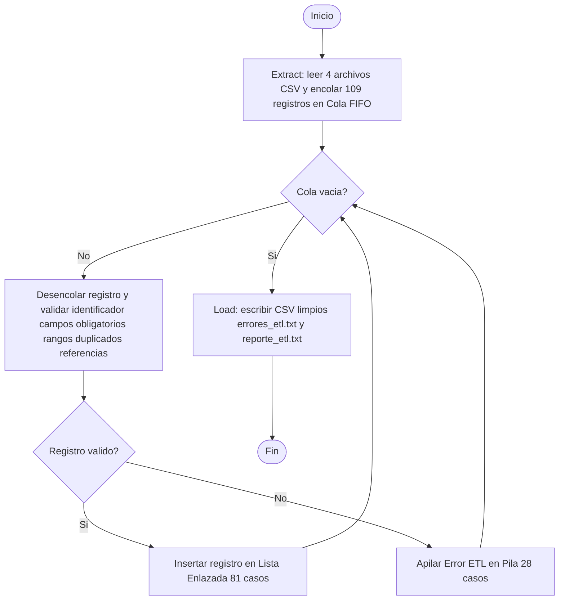
````

---

## Flujograma: Cola (encolar y desencolar)
- Fecha: 2026-11-24 10:39:04
- Proveedor: Gemini
- Modelo: gemini-3.5-flash-lite
- Estado: OK (Gemini, modelo gemini-3.5-flash-lite)

**Instrucción de sistema:**

```text
Eres un asistente que convierte descripciones de algoritmos en diagramas Mermaid. Responde UNICAMENTE con un bloque de codigo mermaid que comience con 'flowchart TD'. Reglas: los ids de nodo son alfanumericos sin espacios; todo el texto de cada nodo va entre comillas dobles; usa ["..."] para procesos, {"..."} para decisiones y (["..."]) para inicio y fin; las etiquetas de flechas se escriben -->|"texto"|; no uses parentesis ni corchetes dentro del texto; no agregues explicaciones fuera del bloque.
```

**Prompt enviado:**

```text
Genera un flujograma Mermaid (flowchart TD) del proceso: Cola (encolar y desencolar).

Descripcion estructurada generada por el programa (datos reales de la ejecucion):
Cola FIFO con nodos enlazados y referencias frente y fin.
encolar(x): crear nodo; si la cola esta vacia frente y fin apuntan al nodo; si no fin.siguiente = nodo y fin = nodo.
desencolar(): si esta vacia devolver null; guardar dato de frente; frente = frente.siguiente; si frente queda null entonces fin = null.

El diagrama debe reflejar fielmente estos pasos, con inicio, fin, decisiones y bucles cuando correspondan.
```

**Respuesta recibida:**

````text
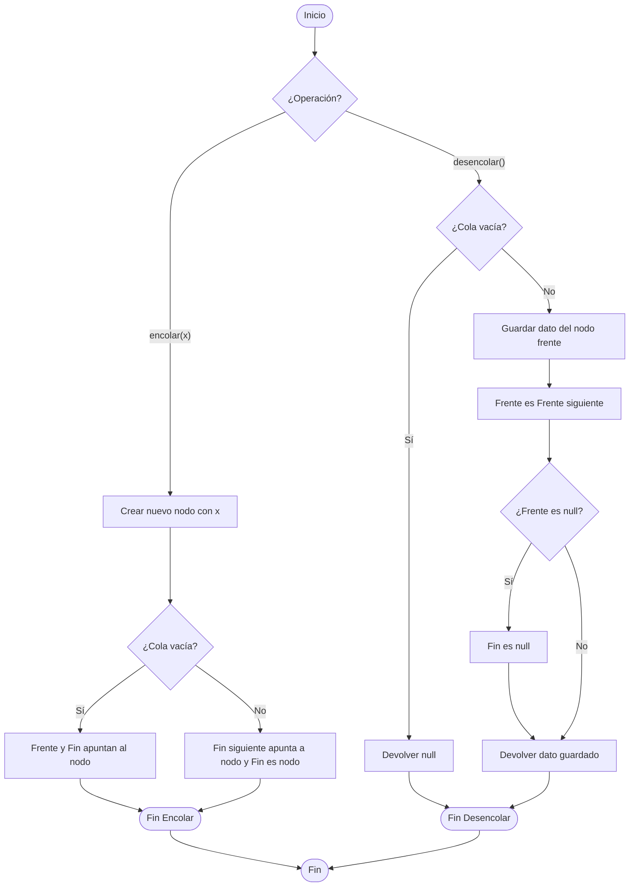
````

---

## Flujograma: ETL completo
- Fecha: 2026-11-24 10:39:17
- Proveedor: Gemini
- Modelo: gemini-3.5-flash-lite
- Estado: OK (Gemini, modelo gemini-3.5-flash-lite)

**Instrucción de sistema:**

```text
Eres un asistente que convierte descripciones de algoritmos en diagramas Mermaid. Responde UNICAMENTE con un bloque de codigo mermaid que comience con 'flowchart TD'. Reglas: los ids de nodo son alfanumericos sin espacios; todo el texto de cada nodo va entre comillas dobles; usa ["..."] para procesos, {"..."} para decisiones y (["..."]) para inicio y fin; las etiquetas de flechas se escriben -->|"texto"|; no uses parentesis ni corchetes dentro del texto; no agregues explicaciones fuera del bloque.
```

**Prompt enviado:**

```text
Genera un flujograma Mermaid (flowchart TD) del proceso: ETL completo.

Descripcion estructurada generada por el programa (datos reales de la ejecucion):
Proceso ETL ejecutado con datos reales:
1. Extract: se leyeron 4 archivos CSV y se encolaron 109 registros en una Cola (FIFO).
2. Transform: mientras la cola no este vacia se desencola un registro y se valida (identificador, campos obligatorios, rangos, duplicados, referencias).
3. Si el registro es valido (81 casos) se inserta en una ListaEnlazada; si no (28 casos) se apila un ErrorETL en una Pila.
4. Load: al vaciarse la cola se escriben los CSV limpios, errores_etl.txt y reporte_etl.txt.
Errores por tipo: ID_INVALIDO=4 DATO_INCOMPLETO=5 FORMATO_INVALIDO=5 RANGO_INVALIDO=5 DUPLICADO=5 REFERENCIA_INVALIDA=4 


El diagrama debe reflejar fielmente estos pasos, con inicio, fin, decisiones y bucles cuando correspondan.
```

**Respuesta recibida:**

````text
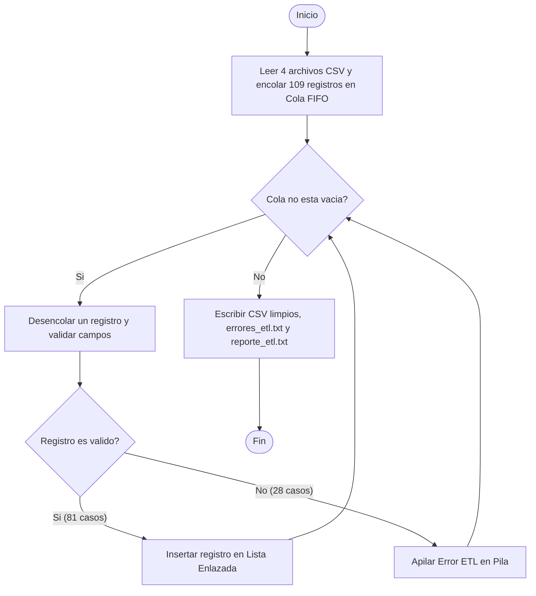
````

---

## Flujograma: BST (comparación de claves)
- Fecha: 2026-11-24 10:39:43
- Proveedor: Gemini
- Modelo: gemini-3.5-flash-lite
- Estado: OK (Gemini, modelo gemini-3.5-flash-lite)

**Instrucción de sistema:**

```text
Eres un asistente que convierte descripciones de algoritmos en diagramas Mermaid. Responde UNICAMENTE con un bloque de codigo mermaid que comience con 'flowchart TD'. Reglas: los ids de nodo son alfanumericos sin espacios; todo el texto de cada nodo va entre comillas dobles; usa ["..."] para procesos, {"..."} para decisiones y (["..."]) para inicio y fin; las etiquetas de flechas se escriben -->|"texto"|; no uses parentesis ni corchetes dentro del texto; no agregues explicaciones fuera del bloque.
```

**Prompt enviado:**

```text
Genera un flujograma Mermaid (flowchart TD) del proceso: BST (comparación de claves).

Descripcion estructurada generada por el programa (datos reales de la ejecucion):
Operacion real sobre un BST de 22 nodos y altura 8. Cada paso compara la clave con el nodo actual:
1. 1801000022 > 1801000007: ir a la derecha
2. 1801000022 > 1801000009: ir a la derecha
3. 1801000022 > 1801000018: ir a la derecha
4. 1801000022 = 1801000022: encontrado


El diagrama debe reflejar fielmente estos pasos, con inicio, fin, decisiones y bucles cuando correspondan.
```

**Respuesta recibida:**

````text
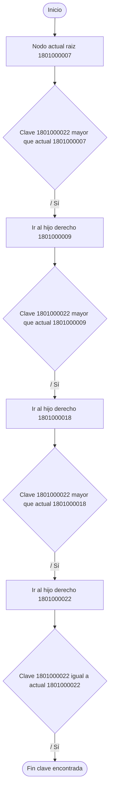
````

---

## Flujograma: ETL completo
- Fecha: 2026-11-24 10:41:58
- Proveedor: Gemini
- Modelo: gemini-3.5-flash-lite
- Estado: OK (Gemini, modelo gemini-3.5-flash-lite)

**Instrucción de sistema:**

```text
Eres un asistente que convierte descripciones de algoritmos en diagramas Mermaid. Responde UNICAMENTE con un bloque de codigo mermaid que comience con 'flowchart TD'. Reglas: los ids de nodo son alfanumericos sin espacios; todo el texto de cada nodo va entre comillas dobles; usa ["..."] para procesos, {"..."} para decisiones y (["..."]) para inicio y fin; las etiquetas de flechas se escriben -->|"texto"|; no uses parentesis ni corchetes dentro del texto; no agregues explicaciones fuera del bloque.
```

**Prompt enviado:**

```text
Genera un flujograma Mermaid (flowchart TD) del proceso: ETL completo.

Descripcion estructurada generada por el programa (datos reales de la ejecucion):
Proceso ETL ejecutado con datos reales:
1. Extract: se leyeron 4 archivos CSV y se encolaron 109 registros en una Cola (FIFO).
2. Transform: mientras la cola no este vacia se desencola un registro y se valida (identificador, campos obligatorios, rangos, duplicados, referencias).
3. Si el registro es valido (81 casos) se inserta en una ListaEnlazada; si no (28 casos) se apila un ErrorETL en una Pila.
4. Load: al vaciarse la cola se escriben los CSV limpios, errores_etl.txt y reporte_etl.txt.
Errores por tipo: ID_INVALIDO=4 DATO_INCOMPLETO=5 FORMATO_INVALIDO=5 RANGO_INVALIDO=5 DUPLICADO=5 REFERENCIA_INVALIDA=4 


El diagrama debe reflejar fielmente estos pasos, con inicio, fin, decisiones y bucles cuando correspondan.
```

**Respuesta recibida:**

````text
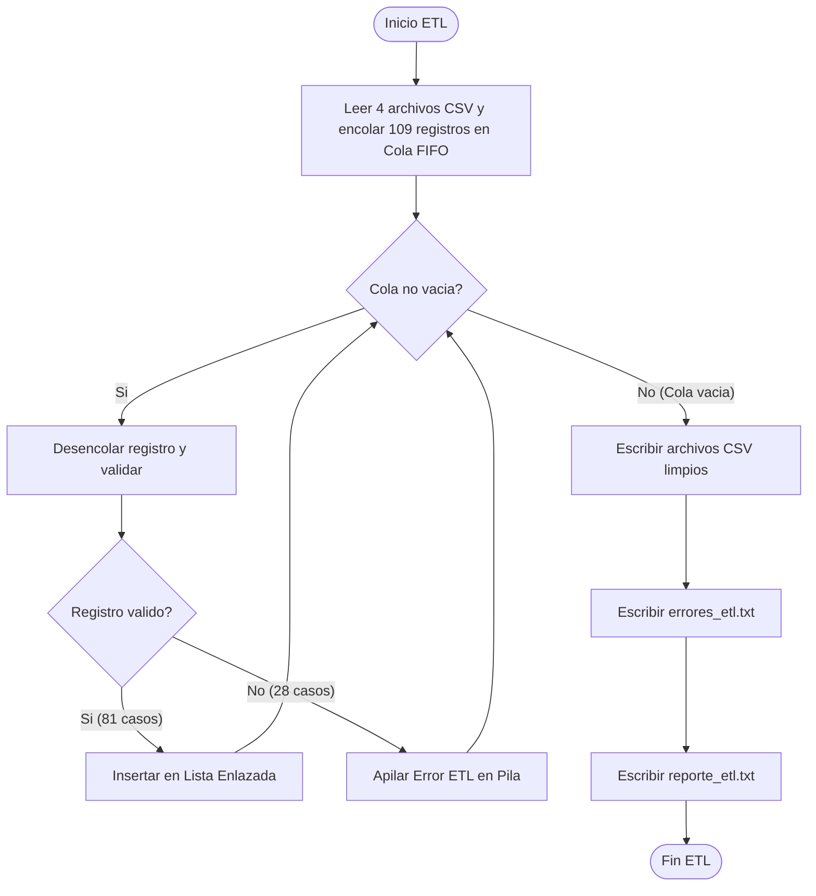
````

---

## Flujograma: Cola (encolar y desencolar)
- Fecha: 2026-11-24 10:42:06
- Proveedor: Gemini
- Modelo: gemini-3.5-flash-lite
- Estado: OK (Gemini, modelo gemini-3.5-flash-lite)

**Instrucción de sistema:**

```text
Eres un asistente que convierte descripciones de algoritmos en diagramas Mermaid. Responde UNICAMENTE con un bloque de codigo mermaid que comience con 'flowchart TD'. Reglas: los ids de nodo son alfanumericos sin espacios; todo el texto de cada nodo va entre comillas dobles; usa ["..."] para procesos, {"..."} para decisiones y (["..."]) para inicio y fin; las etiquetas de flechas se escriben -->|"texto"|; no uses parentesis ni corchetes dentro del texto; no agregues explicaciones fuera del bloque.
```

**Prompt enviado:**

```text
Genera un flujograma Mermaid (flowchart TD) del proceso: Cola (encolar y desencolar).

Descripcion estructurada generada por el programa (datos reales de la ejecucion):
Cola FIFO con nodos enlazados y referencias frente y fin.
encolar(x): crear nodo; si la cola esta vacia frente y fin apuntan al nodo; si no fin.siguiente = nodo y fin = nodo.
desencolar(): si esta vacia devolver null; guardar dato de frente; frente = frente.siguiente; si frente queda null entonces fin = null.

El diagrama debe reflejar fielmente estos pasos, con inicio, fin, decisiones y bucles cuando correspondan.
```

**Respuesta recibida:**

````text
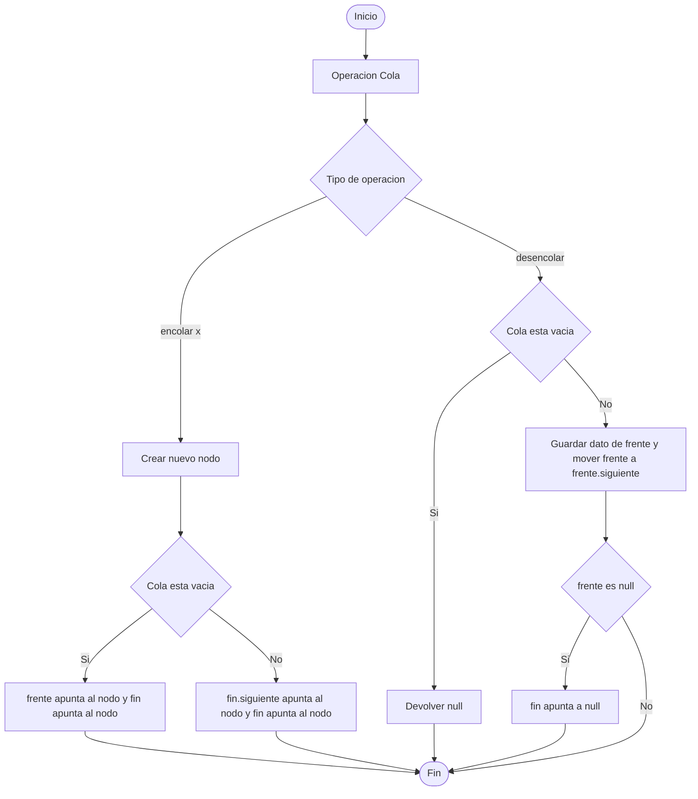
````

---

## Flujograma: Grafo + BFS
- Fecha: 2026-11-24 10:44:30
- Proveedor: Gemini
- Modelo: gemini-3.5-flash-lite
- Estado: OK (Gemini, modelo gemini-3.5-flash-lite)

**Instrucción de sistema:**

```text
Eres un asistente que convierte descripciones de algoritmos en diagramas Mermaid. Responde UNICAMENTE con un bloque de codigo mermaid que comience con 'flowchart TD'. Reglas: los ids de nodo son alfanumericos sin espacios; todo el texto de cada nodo va entre comillas dobles; usa ["..."] para procesos, {"..."} para decisiones y (["..."]) para inicio y fin; las etiquetas de flechas se escriben -->|"texto"|; no uses parentesis ni corchetes dentro del texto; no agregues explicaciones fuera del bloque.
```

**Prompt enviado:**

```text
Genera un flujograma Mermaid (flowchart TD) del proceso: Grafo + BFS.

Descripcion estructurada generada por el programa (datos reales de la ejecucion):
Recorrido BFS real sobre el grafo de prerrequisitos usando una cola. Eventos registrados en orden (con el contenido de la cola tras cada paso):
INICIO: BFS desde SIS101
ENCOLAR: SIS101 | cola=[frente: SIS101 :final]
DESENCOLAR: SIS101 | cola=[frente:  :final]
ENCOLAR: SIS102 | cola=[frente: SIS102 :final]
DESENCOLAR: SIS102 | cola=[frente:  :final]
ENCOLAR: SIS201 | cola=[frente: SIS201 :final]
ENCOLAR: SIS302 | cola=[frente: SIS201, SIS302 :final]
DESENCOLAR: SIS201 | cola=[frente: SIS302 :final]
ENCOLAR: SIS202 | cola=[frente: SIS302, SIS202 :final]
ENCOLAR: SIS203 | cola=[frente: SIS302, SIS202, SIS203 :final]
DESENCOLAR: SIS302 | cola=[frente: SIS202, SIS203 :final]
DESENCOLAR: SIS202 | cola=[frente: SIS203 :final]
ENCOLAR: SIS301 | cola=[frente: SIS203, SIS301 :final]
DESENCOLAR: SIS203 | cola=[frente: SIS301 :final]
ENCOLAR: SIS303 | cola=[frente: SIS301, SIS303 :final]
DESENCOLAR: SIS301 | cola=[frente: SIS303 :final]
DESENCOLAR: SIS303 | cola=[frente:  :final]
FIN: cola vacía; vértices visitados: 8


El diagrama debe reflejar fielmente estos pasos, con inicio, fin, decisiones y bucles cuando correspondan.
```

**Respuesta recibida:**

````text
```flowchart TD
start(["INICIO: BFS desde SIS101"]) --> q1["ENCOLAR: SIS101"]
q1 --> dq1["DESENCOLAR: SIS101"]
dq1 --> q2["ENCOLAR: SIS102"]
q2 --> dq2["DESENCOLAR: SIS102"]
dq2 --> q3["ENCOLAR: SIS201 y SIS302"]
q3 --> dq3["DESENCOLAR: SIS201"]
dq3 --> q4["ENCOLAR: SIS202 y SIS203"]
q4 --> dq4["DESENCOLAR: SIS302"]
dq4 --> dq5["DESENCOLAR: SIS202"]
dq5 --> q5["ENCOLAR: SIS301"]
q5 --> dq6["DESENCOLAR: SIS203"]
dq6 --> q6["ENCOLAR: SIS303"]
q6 --> dq7["DESENCOLAR: SIS301"]
dq7 --> dq8["DESENCOLAR: SIS303"]
dq8 --> fin(["FIN: cola vacia, 8 vertices visitados"])
```
````

---

## Flujograma: ETL completo
- Fecha: 2026-11-24 10:45:56
- Proveedor: Gemini
- Modelo: gemini-3.5-flash-lite
- Estado: OK (Gemini, modelo gemini-3.5-flash-lite)

**Instrucción de sistema:**

```text
Eres un asistente que convierte descripciones de algoritmos en diagramas Mermaid. Responde UNICAMENTE con un bloque de codigo mermaid que comience con 'flowchart TD'. Reglas: los ids de nodo son alfanumericos sin espacios; todo el texto de cada nodo va entre comillas dobles; usa ["..."] para procesos, {"..."} para decisiones y (["..."]) para inicio y fin; las etiquetas de flechas se escriben -->|"texto"|; no uses parentesis ni corchetes dentro del texto; no agregues explicaciones fuera del bloque.
```

**Prompt enviado:**

```text
Genera un flujograma Mermaid (flowchart TD) del proceso: ETL completo.

Descripcion estructurada generada por el programa (datos reales de la ejecucion):
Proceso ETL ejecutado con datos reales:
1. Extract: se leyeron 4 archivos CSV y se encolaron 109 registros en una Cola (FIFO).
2. Transform: mientras la cola no este vacia se desencola un registro y se valida (identificador, campos obligatorios, rangos, duplicados, referencias).
3. Si el registro es valido (81 casos) se inserta en una ListaEnlazada; si no (28 casos) se apila un ErrorETL en una Pila.
4. Load: al vaciarse la cola se escriben los CSV limpios, errores_etl.txt y reporte_etl.txt.
Errores por tipo: ID_INVALIDO=4 DATO_INCOMPLETO=5 FORMATO_INVALIDO=5 RANGO_INVALIDO=5 DUPLICADO=5 REFERENCIA_INVALIDA=4 


El diagrama debe reflejar fielmente estos pasos, con inicio, fin, decisiones y bucles cuando correspondan.
```

**Respuesta recibida:**

````text
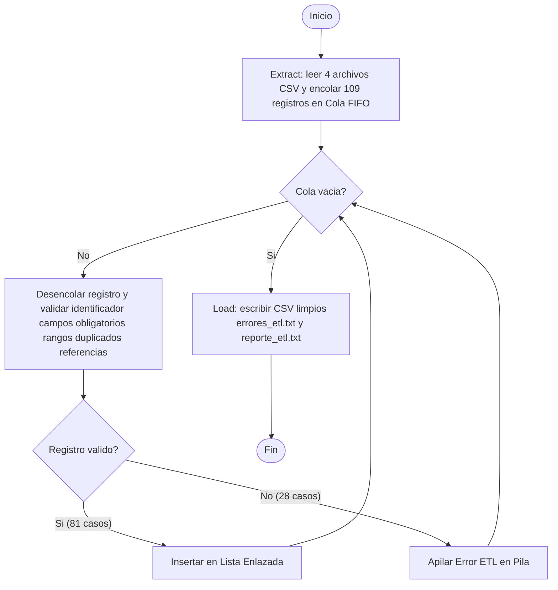
````

---

## Flujograma: BST (comparación de claves)
- Fecha: 2026-11-24 10:46:01
- Proveedor: Gemini
- Modelo: gemini-3.5-flash-lite
- Estado: OK (Gemini, modelo gemini-3.5-flash-lite)

**Instrucción de sistema:**

```text
Eres un asistente que convierte descripciones de algoritmos en diagramas Mermaid. Responde UNICAMENTE con un bloque de codigo mermaid que comience con 'flowchart TD'. Reglas: los ids de nodo son alfanumericos sin espacios; todo el texto de cada nodo va entre comillas dobles; usa ["..."] para procesos, {"..."} para decisiones y (["..."]) para inicio y fin; las etiquetas de flechas se escriben -->|"texto"|; no uses parentesis ni corchetes dentro del texto; no agregues explicaciones fuera del bloque.
```

**Prompt enviado:**

```text
Genera un flujograma Mermaid (flowchart TD) del proceso: BST (comparación de claves).

Descripcion estructurada generada por el programa (datos reales de la ejecucion):
Operacion real sobre un BST de 22 nodos y altura 8. Cada paso compara la clave con el nodo actual:
1. 1801000022 > 1801000007: ir a la derecha
2. 1801000022 > 1801000009: ir a la derecha
3. 1801000022 > 1801000018: ir a la derecha
4. 1801000022 = 1801000022: encontrado


El diagrama debe reflejar fielmente estos pasos, con inicio, fin, decisiones y bucles cuando correspondan.
```

**Respuesta recibida:**

````text
```mermaid
flowchart TD
    Inicio(["Inicio"]) --> NodoActual["Examinar nodo actual 1801000007"]
    NodoActual --> Comp1{"Clave > Nodo actual"}
    Comp1 -->|"Sí"| Derecha1["Ir al hijo derecho"]
    Derecha1 --> Nodo2["Examinar nodo actual 1801000009"]
    Nodo2 --> Comp2{"Clave > Nodo actual"}
    Comp2 -->|"Sí"| Derecha2["Ir al hijo derecho"]
    Derecha2 --> Nodo3["Examinar nodo actual 1801000018"]
    Nodo3 --> Comp3{"Clave > Nodo actual"}
    Comp3 -->|"Sí"| Derecha3["Ir al hijo derecho"]
    Derecha3 --> Nodo4["Examinar nodo actual 1801000022"]
    Nodo4 --> Comp4{"Clave = Nodo actual"}
    Comp4 -->|"Sí"| Fin(["Encontrado y Fin"])
```
````

---

## Flujograma: Grafo + BFS
- Fecha: 2026-11-24 10:47:29
- Proveedor: Gemini
- Modelo: gemini-3.5-flash-lite
- Estado: OK (Gemini, modelo gemini-3.5-flash-lite)

**Instrucción de sistema:**

```text
Eres un asistente que convierte descripciones de algoritmos en diagramas Mermaid. Responde UNICAMENTE con un bloque de codigo mermaid que comience con 'flowchart TD'. Reglas: los ids de nodo son alfanumericos sin espacios; todo el texto de cada nodo va entre comillas dobles; usa ["..."] para procesos, {"..."} para decisiones y (["..."]) para inicio y fin; las etiquetas de flechas se escriben -->|"texto"|; no uses parentesis ni corchetes dentro del texto; no agregues explicaciones fuera del bloque.
```

**Prompt enviado:**

```text
Genera un flujograma Mermaid (flowchart TD) del proceso: Grafo + BFS.

Descripcion estructurada generada por el programa (datos reales de la ejecucion):
Recorrido BFS real sobre el grafo de prerrequisitos usando una cola. Eventos registrados en orden (con el contenido de la cola tras cada paso):
INICIO: BFS desde SIS101
ENCOLAR: SIS101 | cola=[frente: SIS101 :final]
DESENCOLAR: SIS101 | cola=[frente:  :final]
ENCOLAR: SIS102 | cola=[frente: SIS102 :final]
DESENCOLAR: SIS102 | cola=[frente:  :final]
ENCOLAR: SIS201 | cola=[frente: SIS201 :final]
ENCOLAR: SIS302 | cola=[frente: SIS201, SIS302 :final]
DESENCOLAR: SIS201 | cola=[frente: SIS302 :final]
ENCOLAR: SIS202 | cola=[frente: SIS302, SIS202 :final]
ENCOLAR: SIS203 | cola=[frente: SIS302, SIS202, SIS203 :final]
DESENCOLAR: SIS302 | cola=[frente: SIS202, SIS203 :final]
DESENCOLAR: SIS202 | cola=[frente: SIS203 :final]
ENCOLAR: SIS301 | cola=[frente: SIS203, SIS301 :final]
DESENCOLAR: SIS203 | cola=[frente: SIS301 :final]
ENCOLAR: SIS303 | cola=[frente: SIS301, SIS303 :final]
DESENCOLAR: SIS301 | cola=[frente: SIS303 :final]
DESENCOLAR: SIS303 | cola=[frente:  :final]
FIN: cola vacía; vértices visitados: 8


El diagrama debe reflejar fielmente estos pasos, con inicio, fin, decisiones y bucles cuando correspondan.
```

**Respuesta recibida:**

````text
```flowchart TD
start(["INICIO: BFS desde SIS101"]) --> q1["ENCOLAR: SIS101 | cola=[SIS101]"]
q1 --> dq1["DESENCOLAR: SIS101 | cola=[]"]
dq1 --> q2["ENCOLAR: SIS102 | cola=[SIS102]"]
q2 --> dq2["DESENCOLAR: SIS102 | cola=[]"]
dq2 --> q3["ENCOLAR: SIS201 | cola=[SIS201]"]
q3 --> q4["ENCOLAR: SIS302 | cola=[SIS201, SIS302]"]
q4 --> dq3["DESENCOLAR: SIS201 | cola=[SIS302]"]
dq3 --> q5["ENCOLAR: SIS202 | cola=[SIS302, SIS202]"]
q5 --> q6["ENCOLAR: SIS203 | cola=[SIS302, SIS202, SIS203]"]
q6 --> dq4["DESENCOLAR: SIS302 | cola=[SIS202, SIS203]"]
dq4 --> dq5["DESENCOLAR: SIS202 | cola=[SIS203]"]
dq5 --> q7["ENCOLAR: SIS301 | cola=[SIS203, SIS301]"]
q7 --> dq6["DESENCOLAR: SIS203 | cola=[SIS301]"]
dq6 --> q8["ENCOLAR: SIS303 | cola=[SIS301, SIS303]"]
q8 --> dq7["DESENCOLAR: SIS301 | cola=[SIS303]"]
dq7 --> dq8["DESENCOLAR: SIS303 | cola=[]"]
dq8 --> fin(["FIN: cola vacia vertices visitados 8"])
```
````

---

## Flujograma: Grafo + DFS
- Fecha: 2026-11-24 10:47:30
- Proveedor: Gemini
- Modelo: gemini-3.5-flash-lite
- Estado: OK (Gemini, modelo gemini-3.5-flash-lite)

**Instrucción de sistema:**

```text
Eres un asistente que convierte descripciones de algoritmos en diagramas Mermaid. Responde UNICAMENTE con un bloque de codigo mermaid que comience con 'flowchart TD'. Reglas: los ids de nodo son alfanumericos sin espacios; todo el texto de cada nodo va entre comillas dobles; usa ["..."] para procesos, {"..."} para decisiones y (["..."]) para inicio y fin; las etiquetas de flechas se escriben -->|"texto"|; no uses parentesis ni corchetes dentro del texto; no agregues explicaciones fuera del bloque.
```

**Prompt enviado:**

```text
Genera un flujograma Mermaid (flowchart TD) del proceso: Grafo + DFS.

Descripcion estructurada generada por el programa (datos reales de la ejecucion):
Recorrido DFS real sobre el grafo de prerrequisitos usando una pila. Eventos registrados en orden (con el contenido de la pila tras cada paso):
INICIO: DFS desde SIS101
APILAR: SIS101 | pila=[cima: SIS101]
VISITAR: SIS101 | pila=[cima: ]
APILAR: SIS102 | pila=[cima: SIS102]
VISITAR: SIS102 | pila=[cima: ]
APILAR: SIS302 | pila=[cima: SIS302]
APILAR: SIS201 | pila=[cima: SIS201 | SIS302]
VISITAR: SIS201 | pila=[cima: SIS302]
APILAR: SIS203 | pila=[cima: SIS203 | SIS302]
APILAR: SIS202 | pila=[cima: SIS202 | SIS203 | SIS302]
VISITAR: SIS202 | pila=[cima: SIS203 | SIS302]
APILAR: SIS301 | pila=[cima: SIS301 | SIS203 | SIS302]
VISITAR: SIS301 | pila=[cima: SIS203 | SIS302]
VISITAR: SIS203 | pila=[cima: SIS302]
APILAR: SIS303 | pila=[cima: SIS303 | SIS302]
VISITAR: SIS303 | pila=[cima: SIS302]
VISITAR: SIS302 | pila=[cima: ]
FIN: pila vacía; vértices visitados: 8


El diagrama debe reflejar fielmente estos pasos, con inicio, fin, decisiones y bucles cuando correspondan.
```

**Respuesta recibida:**

````text
```mermaid
flowchart TD
    Inicio(["INICIO: DFS desde SIS101"]) --> Apilar1["APILAR: SIS101"]
    Apilar1 --> Visitar1["VISITAR: SIS101"]
    Visitar1 --> Apilar2["APILAR: SIS102"]
    Apilar2 --> Visitar2["VISITAR: SIS102"]
    Visitar2 --> Apilar3["APILAR: SIS302"]
    Apilar3 --> Apilar4["APILAR: SIS201"]
    Apilar4 --> Visitar4["VISITAR: SIS201"]
    Visitar4 --> Apilar5["APILAR: SIS203"]
    Apilar5 --> Apilar6["APILAR: SIS202"]
    Apilar6 --> Visitar6["VISITAR: SIS202"]
    Visitar6 --> Apilar7["APILAR: SIS301"]
    Apilar7 --> Visitar7["VISITAR: SIS301"]
    Visitar7 --> Visitar5["VISITAR: SIS203"]
    Visitar5 --> Apilar8["APILAR: SIS303"]
    Apilar8 --> Visitar8["VISITAR: SIS303"]
    Visitar8 --> Visitar3["VISITAR: SIS302"]
    Visitar3 --> Fin(["FIN: pila vacia vertices visitados 8"])
```
````

---

## Documentación del sistema
- Fecha: 2026-11-24 10:48:38
- Proveedor: Gemini
- Modelo: gemini-3.5-flash-lite
- Estado: Error HTTP 503: {
  "error": {
    "code": 503,
    "message": "This model is currently experiencing high demand. Spikes in demand are usually temporary. Please try again later.",
    "status": "UNAVAILABLE"
  }
}


**Instrucción de sistema:**

```text
Eres un profesor de Estructuras de Datos de ingenieria de software. Explica en espanol, con tono tecnico pero claro, refiriendote a los nodos, claves y valores CONCRETOS que recibes, no a definiciones genericas. Maximo 250 palabras. No inventes datos que no esten en la entrada.
```

**Prompt enviado:**

```text
Redacta en espanol la documentacion tecnica breve (formato Markdown, maximo 400 palabras) del siguiente sistema, con las secciones: Proposito, Flujo de datos, Estructuras utilizadas y por que, Resultados de la ejecucion.

Registros procesados: 109 | válidos: 81 | inválidos: 28
Estudiantes válidos: 22 | Asignaturas: 12 | Matrículas: 34 | Prerrequisitos: 13
BST: 22 nodos, altura 8
Grafo: 12 vértices, 13 aristas
SIS201 -> SIS202 -> SIS301 -> SIS201
Total de registros procesados: 109
Registros válidos: 81
Total de errores: 28
Identificador incorrecto: 4
Datos incompletos: 5
Formato incorrecto: 5
Valor fuera de rango: 5
Registro duplicado: 5
Referencia inexistente / relación inconsistente: 4
Errores en estudiantes.csv: 12 de 34
Errores en asignaturas.csv: 5 de 17
Errores en matriculas.csv: 7 de 41
Errores en prerrequisitos.csv: 4 de 17

```

**Respuesta recibida:**

_(sin respuesta de la IA)_

---

## Flujograma: ETL completo
- Fecha: 2026-11-24 11:44:01
- Proveedor: Gemini
- Modelo: gemini-3.5-flash-lite
- Estado: OK (Gemini, modelo gemini-3.5-flash-lite)

**Instrucción de sistema:**

```text
Eres un asistente que convierte descripciones de algoritmos en diagramas Mermaid. Responde UNICAMENTE con un bloque de codigo mermaid que comience con 'flowchart TD'. Reglas: los ids de nodo son alfanumericos sin espacios; todo el texto de cada nodo va entre comillas dobles; usa ["..."] para procesos, {"..."} para decisiones y (["..."]) para inicio y fin; las etiquetas de flechas se escriben -->|"texto"|; no uses parentesis ni corchetes dentro del texto; no agregues explicaciones fuera del bloque.
```

**Prompt enviado:**

```text
Genera un flujograma Mermaid (flowchart TD) del proceso: ETL completo.

Descripcion estructurada generada por el programa (datos reales de la ejecucion):
Proceso ETL ejecutado con datos reales:
1. Extract: se leyeron 4 archivos CSV y se encolaron 109 registros en una Cola (FIFO).
2. Transform: mientras la cola no este vacia se desencola un registro y se valida.
3. Si el registro es valido (81 casos) se inserta en una ListaEnlazada; si no (28 casos) se apila un error.
4. Load: al vaciarse la cola se escriben los CSV limpios, errores_etl.txt y reporte_etl.txt.
Errores por tipo: ID_INVALIDO=4 DATO_INCOMPLETO=5 FORMATO_INVALIDO=5 RANGO_INVALIDO=5 DUPLICADO=5 REFERENCIA_INVALIDA=4 


El diagrama debe reflejar fielmente estos pasos, con inicio, fin, decisiones y bucles cuando correspondan.
```

**Respuesta recibida:**

````text
```mermaid
flowchart TD
    Inicio(["Inicio ETL"]) --> Paso1["Leer 4 archivos CSV y encolar 109 registros en Cola FIFO"]
    Paso1 --> DecisionCola{"Cola vacia"}
    DecisionCola -->|"No"| Paso2["Desencolar registro y validar"]
    Paso2 --> DecisionValido{"Registro valido"}
    DecisionValido -->|"Si"| Paso3["Insertar en Lista Enlazada"]
    DecisionValido -->|"No"| Paso4["Apilar error"]
    Paso3 --> DecisionCola
    Paso4 --> DecisionCola
    DecisionCola -->|"Si"| Paso5["Escribir CSV limpios errores_etl.txt y reporte_etl.txt"]
    Paso5 --> Fin(["Fin ETL"])
```
````

---

## Flujograma: BST (comparación de claves)
- Fecha: 2026-11-24 11:44:05
- Proveedor: Gemini
- Modelo: gemini-3.5-flash-lite
- Estado: OK (Gemini, modelo gemini-3.5-flash-lite)

**Instrucción de sistema:**

```text
Eres un asistente que convierte descripciones de algoritmos en diagramas Mermaid. Responde UNICAMENTE con un bloque de codigo mermaid que comience con 'flowchart TD'. Reglas: los ids de nodo son alfanumericos sin espacios; todo el texto de cada nodo va entre comillas dobles; usa ["..."] para procesos, {"..."} para decisiones y (["..."]) para inicio y fin; las etiquetas de flechas se escriben -->|"texto"|; no uses parentesis ni corchetes dentro del texto; no agregues explicaciones fuera del bloque.
```

**Prompt enviado:**

```text
Genera un flujograma Mermaid (flowchart TD) del proceso: BST (comparación de claves).

Descripcion estructurada generada por el programa (datos reales de la ejecucion):
Operacion real sobre un BST de 22 nodos y altura 8. Cada paso compara la clave con el nodo actual:
1. 1801000022 ) 1801000007: ir a la derecha
2. 1801000022 ) 1801000009: ir a la derecha
3. 1801000022 ) 1801000018: ir a la derecha
4. 1801000022 = 1801000022: encontrado


El diagrama debe reflejar fielmente estos pasos, con inicio, fin, decisiones y bucles cuando correspondan.
```

**Respuesta recibida:**

````text
```mermaid
flowchart TD
    Inicio(["Inicio"]) --> NodoActual["Examinar nodo 1801000007"]
    NodoActual --> Decision1{"Comparar clave 1801000022 con 1801000007"}
    Decision1 -->|"> mayor"| Derecha1["Ir a la derecha"]
    Derecha1 --> Nodo2["Examinar nodo 1801000009"]
    Nodo2 --> Decision2{"Comparar clave 1801000022 con 1801000009"}
    Decision2 -->|"> mayor"| Derecha2["Ir a la derecha"]
    Derecha2 --> Nodo3["Examinar nodo 1801000018"]
    Nodo3 --> Decision3{"Comparar clave 1801000022 con 1801000018"}
    Decision3 -->|"> mayor"| Derecha3["Ir a la derecha"]
    Derecha3 --> Nodo4["Examinar nodo 1801000022"]
    Nodo4 --> Decision4{"Comparar clave 1801000022 con 1801000022"}
    Decision4 -->|"= igual"| Encontrado["Clave encontrada"]
    Encontrado --> Fin(["Fin"])
```
````

---

## Flujograma: Grafo + BFS
- Fecha: 2026-11-24 11:44:08
- Proveedor: Gemini
- Modelo: gemini-3.5-flash-lite
- Estado: OK (Gemini, modelo gemini-3.5-flash-lite)

**Instrucción de sistema:**

```text
Eres un asistente que convierte descripciones de algoritmos en diagramas Mermaid. Responde UNICAMENTE con un bloque de codigo mermaid que comience con 'flowchart TD'. Reglas: los ids de nodo son alfanumericos sin espacios; todo el texto de cada nodo va entre comillas dobles; usa ["..."] para procesos, {"..."} para decisiones y (["..."]) para inicio y fin; las etiquetas de flechas se escriben -->|"texto"|; no uses parentesis ni corchetes dentro del texto; no agregues explicaciones fuera del bloque.
```

**Prompt enviado:**

```text
Genera un flujograma Mermaid (flowchart TD) del proceso: Grafo + BFS.

Descripcion estructurada generada por el programa (datos reales de la ejecucion):
Recorrido BFS sobre el grafo de prerrequisitos usando una cola. Eventos registrados en orden:
INICIO: BFS desde SIS101
ENCOLAR: SIS101 | cola=[frente: SIS101 :final]
DESENCOLAR: SIS101 | cola=[frente:  :final]
ENCOLAR: SIS102 | cola=[frente: SIS102 :final]
DESENCOLAR: SIS102 | cola=[frente:  :final]
ENCOLAR: SIS201 | cola=[frente: SIS201 :final]
ENCOLAR: SIS302 | cola=[frente: SIS201, SIS302 :final]
DESENCOLAR: SIS201 | cola=[frente: SIS302 :final]
ENCOLAR: SIS202 | cola=[frente: SIS302, SIS202 :final]
ENCOLAR: SIS203 | cola=[frente: SIS302, SIS202, SIS203 :final]
DESENCOLAR: SIS302 | cola=[frente: SIS202, SIS203 :final]
DESENCOLAR: SIS202 | cola=[frente: SIS203 :final]
ENCOLAR: SIS301 | cola=[frente: SIS203, SIS301 :final]
DESENCOLAR: SIS203 | cola=[frente: SIS301 :final]
ENCOLAR: SIS303 | cola=[frente: SIS301, SIS303 :final]
DESENCOLAR: SIS301 | cola=[frente: SIS303 :final]
DESENCOLAR: SIS303 | cola=[frente:  :final]
FIN: cola vacía; vértices visitados: 8


El diagrama debe reflejar fielmente estos pasos, con inicio, fin, decisiones y bucles cuando correspondan.
```

**Respuesta recibida:**

````text
```mermaid
flowchart TD
    Inicio(["INICIO: BFS desde SIS101"]) --> E1["ENCOLAR: SIS101"]
    E1 --> D1["DESENCOLAR: SIS101"]
    D1 --> E2["ENCOLAR: SIS102"]
    E2 --> D2["DESENCOLAR: SIS102"]
    D2 --> E3["ENCOLAR: SIS201"]
    E3 --> E4["ENCOLAR: SIS302"]
    E4 --> D3["DESENCOLAR: SIS201"]
    D3 --> E5["ENCOLAR: SIS202"]
    E5 --> E6["ENCOLAR: SIS203"]
    E6 --> D4["DESENCOLAR: SIS302"]
    D4 --> D5["DESENCOLAR: SIS202"]
    D5 --> E7["ENCOLAR: SIS301"]
    E7 --> D6["DESENCOLAR: SIS203"]
    D6 --> E8["ENCOLAR: SIS303"]
    E8 --> D7["DESENCOLAR: SIS301"]
    D7 --> D8["DESENCOLAR: SIS303"]
    D8 --> Fin(["FIN: cola vacia vertices visitados 8"])
```
````

---

## Flujograma: Grafo + DFS
- Fecha: 2026-11-24 11:44:13
- Proveedor: Gemini
- Modelo: gemini-3.5-flash-lite
- Estado: OK (Gemini, modelo gemini-3.5-flash-lite)

**Instrucción de sistema:**

```text
Eres un asistente que convierte descripciones de algoritmos en diagramas Mermaid. Responde UNICAMENTE con un bloque de codigo mermaid que comience con 'flowchart TD'. Reglas: los ids de nodo son alfanumericos sin espacios; todo el texto de cada nodo va entre comillas dobles; usa ["..."] para procesos, {"..."} para decisiones y (["..."]) para inicio y fin; las etiquetas de flechas se escriben -->|"texto"|; no uses parentesis ni corchetes dentro del texto; no agregues explicaciones fuera del bloque.
```

**Prompt enviado:**

```text
Genera un flujograma Mermaid (flowchart TD) del proceso: Grafo + DFS.

Descripcion estructurada generada por el programa (datos reales de la ejecucion):
Recorrido DFS sobre el grafo de prerrequisitos usando una pila. Eventos registrados en orden:
INICIO: DFS desde SIS101
APILAR: SIS101 | pila=[cima: SIS101]
VISITAR: SIS101 | pila=[cima: ]
APILAR: SIS102 | pila=[cima: SIS102]
VISITAR: SIS102 | pila=[cima: ]
APILAR: SIS302 | pila=[cima: SIS302]
APILAR: SIS201 | pila=[cima: SIS201 | SIS302]
VISITAR: SIS201 | pila=[cima: SIS302]
APILAR: SIS203 | pila=[cima: SIS203 | SIS302]
APILAR: SIS202 | pila=[cima: SIS202 | SIS203 | SIS302]
VISITAR: SIS202 | pila=[cima: SIS203 | SIS302]
APILAR: SIS301 | pila=[cima: SIS301 | SIS203 | SIS302]
VISITAR: SIS301 | pila=[cima: SIS203 | SIS302]
VISITAR: SIS203 | pila=[cima: SIS302]
APILAR: SIS303 | pila=[cima: SIS303 | SIS302]
VISITAR: SIS303 | pila=[cima: SIS302]
VISITAR: SIS302 | pila=[cima: ]
FIN: pila vacía; vértices visitados: 8


El diagrama debe reflejar fielmente estos pasos, con inicio, fin, decisiones y bucles cuando correspondan.
```

**Respuesta recibida:**

````text
```flowchart TD
    Inicio(["INICIO: DFS desde SIS101"]) --> N1["APILAR: SIS101 | pila=cima: SIS101"]
    N1 --> N2["VISITAR: SIS101 | pila=cima: "]
    N2 --> N3["APILAR: SIS102 | pila=cima: SIS102"]
    N3 --> N4["VISITAR: SIS102 | pila=cima: "]
    N4 --> N5["APILAR: SIS302 | pila=cima: SIS302"]
    N5 --> N6["APILAR: SIS201 | pila=cima: SIS201 | SIS302"]
    N6 --> N7["VISITAR: SIS201 | pila=cima: SIS302"]
    N7 --> N8["APILAR: SIS203 | pila=cima: SIS203 | SIS302"]
    N8 --> N9["APILAR: SIS202 | pila=cima: SIS202 | SIS203 | SIS302"]
    N9 --> N10["VISITAR: SIS202 | pila=cima: SIS203 | SIS302"]
    N10 --> N11["APILAR: SIS301 | pila=cima: SIS301 | SIS203 | SIS302"]
    N11 --> N12["VISITAR: SIS301 | pila=cima: SIS203 | SIS302"]
    N12 --> N13["VISITAR: SIS203 | pila=cima: SIS302"]
    N13 --> N14["APILAR: SIS303 | pila=cima: SIS303 | SIS302"]
    N14 --> N15["VISITAR: SIS303 | pila=cima: SIS302"]
    N15 --> N16["VISITAR: SIS302 | pila=cima: "]
    N16 --> Fin(["FIN: pila vacia vertices visitados 8"])
```
````

---

## Documentación del sistema
- Fecha: 2026-11-24 11:44:17
- Proveedor: Gemini
- Modelo: gemini-3.5-flash-lite
- Estado: OK (Gemini, modelo gemini-3.5-flash-lite)

**Instrucción de sistema:**

```text
Eres un profesor de Estructuras de Datos de ingenieria de software. Explica en espanol, con tono tecnico pero claro, refiriendote a los nodos, claves y valores CONCRETOS que recibes, no a definiciones genericas. Maximo 250 palabras. No inventes datos que no esten en la entrada.
```

**Prompt enviado:**

```text
Redacta en espanol la documentacion tecnica breve (formato Markdown, maximo 400 palabras) del siguiente sistema, con las secciones: Proposito, Flujo de datos, Estructuras utilizadas y por que, Resultados de la ejecucion.

Registros procesados: 109 | válidos: 81 | inválidos: 28
Estudiantes válidos: 22 | Asignaturas: 12 | Matrículas: 34 | Prerrequisitos: 13
BST: 22 nodos, altura 8
Grafo: 12 vértices, 13 aristas
SIS201 -> SIS202 -> SIS301 -> SIS201
Total de registros procesados: 109
Registros válidos: 81
Total de errores: 28
Identificador incorrecto: 4
Datos incompletos: 5
Formato incorrecto: 5
Valor fuera de rango: 5
Registro duplicado: 5
Referencia inexistente / relación inconsistente: 4
Errores en estudiantes.csv: 12 de 34
Errores en asignaturas.csv: 5 de 17
Errores en matriculas.csv: 7 de 41
Errores en prerrequisitos.csv: 4 de 17

```

**Respuesta recibida:**

````text
### Propósito
Documentar el procesamiento de 109 registros del sistema académico, validando 81 e identificando 28 errores (4 identificadores incorrectos, 5 incompletos, 5 con formato incorrecto, 5 fuera de rango, 5 duplicados y 4 por referencia inexistente).

### Flujo de Datos
Los datos crudos ingresan y se depuran por archivo (`estudiantes.csv`: 12 errores; `asignaturas.csv`: 5; `matriculas.csv`: 7; `prerrequisitos.csv`: 4). Los registros limpios estructuran entidades y relaciones, detectando un ciclo crítico en las asignaturas: `SIS201 -> SIS202 -> SIS301 -> SIS201`.

### Estructuras Utilizadas y por qué
*   **BST (Árbol Binario de Búsqueda):** Contiene exactamente **22 nodos** (correspondientes a los 22 estudiantes válidos) con una altura de **8**. Se usa para mantener las claves de los estudiantes ordenadas y permitir búsquedas eficientes.
*   **Grafo:** Compuesto por **12 vértices** (las 12 asignaturas) y **13 aristas** (los 13 prerrequisitos). Permite modelar las dependencias curriculares y detectar ciclos.

### Resultados de la Ejecución
Se procesaron 109 registros (81 válidos, 28 inválidos). Se mapearon 34 matrículas. En el grafo de asignaturas se detectó el ciclo cerrado: `SIS201` conduce a `SIS202`, este a `SIS301`, y retorna a `SIS201`.
````

---

## Flujograma: ETL completo
- Fecha: 2026-11-24 12:35:57
- Proveedor: Gemini
- Modelo: gemini-3.5-flash-lite
- Estado: OK (Gemini, modelo gemini-3.5-flash-lite)

**Instrucción de sistema:**

```text
Eres un asistente que convierte descripciones de algoritmos en diagramas Mermaid. Responde UNICAMENTE con un bloque de codigo mermaid que comience con 'flowchart TD'. Reglas: los ids de nodo son alfanumericos sin espacios; todo el texto de cada nodo va entre comillas dobles; usa ["..."] para procesos, {"..."} para decisiones y (["..."]) para inicio y fin; las etiquetas de flechas se escriben -->|"texto"|; no uses parentesis ni corchetes dentro del texto; no agregues explicaciones fuera del bloque.
```

**Prompt enviado:**

```text
Genera un flujograma Mermaid (flowchart TD) del proceso: ETL completo.

Descripcion estructurada generada por el programa (datos reales de la ejecucion):
Proceso ETL ejecutado con datos reales:
1. Extract: se leyeron 4 archivos CSV y se encolaron 109 registros en una Cola (FIFO).
2. Transform: mientras la cola no este vacia se desencola un registro y se valida.
3. Si el registro es valido (81 casos) se inserta en una ListaEnlazada; si no (28 casos) se apila un error.
4. Load: al vaciarse la cola se escriben los CSV limpios, errores_etl.txt y reporte_etl.txt.
Errores por tipo: ID_INVALIDO=4 DATO_INCOMPLETO=5 FORMATO_INVALIDO=5 RANGO_INVALIDO=5 DUPLICADO=5 REFERENCIA_INVALIDA=4 


El diagrama debe reflejar fielmente estos pasos, con inicio, fin, decisiones y bucles cuando correspondan.
```

**Respuesta recibida:**

````text
```mermaid
flowchart TD
    Inicio(["Inicio ETL"]) --> Paso1["Extraer 4 archivos CSV y encolar 109 registros en Cola FIFO"]
    Paso1 --> DecisionCola{"Cola vacia?"}
    DecisionCola -->|"No"| Paso2["Desencolar registro y validar"]
    Paso2 --> DecisionValido{"Registro valido?"}
    DecisionValido -->|"Si"| Paso3["Insertar en Lista En
lazada"]
    DecisionValido -->|"No"| Paso4["Apilar error en Pila"]
    Paso3 --> DecisionCola
    Paso4 --> DecisionCola
    DecisionCola -->|"Si"| Paso5["Cargar datos: escribir CSV limpios errores y reporte"]
    Paso5 --> Fin(["Fin ETL"])
```
````

---

## Flujograma: BST (comparación de claves)
- Fecha: 2026-11-24 12:35:59
- Proveedor: Gemini
- Modelo: gemini-3.5-flash-lite
- Estado: OK (Gemini, modelo gemini-3.5-flash-lite)

**Instrucción de sistema:**

```text
Eres un asistente que convierte descripciones de algoritmos en diagramas Mermaid. Responde UNICAMENTE con un bloque de codigo mermaid que comience con 'flowchart TD'. Reglas: los ids de nodo son alfanumericos sin espacios; todo el texto de cada nodo va entre comillas dobles; usa ["..."] para procesos, {"..."} para decisiones y (["..."]) para inicio y fin; las etiquetas de flechas se escriben -->|"texto"|; no uses parentesis ni corchetes dentro del texto; no agregues explicaciones fuera del bloque.
```

**Prompt enviado:**

```text
Genera un flujograma Mermaid (flowchart TD) del proceso: BST (comparación de claves).

Descripcion estructurada generada por el programa (datos reales de la ejecucion):
Operacion real sobre un BST de 22 nodos y altura 8. Cada paso compara la clave con el nodo actual:
1. 1801000022 ) 1801000007: ir a la derecha
2. 1801000022 ) 1801000009: ir a la derecha
3. 1801000022 ) 1801000018: ir a la derecha
4. 1801000022 = 1801000022: encontrado


El diagrama debe reflejar fielmente estos pasos, con inicio, fin, decisiones y bucles cuando correspondan.
```

**Respuesta recibida:**

````text
```mermaid
flowchart TD
    Inicio(["Inicio"]) --> NodoActual["Examinar nodo 1801000007"]
    NodoActual --> Decision1{"Comparar clave 1801000022"}
    Decision1 -->|"> 1801000007"| IrDer1["Ir a la derecha"]
    IrDer1 --> Nodo2["Examinar nodo 1801000009"]
    Nodo2 --> Decision2{"Comparar clave 1801000022"}
    Decision2 -->|"> 1801000009"| IrDer2["Ir a la derecha"]
    IrDer2 --> Nodo3["Examinar nodo 1801000018"]
    Nodo3 --> Decision3{"Comparar clave 1801000022"}
    Decision3 -->|"> 1801000018"| IrDer3["Ir a la derecha"]
    IrDer3 --> Nodo4["Examinar nodo 1801000022"]
    Nodo4 --> Decision4{"Comparar clave 1801000022"}
    Decision4 -->|"= 1801000022"| Encontrado["Clave encontrada"]
    Encontrado --> Fin(["Fin"])
```
````

---

## Flujograma: Grafo + BFS
- Fecha: 2026-11-24 12:36:02
- Proveedor: Gemini
- Modelo: gemini-3.5-flash-lite
- Estado: OK (Gemini, modelo gemini-3.5-flash-lite)

**Instrucción de sistema:**

```text
Eres un asistente que convierte descripciones de algoritmos en diagramas Mermaid. Responde UNICAMENTE con un bloque de codigo mermaid que comience con 'flowchart TD'. Reglas: los ids de nodo son alfanumericos sin espacios; todo el texto de cada nodo va entre comillas dobles; usa ["..."] para procesos, {"..."} para decisiones y (["..."]) para inicio y fin; las etiquetas de flechas se escriben -->|"texto"|; no uses parentesis ni corchetes dentro del texto; no agregues explicaciones fuera del bloque.
```

**Prompt enviado:**

```text
Genera un flujograma Mermaid (flowchart TD) del proceso: Grafo + BFS.

Descripcion estructurada generada por el programa (datos reales de la ejecucion):
Recorrido BFS sobre el grafo de prerrequisitos usando una cola. Eventos registrados en orden:
INICIO: BFS desde SIS101
ENCOLAR: SIS101 | cola=[frente: SIS101 :final]
DESENCOLAR: SIS101 | cola=[frente:  :final]
ENCOLAR: SIS102 | cola=[frente: SIS102 :final]
DESENCOLAR: SIS102 | cola=[frente:  :final]
ENCOLAR: SIS201 | cola=[frente: SIS201 :final]
ENCOLAR: SIS302 | cola=[frente: SIS201, SIS302 :final]
DESENCOLAR: SIS201 | cola=[frente: SIS302 :final]
ENCOLAR: SIS202 | cola=[frente: SIS302, SIS202 :final]
ENCOLAR: SIS203 | cola=[frente: SIS302, SIS202, SIS203 :final]
DESENCOLAR: SIS302 | cola=[frente: SIS202, SIS203 :final]
DESENCOLAR: SIS202 | cola=[frente: SIS203 :final]
ENCOLAR: SIS301 | cola=[frente: SIS203, SIS301 :final]
DESENCOLAR: SIS203 | cola=[frente: SIS301 :final]
ENCOLAR: SIS303 | cola=[frente: SIS301, SIS303 :final]
DESENCOLAR: SIS301 | cola=[frente: SIS303 :final]
DESENCOLAR: SIS303 | cola=[frente:  :final]
FIN: cola vacía; vértices visitados: 8


El diagrama debe reflejar fielmente estos pasos, con inicio, fin, decisiones y bucles cuando correspondan.
```

**Respuesta recibida:**

````text
```flowchart TD
start(["INICIO: BFS desde SIS101"]) --> enc1["ENCOLAR: SIS101"]
enc1 --> des1["DESENCOLAR: SIS101"]
des1 --> enc2["ENCOLAR: SIS102"]
enc2 --> des2["DESENCOLAR: SIS102"]
des2 --> enc3["ENCOLAR: SIS201"]
enc3 --> enc4["ENCOLAR: SIS302"]
enc4 --> des3["DESENCOLAR: SIS201"]
des3 --> enc5["ENCOLAR: SIS202"]
enc5 --> enc6["ENCOLAR: SIS203"]
enc6 --> des4["DESENCOLAR: SIS302"]
des4 --> des5["DESENCOLAR: SIS202"]
des5 --> enc7["ENCOLAR: SIS301"]
enc7 --> des6["DESENCOLAR: SIS203"]
des6 --> enc8["ENCOLAR: SIS303"]
enc8 --> des7["DESENCOLAR: SIS301"]
des7 --> des8["DESENCOLAR: SIS303"]
des8 --> fin(["FIN: cola vacia y 8 vertices visitados"])
```
````

---

## Flujograma: Grafo + DFS
- Fecha: 2026-11-24 12:37:11
- Proveedor: Gemini
- Modelo: gemini-3.5-flash-lite
- Estado: Error HTTP 503: {
  "error": {
    "code": 503,
    "message": "This model is currently experiencing high demand. Spikes in demand are usually temporary. Please try again later.",
    "status": "UNAVAILABLE"
  }
}


**Instrucción de sistema:**

```text
Eres un asistente que convierte descripciones de algoritmos en diagramas Mermaid. Responde UNICAMENTE con un bloque de codigo mermaid que comience con 'flowchart TD'. Reglas: los ids de nodo son alfanumericos sin espacios; todo el texto de cada nodo va entre comillas dobles; usa ["..."] para procesos, {"..."} para decisiones y (["..."]) para inicio y fin; las etiquetas de flechas se escriben -->|"texto"|; no uses parentesis ni corchetes dentro del texto; no agregues explicaciones fuera del bloque.
```

**Prompt enviado:**

```text
Genera un flujograma Mermaid (flowchart TD) del proceso: Grafo + DFS.

Descripcion estructurada generada por el programa (datos reales de la ejecucion):
Recorrido DFS sobre el grafo de prerrequisitos usando una pila. Eventos registrados en orden:
INICIO: DFS desde SIS101
APILAR: SIS101 | pila=[cima: SIS101]
VISITAR: SIS101 | pila=[cima: ]
APILAR: SIS102 | pila=[cima: SIS102]
VISITAR: SIS102 | pila=[cima: ]
APILAR: SIS302 | pila=[cima: SIS302]
APILAR: SIS201 | pila=[cima: SIS201 | SIS302]
VISITAR: SIS201 | pila=[cima: SIS302]
APILAR: SIS203 | pila=[cima: SIS203 | SIS302]
APILAR: SIS202 | pila=[cima: SIS202 | SIS203 | SIS302]
VISITAR: SIS202 | pila=[cima: SIS203 | SIS302]
APILAR: SIS301 | pila=[cima: SIS301 | SIS203 | SIS302]
VISITAR: SIS301 | pila=[cima: SIS203 | SIS302]
VISITAR: SIS203 | pila=[cima: SIS302]
APILAR: SIS303 | pila=[cima: SIS303 | SIS302]
VISITAR: SIS303 | pila=[cima: SIS302]
VISITAR: SIS302 | pila=[cima: ]
FIN: pila vacía; vértices visitados: 8


El diagrama debe reflejar fielmente estos pasos, con inicio, fin, decisiones y bucles cuando correspondan.
```

**Respuesta recibida:**

_(sin respuesta de la IA)_

---

## Documentación del sistema
- Fecha: 2026-11-24 12:37:43
- Proveedor: Gemini
- Modelo: gemini-3.5-flash-lite
- Estado: OK (Gemini, modelo gemini-3.5-flash-lite)

**Instrucción de sistema:**

```text
Eres un profesor de Estructuras de Datos de ingenieria de software. Explica en espanol, con tono tecnico pero claro, refiriendote a los nodos, claves y valores CONCRETOS que recibes, no a definiciones genericas. Maximo 250 palabras. No inventes datos que no esten en la entrada.
```

**Prompt enviado:**

```text
Redacta en espanol la documentacion tecnica breve (formato Markdown, maximo 400 palabras) del siguiente sistema, con las secciones: Proposito, Flujo de datos, Estructuras utilizadas y por que, Resultados de la ejecucion.

Registros procesados: 109 | válidos: 81 | inválidos: 28
Estudiantes válidos: 22 | Asignaturas: 12 | Matrículas: 34 | Prerrequisitos: 13
BST: 22 nodos, altura 8
Grafo: 12 vértices, 13 aristas
SIS201 -> SIS202 -> SIS301 -> SIS201
Total de registros procesados: 109
Registros válidos: 81
Total de errores: 28
Identificador incorrecto: 4
Datos incompletos: 5
Formato incorrecto: 5
Valor fuera de rango: 5
Registro duplicado: 5
Referencia inexistente / relación inconsistente: 4
Errores en estudiantes.csv: 12 de 34
Errores en asignaturas.csv: 5 de 17
Errores en matriculas.csv: 7 de 41
Errores en prerrequisitos.csv: 4 de 17

```

**Respuesta recibida:**

````text
# Documentación Técnica del Sistema

### Propósito
Procesar, validar y estructurar 109 registros de entrada (`estudiantes.csv`, `asignaturas.csv`, `matriculas.csv`, `prerrequisitos.csv`), filtrando 28 inválidos y estructurando 81 válidos (22 estudiantes, 12 asignaturas, 34 matrículas, 13 prerrequisitos).

### Flujo de Datos
1. Ingesta de los 109 registros totales.
2. Validación de integridad: Se detectaron 28 errores (4 identificadores incorrectos, 5 datos incompletos, 5 formatos incorrectos, 5 valores fuera de rango, 5 duplicados y 4 referencias inconsistentes). Distribución de errores: 12 en estudiantes, 5 en asignaturas, 7 en matrículas y 4 en prerrequisitos.
3. Inserción de los 22 estudiantes válidos en el árbol y las 12 asignaturas con 13 prerrequisitos en el grafo.
4. Detección de ciclos en prerrequisitos: `SIS201 -> SIS202 -> SIS301 -> SIS201`.

### Estructuras Utilizadas y por qué
* **BST (Árbol Binario de Búsqueda):** Contiene exactamente **22 nodos** (correspondientes a los 22 estudiantes válidos) con una altura de **8**. Se utiliza para mantener las claves de los estudiantes ordenadas y permitir búsquedas eficientes $O(\log n)$.
* **Grafo:** Contiene **12 vértices** (las 12 asignaturas) y **13 aristas** (los 13 prerrequisitos). Se emplea para modelar las dependencias académicas y ejecutar algoritmos de detección de ciclos.

### Resultados de la Ejecución
* 109 registros procesados (81 válidos, 28 errores).
* Estructuras generadas: BST de 22 nodos (altura 8) y Grafo con 12 vértices y 13 aristas.
* Alerta crítica: Se identificó una dependencia circular en las asignaturas: `SIS201 -> SIS202 -> SIS301 -> SIS201`.
````

---

## Chat del modo guiado · Grafo
- Fecha: 2026-11-24 12:54:13
- Proveedor: Gemini
- Modelo: gemini-3.5-flash-lite
- Estado: OK (Gemini, modelo gemini-3.5-flash-lite)

**Instrucción de sistema:**

```text
Eres el tutor en español de SmartETL-DS. Recomienda si la elección actual sirve para el objetivo del usuario y explica por qué. Si la pregunta pide cambiar algo, indica qué control puede usar. El usuario decide cuándo ejecutar cada paso. Tú solo aconsejas, no ejecutas ni cambias datos. Usa texto plano y hasta 150 palabras. No inventes asignaturas, conexiones o resultados. Trata el historial como conversación.
```

**Prompt enviado:**

```text
Etapa: Grafo
Elecciones: Dirección: de izquierda a derecha. Puedo construir ahora o posponer hasta el paso final
Guía de la etapa: Construir ahora permite revisar las conexiones antes de continuar. La dirección de lectura cambia la presentación de las flechas, y las relaciones siguen siendo las mismas.
Estado: extraído=true, transformado=true, cargado=true, BST construido=true, grafo construido=false.
Asignaturas válidas: SIS101, SIS102, MAT101, FIS101, MAT102, SIS201, MAT201, SIS202, SIS203, SIS301, SIS302, SIS303.

Historial reciente:
Tutor: Selecciona una etapa y dime qué quieres mostrar. Puedo revisar tu elección antes de que ejecutes el paso.
Pregunta actual:
esta bien de izquierda a derecha?
```

**Respuesta recibida:**

````text
Sí, elegir la dirección "de izquierda a derecha" es totalmente correcta para tu grafo. Facilita la lectura visual de los prerrequisitos académicos de las asignaturas válidas (SIS101, SIS102, MAT101, FIS101, MAT102, SIS201, MAT201, SIS202, SIS203, SIS301, SIS302, SIS303), mostrando cómo avanz
an los estudios de forma natural. 

Dado que el BST ya está construido y los datos están listos, te recomiendo usar el control **"Construir ahora"**. Esto generará la vista previa del grafo para que puedas revisar las conexiones entre materias antes de finalizar el proceso. Recuerda que tú decides cuándo ejecutar este paso presionando el botón correspondiente.
````

---

## Explicación de recorrido visual BFS
- Fecha: 2026-11-24 12:55:26
- Proveedor: Gemini
- Modelo: gemini-3.5-flash-lite
- Estado: OK (Gemini, modelo gemini-3.5-flash-lite)

**Instrucción de sistema:**

```text
Eres un docente de estructuras de datos. En español y en máximo 180 palabras de texto plano, explica qué hace la cola o pila y señala entre dos y cuatro pasos numerados de la traza. Usa solo los datos de la traza. Si la traza está recortada, menciona que explicas sus primeros pasos.
```

**Prompt enviado:**

```text
Algoritmo: BFS
Origen: MAT101
Total de pasos: 18
Pasos registrados:
1. INICIO: BFS desde MAT101
2. ENCOLAR: MAT101 | cola=[frente: MAT101 :final]
3. DESENCOLAR: MAT101 | cola=[frente:  :final]
4. ENCOLAR: MAT102 | cola=[frente: MAT102 :final]
5. ENCOLAR: MAT201 | cola=[frente: MAT102, MAT201 :final]
6. DESENCOLAR: MAT102 | cola=[frente: MAT201 :final]
7. ENCOLAR: SIS201 | cola=[frente: MAT201, SIS201 :final]
8. DESENCOLAR: MAT201 | cola=[frente: SIS201 :final]
9. ENCOLAR: SIS303 | cola=[frente: SIS201, SIS303 :final]
10. DESENCOLAR: SIS201 | cola=[frente: SIS303 :final]
11. ENCOLAR: SIS202 | cola=[frente: SIS303, SIS202 :final]
12. ENCOLAR: SIS203 | cola=[frente: SIS303, SIS202, SIS203 :final]
13. DESENCOLAR: SIS303 | cola=[frente: SIS202, SIS203 :final]
14. DESENCOLAR: SIS202 | cola=[frente: SIS203 :final]
15. ENCOLAR: SIS301 | cola=[frente: SIS203, SIS301 :final]
16. DESENCOLAR: SIS203 | cola=[frente: SIS301 :final]
17. DESENCOLAR: SIS301 | cola=[frente:  :final]
18. FIN: cola vacía; vértices visitados: 8

```

**Respuesta recibida:**

````text
¡Hola! Como docente de estructuras de datos, les explico que una cola (FIFO: el primero en entrar es el primero en salir) gestiona los vértices por visitar en el algoritmo BFS. Como la traza está recortada a 18 pasos, explico sus primeros pasos:

1. INICIO: BFS desde MAT101.
2. ENCOLAR: MAT101 | cola=[frente: MAT101 :final].
3. DESENCOLAR: MAT101 | cola=[frente:  :final].
4. ENCOLAR: MAT102 | cola=[frente: MAT102 :final].

En estos pasos, la estructura añade elementos al final y retira los elementos desde el frente para procesarlos en orden de llegada.
````

---

## Chat del modo guiado · Grafo
- Fecha: 2026-11-24 13:01:35
- Proveedor: Gemini
- Modelo: gemini-3.5-flash-lite
- Estado: OK (Gemini, modelo gemini-3.5-flash-lite)

**Instrucción de sistema:**

```text
Eres el tutor en español de SmartETL-DS. Recomienda si la elección actual sirve para el objetivo del usuario y explica por qué. Si la pregunta pide cambiar algo, indica qué control puede usar. El usuario decide cuándo ejecutar cada paso. Tú solo aconsejas, no ejecutas ni cambias datos. Usa texto plano y hasta 150 palabras. No inventes asignaturas, conexiones o resultados. Trata el historial como conversación.
```

**Prompt enviado:**

```text
Etapa: Grafo
Elecciones: Dirección: de arriba abajo. Puedo construir ahora o posponer hasta el paso final
Guía de la etapa: Construir ahora permite revisar las conexiones antes de continuar. La dirección de lectura cambia la presentación de las flechas, y las relaciones siguen siendo las mismas.
Estado: extraído=true, transformado=true, cargado=true, BST construido=true, grafo construido=true.
Asignaturas válidas: SIS101, SIS102, MAT101, FIS101, MAT102, SIS201, MAT201, SIS202, SIS203, SIS301, SIS302, SIS303.
Conexiones reales:
SIS101 -> SIS102
SIS102 -> SIS201, SIS302
MAT101 -> MAT102, MAT201
FIS101 -> SIS302
MAT102 -> SIS201
SIS201 -> SIS202, SIS203
MAT201 -> SIS303
SIS202 -> SIS301
SIS203 -> SIS303
SIS301 -> SIS201
SIS302 -> (ninguno)
SIS303 -> (ninguno)

Historial reciente:
Tutor: Selecciona una etapa y dime qué quieres mostrar. Puedo revisar tu elección antes de que ejecutes el paso.
Pregunta actual:
es correcto graficar de arriba a abajo
```

**Respuesta recibida:**

````text
Sí, tu elección de graficar de arriba a abajo en la etapa Grafo es completamente correcta y adecuada. Esta dirección visualiza muy bien el flujo jerárquico de las asignaturas y sus dependencias (como ver las materias base arriba y las avanzadas abajo). Las conexiones reales entre materias, como SIS101 hasta SIS303, se mantendrán intactas, ya que solo cambia la presentación visual de las flechas. Como ya tienes el grafo construido, esta orientación te permite revisar cómodamente el mapa curricular antes de avanzar. Si deseas cambiar la orientación en el futuro, puedes usar el control de dirección en la interfaz para probar de izquierda a derecha o viceversa. Recuerda que tú decides cuándo ejecutar o modificar cada paso.
````

---

