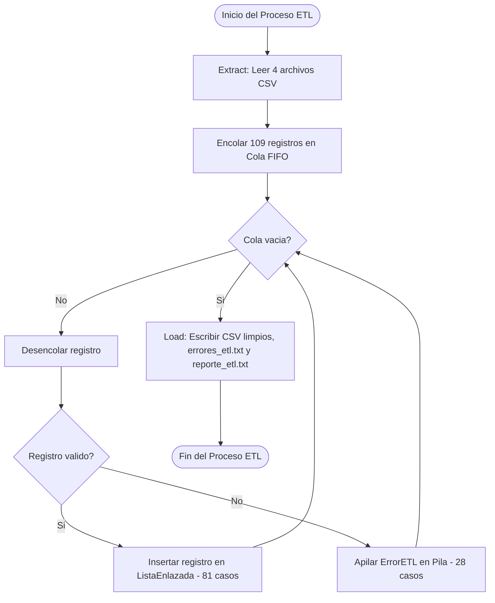
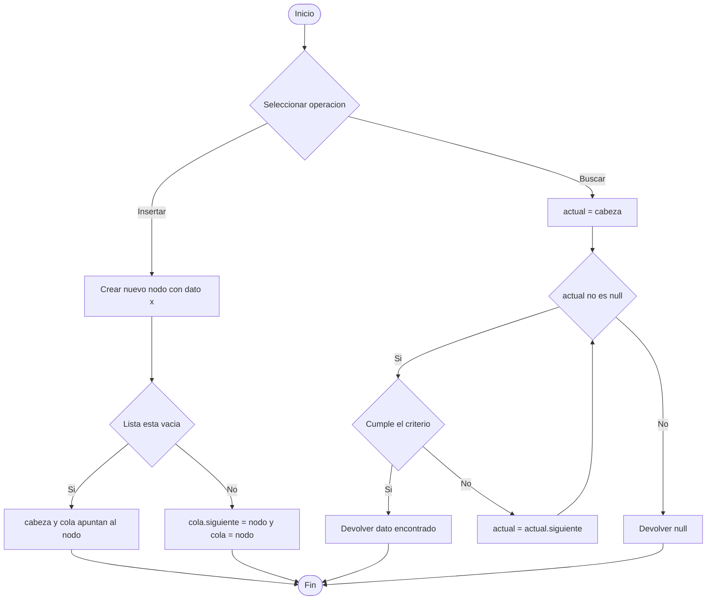

## Flujograma: ETL completo
- Fecha: 2026-11-19 09:49:53
- Modelo: claude-sonnet-5-5
- Estado: Sin ANTHROPIC_API_KEY: se usó el generador local (sin IA)

**Instrucción de sistema:**

```text
Eres un asistente que convierte descripciones de algoritmos en diagramas Mermaid. Responde UNICAMENTE con un bloque de codigo mermaid que comience con 'flowchart TD'. Reglas: los ids de nodo son alfanumericos sin espacios; todo el texto de cada nodo va entre comillas dobles; usa ["..."] para procesos, {"..."} para decisiones y (["..."]) para inicio y fin; las etiquetas de flechas se escriben -->|"texto"|; no uses parentesis ni corchetes dentro del texto; no agregues explicaciones fuera del bloque.
```

**Prompt enviado:**

```text
Genera un flujograma Mermaid (flowchart TD) del proceso: ETL completo.

Descripcion estructurada generada por el programa (datos reales de la ejecucion):
Proceso ETL ejecutado con datos reales:
1. Extract: se leyeron 4 archivos CSV y se encolaron 109 registros en una Cola (FIFO).
2. Transform: mientras la cola no este vacia se desencola un registro y se valida (identificador, campos obligatorios, rangos, duplicados, referencias).
3. Si el registro es valido (81 casos) se inserta en una ListaEnlazada; si no (28 casos) se apila un ErrorETL en una Pila.
4. Load: al vaciarse la cola se escriben los CSV limpios, errores_etl.txt y reporte_etl.txt.
Errores por tipo: ID_INVALIDO=4 DATO_INCOMPLETO=5 FORMATO_INVALIDO=5 RANGO_INVALIDO=5 DUPLICADO=5 REFERENCIA_INVALIDA=4 


El diagrama debe reflejar fielmente estos pasos, con inicio, fin, decisiones y bucles cuando correspondan.
```

**Respuesta recibida:**

_(sin respuesta de la IA)_

---

## Flujograma: Cola (encolar y desencolar)
- Fecha: 2026-11-19 09:49:53
- Modelo: claude-sonnet-5-5
- Estado: Sin ANTHROPIC_API_KEY: se usó el generador local (sin IA)

**Instrucción de sistema:**

```text
Eres un asistente que convierte descripciones de algoritmos en diagramas Mermaid. Responde UNICAMENTE con un bloque de codigo mermaid que comience con 'flowchart TD'. Reglas: los ids de nodo son alfanumericos sin espacios; todo el texto de cada nodo va entre comillas dobles; usa ["..."] para procesos, {"..."} para decisiones y (["..."]) para inicio y fin; las etiquetas de flechas se escriben -->|"texto"|; no uses parentesis ni corchetes dentro del texto; no agregues explicaciones fuera del bloque.
```

**Prompt enviado:**

```text
Genera un flujograma Mermaid (flowchart TD) del proceso: Cola (encolar y desencolar).

Descripcion estructurada generada por el programa (datos reales de la ejecucion):
Cola FIFO con nodos enlazados y referencias frente y fin.
encolar(x): crear nodo; si la cola esta vacia frente y fin apuntan al nodo; si no fin.siguiente = nodo y fin = nodo.
desencolar(): si esta vacia devolver null; guardar dato de frente; frente = frente.siguiente; si frente queda null entonces fin = null.

El diagrama debe reflejar fielmente estos pasos, con inicio, fin, decisiones y bucles cuando correspondan.
```

**Respuesta recibida:**

_(sin respuesta de la IA)_

---

## Flujograma: Pila (apilar y desapilar)
- Fecha: 2026-11-19 09:49:53
- Modelo: claude-sonnet-5-5
- Estado: Sin ANTHROPIC_API_KEY: se usó el generador local (sin IA)

**Instrucción de sistema:**

```text
Eres un asistente que convierte descripciones de algoritmos en diagramas Mermaid. Responde UNICAMENTE con un bloque de codigo mermaid que comience con 'flowchart TD'. Reglas: los ids de nodo son alfanumericos sin espacios; todo el texto de cada nodo va entre comillas dobles; usa ["..."] para procesos, {"..."} para decisiones y (["..."]) para inicio y fin; las etiquetas de flechas se escriben -->|"texto"|; no uses parentesis ni corchetes dentro del texto; no agregues explicaciones fuera del bloque.
```

**Prompt enviado:**

```text
Genera un flujograma Mermaid (flowchart TD) del proceso: Pila (apilar y desapilar).

Descripcion estructurada generada por el programa (datos reales de la ejecucion):
Pila LIFO con nodos enlazados y referencia cima.
apilar(x): crear nodo; nodo.siguiente = cima; cima = nodo.
desapilar(): si esta vacia devolver null; guardar dato de la cima; cima = cima.siguiente.

El diagrama debe reflejar fielmente estos pasos, con inicio, fin, decisiones y bucles cuando correspondan.
```

**Respuesta recibida:**

_(sin respuesta de la IA)_

---

## Flujograma: Lista enlazada (insertar y buscar)
- Fecha: 2026-11-19 09:49:53
- Modelo: claude-sonnet-5-5
- Estado: Sin ANTHROPIC_API_KEY: se usó el generador local (sin IA)

**Instrucción de sistema:**

```text
Eres un asistente que convierte descripciones de algoritmos en diagramas Mermaid. Responde UNICAMENTE con un bloque de codigo mermaid que comience con 'flowchart TD'. Reglas: los ids de nodo son alfanumericos sin espacios; todo el texto de cada nodo va entre comillas dobles; usa ["..."] para procesos, {"..."} para decisiones y (["..."]) para inicio y fin; las etiquetas de flechas se escriben -->|"texto"|; no uses parentesis ni corchetes dentro del texto; no agregues explicaciones fuera del bloque.
```

**Prompt enviado:**

```text
Genera un flujograma Mermaid (flowchart TD) del proceso: Lista enlazada (insertar y buscar).

Descripcion estructurada generada por el programa (datos reales de la ejecucion):
Lista enlazada simple con referencias cabeza y cola.
insertar(x): crear nodo; si la lista esta vacia cabeza y cola apuntan al nodo; si no cola.siguiente = nodo y cola = nodo.
buscar(criterio): actual = cabeza; mientras actual no sea null: si cumple el criterio devolver el dato; avanzar actual = actual.siguiente; al terminar devolver null.

El diagrama debe reflejar fielmente estos pasos, con inicio, fin, decisiones y bucles cuando correspondan.
```

**Respuesta recibida:**

_(sin respuesta de la IA)_

---

## Flujograma: BST (comparación de claves)
- Fecha: 2026-11-19 09:49:53
- Modelo: claude-sonnet-5-5
- Estado: Sin ANTHROPIC_API_KEY: se usó el generador local (sin IA)

**Instrucción de sistema:**

```text
Eres un asistente que convierte descripciones de algoritmos en diagramas Mermaid. Responde UNICAMENTE con un bloque de codigo mermaid que comience con 'flowchart TD'. Reglas: los ids de nodo son alfanumericos sin espacios; todo el texto de cada nodo va entre comillas dobles; usa ["..."] para procesos, {"..."} para decisiones y (["..."]) para inicio y fin; las etiquetas de flechas se escriben -->|"texto"|; no uses parentesis ni corchetes dentro del texto; no agregues explicaciones fuera del bloque.
```

**Prompt enviado:**

```text
Genera un flujograma Mermaid (flowchart TD) del proceso: BST (comparación de claves).

Descripcion estructurada generada por el programa (datos reales de la ejecucion):
Operacion real sobre un BST de 22 nodos y altura 8. Cada paso compara la clave con el nodo actual:
1. 1801000022 > 1801000007: ir a la derecha
2. 1801000022 > 1801000009: ir a la derecha
3. 1801000022 > 1801000018: ir a la derecha
4. 1801000022 = 1801000022: encontrado


El diagrama debe reflejar fielmente estos pasos, con inicio, fin, decisiones y bucles cuando correspondan.
```

**Respuesta recibida:**

_(sin respuesta de la IA)_

---

## Flujograma: Grafo + BFS
- Fecha: 2026-11-19 09:49:53
- Modelo: claude-sonnet-5-5
- Estado: Sin ANTHROPIC_API_KEY: se usó el generador local (sin IA)

**Instrucción de sistema:**

```text
Eres un asistente que convierte descripciones de algoritmos en diagramas Mermaid. Responde UNICAMENTE con un bloque de codigo mermaid que comience con 'flowchart TD'. Reglas: los ids de nodo son alfanumericos sin espacios; todo el texto de cada nodo va entre comillas dobles; usa ["..."] para procesos, {"..."} para decisiones y (["..."]) para inicio y fin; las etiquetas de flechas se escriben -->|"texto"|; no uses parentesis ni corchetes dentro del texto; no agregues explicaciones fuera del bloque.
```

**Prompt enviado:**

```text
Genera un flujograma Mermaid (flowchart TD) del proceso: Grafo + BFS.

Descripcion estructurada generada por el programa (datos reales de la ejecucion):
Recorrido BFS real sobre el grafo de prerrequisitos usando una cola. Eventos registrados en orden (con el contenido de la cola tras cada paso):
INICIO: BFS desde SIS101
ENCOLAR: SIS101 | cola=[frente: SIS101 :final]
DESENCOLAR: SIS101 | cola=[frente:  :final]
ENCOLAR: SIS102 | cola=[frente: SIS102 :final]
DESENCOLAR: SIS102 | cola=[frente:  :final]
ENCOLAR: SIS201 | cola=[frente: SIS201 :final]
ENCOLAR: SIS302 | cola=[frente: SIS201, SIS302 :final]
DESENCOLAR: SIS201 | cola=[frente: SIS302 :final]
ENCOLAR: SIS202 | cola=[frente: SIS302, SIS202 :final]
ENCOLAR: SIS203 | cola=[frente: SIS302, SIS202, SIS203 :final]
DESENCOLAR: SIS302 | cola=[frente: SIS202, SIS203 :final]
DESENCOLAR: SIS202 | cola=[frente: SIS203 :final]
ENCOLAR: SIS301 | cola=[frente: SIS203, SIS301 :final]
DESENCOLAR: SIS203 | cola=[frente: SIS301 :final]
ENCOLAR: SIS303 | cola=[frente: SIS301, SIS303 :final]
DESENCOLAR: SIS301 | cola=[frente: SIS303 :final]
DESENCOLAR: SIS303 | cola=[frente:  :final]
FIN: cola vacía; vértices visitados: 8


El diagrama debe reflejar fielmente estos pasos, con inicio, fin, decisiones y bucles cuando correspondan.
```

**Respuesta recibida:**

_(sin respuesta de la IA)_

---

## Flujograma: Grafo + DFS
- Fecha: 2026-11-19 09:49:53
- Modelo: claude-sonnet-5-5
- Estado: Sin ANTHROPIC_API_KEY: se usó el generador local (sin IA)

**Instrucción de sistema:**

```text
Eres un asistente que convierte descripciones de algoritmos en diagramas Mermaid. Responde UNICAMENTE con un bloque de codigo mermaid que comience con 'flowchart TD'. Reglas: los ids de nodo son alfanumericos sin espacios; todo el texto de cada nodo va entre comillas dobles; usa ["..."] para procesos, {"..."} para decisiones y (["..."]) para inicio y fin; las etiquetas de flechas se escriben -->|"texto"|; no uses parentesis ni corchetes dentro del texto; no agregues explicaciones fuera del bloque.
```

**Prompt enviado:**

```text
Genera un flujograma Mermaid (flowchart TD) del proceso: Grafo + DFS.

Descripcion estructurada generada por el programa (datos reales de la ejecucion):
Recorrido DFS real sobre el grafo de prerrequisitos usando una pila. Eventos registrados en orden (con el contenido de la pila tras cada paso):
INICIO: DFS desde SIS101
APILAR: SIS101 | pila=[cima: SIS101]
VISITAR: SIS101 | pila=[cima: ]
APILAR: SIS102 | pila=[cima: SIS102]
VISITAR: SIS102 | pila=[cima: ]
APILAR: SIS302 | pila=[cima: SIS302]
APILAR: SIS201 | pila=[cima: SIS201 | SIS302]
VISITAR: SIS201 | pila=[cima: SIS302]
APILAR: SIS203 | pila=[cima: SIS203 | SIS302]
APILAR: SIS202 | pila=[cima: SIS202 | SIS203 | SIS302]
VISITAR: SIS202 | pila=[cima: SIS203 | SIS302]
APILAR: SIS301 | pila=[cima: SIS301 | SIS203 | SIS302]
VISITAR: SIS301 | pila=[cima: SIS203 | SIS302]
VISITAR: SIS203 | pila=[cima: SIS302]
APILAR: SIS303 | pila=[cima: SIS303 | SIS302]
VISITAR: SIS303 | pila=[cima: SIS302]
VISITAR: SIS302 | pila=[cima: ]
FIN: pila vacía; vértices visitados: 8


El diagrama debe reflejar fielmente estos pasos, con inicio, fin, decisiones y bucles cuando correspondan.
```

**Respuesta recibida:**

_(sin respuesta de la IA)_

---

## Documentación del sistema
- Fecha: 2026-11-19 09:49:53
- Modelo: claude-sonnet-5-5
- Estado: Sin ANTHROPIC_API_KEY: se usó el generador local (sin IA)

**Instrucción de sistema:**

```text
Eres un profesor de Estructuras de Datos de ingenieria de software. Explica en espanol, con tono tecnico pero claro, refiriendote a los nodos, claves y valores CONCRETOS que recibes, no a definiciones genericas. Maximo 250 palabras. No inventes datos que no esten en la entrada.
```

**Prompt enviado:**

```text
Redacta en espanol la documentacion tecnica breve (formato Markdown, maximo 400 palabras) del siguiente sistema, con las secciones: Proposito, Flujo de datos, Estructuras utilizadas y por que, Resultados de la ejecucion.

Registros procesados: 109 | válidos: 81 | inválidos: 28
Estudiantes válidos: 22 | Asignaturas: 12 | Matrículas: 34 | Prerrequisitos: 13
BST: 22 nodos, altura 8
Grafo: 12 vértices, 13 aristas
SIS201 -> SIS202 -> SIS301 -> SIS201
Total de registros procesados: 109
Registros válidos: 81
Total de errores: 28
Identificador incorrecto: 4
Datos incompletos: 5
Formato incorrecto: 5
Valor fuera de rango: 5
Registro duplicado: 5
Referencia inexistente / relación inconsistente: 4
Errores en estudiantes.csv: 12 de 34
Errores en asignaturas.csv: 5 de 17
Errores en matriculas.csv: 7 de 41
Errores en prerrequisitos.csv: 4 de 17

```

**Respuesta recibida:**

_(sin respuesta de la IA)_

---

## Explicación del BST
- Fecha: 2026-11-19 09:49:53
- Modelo: claude-sonnet-5-5
- Estado: Sin ANTHROPIC_API_KEY: se usó el generador local (sin IA)

**Instrucción de sistema:**

```text
Eres un profesor de Estructuras de Datos de ingenieria de software. Explica en espanol, con tono tecnico pero claro, refiriendote a los nodos, claves y valores CONCRETOS que recibes, no a definiciones genericas. Maximo 250 palabras. No inventes datos que no esten en la entrada.
```

**Prompt enviado:**

```text
Explica el siguiente arbol binario de busqueda (BST) real. Cada linea indica un nodo con sus hijos.

Raíz: 1801000007
1801000007 | izquierdo: 1801000003 | derecho: 1801000009
1801000003 | izquierdo: 1801000001 | derecho: 1801000005
1801000001 | izquierdo: - | derecho: 1801000002
1801000002 | izquierdo: - | derecho: -
1801000005 | izquierdo: 1801000004 | derecho: 1801000006
1801000004 | izquierdo: - | derecho: -
1801000006 | izquierdo: - | derecho: -
1801000009 | izquierdo: 1801000008 | derecho: 1801000018
1801000008 | izquierdo: - | derecho: -
1801000018 | izquierdo: 1801000012 | derecho: 1801000022
1801000012 | izquierdo: 1801000011 | derecho: 1801000016
1801000011 | izquierdo: 1801000010 | derecho: -
1801000010 | izquierdo: - | derecho: -
1801000016 | izquierdo: 1801000015 | derecho: 1801000017
1801000015 | izquierdo: 1801000013 | derecho: -
1801000013 | izquierdo: - | derecho: 1801000014
1801000014 | izquierdo: - | derecho: -
1801000017 | izquierdo: - | derecho: -
1801000022 | izquierdo: 1801000020 | derecho: -
1801000020 | izquierdo: 1801000019 | derecho: 1801000021
1801000019 | izquierdo: - | derecho: -
1801000021 | izquierdo: - | derecho: -

Nodos: 22. Altura: 8. Altura minima posible con ese numero de nodos: 5.

Indica cual es la raiz, como se cumple la propiedad BST en al menos dos nodos concretos y si el arbol esta balanceado o degenerado y que consecuencia tiene para la busqueda.
```

**Respuesta recibida:**

_(sin respuesta de la IA)_

---

## Explicación del grafo
- Fecha: 2026-11-19 09:49:53
- Modelo: claude-sonnet-5-5
- Estado: Sin ANTHROPIC_API_KEY: se usó el generador local (sin IA)

**Instrucción de sistema:**

```text
Eres un profesor de Estructuras de Datos de ingenieria de software. Explica en espanol, con tono tecnico pero claro, refiriendote a los nodos, claves y valores CONCRETOS que recibes, no a definiciones genericas. Maximo 250 palabras. No inventes datos que no esten en la entrada.
```

**Prompt enviado:**

```text
Explica el siguiente grafo dirigido real de prerrequisitos entre asignaturas. Cada linea es: asignatura -> asignaturas que dependen de ella.

SIS101 -> SIS102
SIS102 -> SIS201, SIS302
MAT101 -> MAT102, MAT201
FIS101 -> SIS302
MAT102 -> SIS201
SIS201 -> SIS202, SIS203
MAT201 -> SIS303
SIS202 -> SIS301
SIS203 -> SIS303
SIS301 -> SIS201
SIS302 -> (ninguno)
SIS303 -> (ninguno)

Vertices: 12. Aristas: 13.
Ciclos detectados: SIS201 -> SIS202 -> SIS301 -> SIS201

Indica que asignaturas no tienen prerrequisitos, cuales son las finales, la cadena de prerrequisitos mas larga que puedas identificar y que implica un ciclo para la malla.
```

**Respuesta recibida:**

_(sin respuesta de la IA)_

---

## Análisis de errores ETL
- Fecha: 2026-11-19 09:49:53
- Modelo: claude-sonnet-5-5
- Estado: Sin ANTHROPIC_API_KEY: se usó el generador local (sin IA)

**Instrucción de sistema:**

```text
Eres un profesor de Estructuras de Datos de ingenieria de software. Explica en espanol, con tono tecnico pero claro, refiriendote a los nodos, claves y valores CONCRETOS que recibes, no a definiciones genericas. Maximo 250 palabras. No inventes datos que no esten en la entrada.
```

**Prompt enviado:**

```text
El programa ETL calculo estas estadisticas agregadas de errores (no se envian registros individuales):

Total de registros procesados: 109
Registros válidos: 81
Total de errores: 28
Identificador incorrecto: 4
Datos incompletos: 5
Formato incorrecto: 5
Valor fuera de rango: 5
Registro duplicado: 5
Referencia inexistente / relación inconsistente: 4
Errores en estudiantes.csv: 12 de 34
Errores en asignaturas.csv: 5 de 17
Errores en matriculas.csv: 7 de 41
Errores en prerrequisitos.csv: 4 de 17

Redacta una interpretacion tecnica de los patrones observados: cual es la categoria dominante, que fuente de datos es la mas problematica y que reglas de validacion o acciones de limpieza recomiendas.
```

**Respuesta recibida:**

_(sin respuesta de la IA)_

---

## Flujograma: ETL completo
- Fecha: 2026-11-19 09:49:59
- Modelo: claude-sonnet-5-5
- Estado: Sin ANTHROPIC_API_KEY: se usó el generador local (sin IA)

**Instrucción de sistema:**

```text
Eres un asistente que convierte descripciones de algoritmos en diagramas Mermaid. Responde UNICAMENTE con un bloque de codigo mermaid que comience con 'flowchart TD'. Reglas: los ids de nodo son alfanumericos sin espacios; todo el texto de cada nodo va entre comillas dobles; usa ["..."] para procesos, {"..."} para decisiones y (["..."]) para inicio y fin; las etiquetas de flechas se escriben -->|"texto"|; no uses parentesis ni corchetes dentro del texto; no agregues explicaciones fuera del bloque.
```

**Prompt enviado:**

```text
Genera un flujograma Mermaid (flowchart TD) del proceso: ETL completo.

Descripcion estructurada generada por el programa (datos reales de la ejecucion):
Proceso ETL ejecutado con datos reales:
1. Extract: se leyeron 4 archivos CSV y se encolaron 109 registros en una Cola (FIFO).
2. Transform: mientras la cola no este vacia se desencola un registro y se valida (identificador, campos obligatorios, rangos, duplicados, referencias).
3. Si el registro es valido (81 casos) se inserta en una ListaEnlazada; si no (28 casos) se apila un ErrorETL en una Pila.
4. Load: al vaciarse la cola se escriben los CSV limpios, errores_etl.txt y reporte_etl.txt.
Errores por tipo: ID_INVALIDO=4 DATO_INCOMPLETO=5 FORMATO_INVALIDO=5 RANGO_INVALIDO=5 DUPLICADO=5 REFERENCIA_INVALIDA=4 


El diagrama debe reflejar fielmente estos pasos, con inicio, fin, decisiones y bucles cuando correspondan.
```

**Respuesta recibida:**

_(sin respuesta de la IA)_

---

## Flujograma: Cola (encolar y desencolar)
- Fecha: 2026-11-19 09:49:59
- Modelo: claude-sonnet-5-5
- Estado: Sin ANTHROPIC_API_KEY: se usó el generador local (sin IA)

**Instrucción de sistema:**

```text
Eres un asistente que convierte descripciones de algoritmos en diagramas Mermaid. Responde UNICAMENTE con un bloque de codigo mermaid que comience con 'flowchart TD'. Reglas: los ids de nodo son alfanumericos sin espacios; todo el texto de cada nodo va entre comillas dobles; usa ["..."] para procesos, {"..."} para decisiones y (["..."]) para inicio y fin; las etiquetas de flechas se escriben -->|"texto"|; no uses parentesis ni corchetes dentro del texto; no agregues explicaciones fuera del bloque.
```

**Prompt enviado:**

```text
Genera un flujograma Mermaid (flowchart TD) del proceso: Cola (encolar y desencolar).

Descripcion estructurada generada por el programa (datos reales de la ejecucion):
Cola FIFO con nodos enlazados y referencias frente y fin.
encolar(x): crear nodo; si la cola esta vacia frente y fin apuntan al nodo; si no fin.siguiente = nodo y fin = nodo.
desencolar(): si esta vacia devolver null; guardar dato de frente; frente = frente.siguiente; si frente queda null entonces fin = null.

El diagrama debe reflejar fielmente estos pasos, con inicio, fin, decisiones y bucles cuando correspondan.
```

**Respuesta recibida:**

_(sin respuesta de la IA)_

---

## Flujograma: Pila (apilar y desapilar)
- Fecha: 2026-11-19 09:49:59
- Modelo: claude-sonnet-5-5
- Estado: Sin ANTHROPIC_API_KEY: se usó el generador local (sin IA)

**Instrucción de sistema:**

```text
Eres un asistente que convierte descripciones de algoritmos en diagramas Mermaid. Responde UNICAMENTE con un bloque de codigo mermaid que comience con 'flowchart TD'. Reglas: los ids de nodo son alfanumericos sin espacios; todo el texto de cada nodo va entre comillas dobles; usa ["..."] para procesos, {"..."} para decisiones y (["..."]) para inicio y fin; las etiquetas de flechas se escriben -->|"texto"|; no uses parentesis ni corchetes dentro del texto; no agregues explicaciones fuera del bloque.
```

**Prompt enviado:**

```text
Genera un flujograma Mermaid (flowchart TD) del proceso: Pila (apilar y desapilar).

Descripcion estructurada generada por el programa (datos reales de la ejecucion):
Pila LIFO con nodos enlazados y referencia cima.
apilar(x): crear nodo; nodo.siguiente = cima; cima = nodo.
desapilar(): si esta vacia devolver null; guardar dato de la cima; cima = cima.siguiente.

El diagrama debe reflejar fielmente estos pasos, con inicio, fin, decisiones y bucles cuando correspondan.
```

**Respuesta recibida:**

_(sin respuesta de la IA)_

---

## Flujograma: Lista enlazada (insertar y buscar)
- Fecha: 2026-11-19 09:49:59
- Modelo: claude-sonnet-5-5
- Estado: Sin ANTHROPIC_API_KEY: se usó el generador local (sin IA)

**Instrucción de sistema:**

```text
Eres un asistente que convierte descripciones de algoritmos en diagramas Mermaid. Responde UNICAMENTE con un bloque de codigo mermaid que comience con 'flowchart TD'. Reglas: los ids de nodo son alfanumericos sin espacios; todo el texto de cada nodo va entre comillas dobles; usa ["..."] para procesos, {"..."} para decisiones y (["..."]) para inicio y fin; las etiquetas de flechas se escriben -->|"texto"|; no uses parentesis ni corchetes dentro del texto; no agregues explicaciones fuera del bloque.
```

**Prompt enviado:**

```text
Genera un flujograma Mermaid (flowchart TD) del proceso: Lista enlazada (insertar y buscar).

Descripcion estructurada generada por el programa (datos reales de la ejecucion):
Lista enlazada simple con referencias cabeza y cola.
insertar(x): crear nodo; si la lista esta vacia cabeza y cola apuntan al nodo; si no cola.siguiente = nodo y cola = nodo.
buscar(criterio): actual = cabeza; mientras actual no sea null: si cumple el criterio devolver el dato; avanzar actual = actual.siguiente; al terminar devolver null.

El diagrama debe reflejar fielmente estos pasos, con inicio, fin, decisiones y bucles cuando correspondan.
```

**Respuesta recibida:**

_(sin respuesta de la IA)_

---

## Flujograma: BST (comparación de claves)
- Fecha: 2026-11-19 09:49:59
- Modelo: claude-sonnet-5-5
- Estado: Sin ANTHROPIC_API_KEY: se usó el generador local (sin IA)

**Instrucción de sistema:**

```text
Eres un asistente que convierte descripciones de algoritmos en diagramas Mermaid. Responde UNICAMENTE con un bloque de codigo mermaid que comience con 'flowchart TD'. Reglas: los ids de nodo son alfanumericos sin espacios; todo el texto de cada nodo va entre comillas dobles; usa ["..."] para procesos, {"..."} para decisiones y (["..."]) para inicio y fin; las etiquetas de flechas se escriben -->|"texto"|; no uses parentesis ni corchetes dentro del texto; no agregues explicaciones fuera del bloque.
```

**Prompt enviado:**

```text
Genera un flujograma Mermaid (flowchart TD) del proceso: BST (comparación de claves).

Descripcion estructurada generada por el programa (datos reales de la ejecucion):
Operacion real sobre un BST de 22 nodos y altura 8. Cada paso compara la clave con el nodo actual:
1. 1801000022 > 1801000007: ir a la derecha
2. 1801000022 > 1801000009: ir a la derecha
3. 1801000022 > 1801000018: ir a la derecha
4. 1801000022 = 1801000022: encontrado


El diagrama debe reflejar fielmente estos pasos, con inicio, fin, decisiones y bucles cuando correspondan.
```

**Respuesta recibida:**

_(sin respuesta de la IA)_

---

## Flujograma: Grafo + BFS
- Fecha: 2026-11-19 09:49:59
- Modelo: claude-sonnet-5-5
- Estado: Sin ANTHROPIC_API_KEY: se usó el generador local (sin IA)

**Instrucción de sistema:**

```text
Eres un asistente que convierte descripciones de algoritmos en diagramas Mermaid. Responde UNICAMENTE con un bloque de codigo mermaid que comience con 'flowchart TD'. Reglas: los ids de nodo son alfanumericos sin espacios; todo el texto de cada nodo va entre comillas dobles; usa ["..."] para procesos, {"..."} para decisiones y (["..."]) para inicio y fin; las etiquetas de flechas se escriben -->|"texto"|; no uses parentesis ni corchetes dentro del texto; no agregues explicaciones fuera del bloque.
```

**Prompt enviado:**

```text
Genera un flujograma Mermaid (flowchart TD) del proceso: Grafo + BFS.

Descripcion estructurada generada por el programa (datos reales de la ejecucion):
Recorrido BFS real sobre el grafo de prerrequisitos usando una cola. Eventos registrados en orden (con el contenido de la cola tras cada paso):
INICIO: BFS desde SIS101
ENCOLAR: SIS101 | cola=[frente: SIS101 :final]
DESENCOLAR: SIS101 | cola=[frente:  :final]
ENCOLAR: SIS102 | cola=[frente: SIS102 :final]
DESENCOLAR: SIS102 | cola=[frente:  :final]
ENCOLAR: SIS201 | cola=[frente: SIS201 :final]
ENCOLAR: SIS302 | cola=[frente: SIS201, SIS302 :final]
DESENCOLAR: SIS201 | cola=[frente: SIS302 :final]
ENCOLAR: SIS202 | cola=[frente: SIS302, SIS202 :final]
ENCOLAR: SIS203 | cola=[frente: SIS302, SIS202, SIS203 :final]
DESENCOLAR: SIS302 | cola=[frente: SIS202, SIS203 :final]
DESENCOLAR: SIS202 | cola=[frente: SIS203 :final]
ENCOLAR: SIS301 | cola=[frente: SIS203, SIS301 :final]
DESENCOLAR: SIS203 | cola=[frente: SIS301 :final]
ENCOLAR: SIS303 | cola=[frente: SIS301, SIS303 :final]
DESENCOLAR: SIS301 | cola=[frente: SIS303 :final]
DESENCOLAR: SIS303 | cola=[frente:  :final]
FIN: cola vacía; vértices visitados: 8


El diagrama debe reflejar fielmente estos pasos, con inicio, fin, decisiones y bucles cuando correspondan.
```

**Respuesta recibida:**

_(sin respuesta de la IA)_

---

## Flujograma: Grafo + DFS
- Fecha: 2026-11-19 09:49:59
- Modelo: claude-sonnet-5-5
- Estado: Sin ANTHROPIC_API_KEY: se usó el generador local (sin IA)

**Instrucción de sistema:**

```text
Eres un asistente que convierte descripciones de algoritmos en diagramas Mermaid. Responde UNICAMENTE con un bloque de codigo mermaid que comience con 'flowchart TD'. Reglas: los ids de nodo son alfanumericos sin espacios; todo el texto de cada nodo va entre comillas dobles; usa ["..."] para procesos, {"..."} para decisiones y (["..."]) para inicio y fin; las etiquetas de flechas se escriben -->|"texto"|; no uses parentesis ni corchetes dentro del texto; no agregues explicaciones fuera del bloque.
```

**Prompt enviado:**

```text
Genera un flujograma Mermaid (flowchart TD) del proceso: Grafo + DFS.

Descripcion estructurada generada por el programa (datos reales de la ejecucion):
Recorrido DFS real sobre el grafo de prerrequisitos usando una pila. Eventos registrados en orden (con el contenido de la pila tras cada paso):
INICIO: DFS desde SIS101
APILAR: SIS101 | pila=[cima: SIS101]
VISITAR: SIS101 | pila=[cima: ]
APILAR: SIS102 | pila=[cima: SIS102]
VISITAR: SIS102 | pila=[cima: ]
APILAR: SIS302 | pila=[cima: SIS302]
APILAR: SIS201 | pila=[cima: SIS201 | SIS302]
VISITAR: SIS201 | pila=[cima: SIS302]
APILAR: SIS203 | pila=[cima: SIS203 | SIS302]
APILAR: SIS202 | pila=[cima: SIS202 | SIS203 | SIS302]
VISITAR: SIS202 | pila=[cima: SIS203 | SIS302]
APILAR: SIS301 | pila=[cima: SIS301 | SIS203 | SIS302]
VISITAR: SIS301 | pila=[cima: SIS203 | SIS302]
VISITAR: SIS203 | pila=[cima: SIS302]
APILAR: SIS303 | pila=[cima: SIS303 | SIS302]
VISITAR: SIS303 | pila=[cima: SIS302]
VISITAR: SIS302 | pila=[cima: ]
FIN: pila vacía; vértices visitados: 8


El diagrama debe reflejar fielmente estos pasos, con inicio, fin, decisiones y bucles cuando correspondan.
```

**Respuesta recibida:**

_(sin respuesta de la IA)_

---

## Documentación del sistema
- Fecha: 2026-11-19 09:49:59
- Modelo: claude-sonnet-5-5
- Estado: Sin ANTHROPIC_API_KEY: se usó el generador local (sin IA)

**Instrucción de sistema:**

```text
Eres un profesor de Estructuras de Datos de ingenieria de software. Explica en espanol, con tono tecnico pero claro, refiriendote a los nodos, claves y valores CONCRETOS que recibes, no a definiciones genericas. Maximo 250 palabras. No inventes datos que no esten en la entrada.
```

**Prompt enviado:**

```text
Redacta en espanol la documentacion tecnica breve (formato Markdown, maximo 400 palabras) del siguiente sistema, con las secciones: Proposito, Flujo de datos, Estructuras utilizadas y por que, Resultados de la ejecucion.

Registros procesados: 109 | válidos: 81 | inválidos: 28
Estudiantes válidos: 22 | Asignaturas: 12 | Matrículas: 34 | Prerrequisitos: 13
BST: 22 nodos, altura 8
Grafo: 12 vértices, 13 aristas
SIS201 -> SIS202 -> SIS301 -> SIS201
Total de registros procesados: 109
Registros válidos: 81
Total de errores: 28
Identificador incorrecto: 4
Datos incompletos: 5
Formato incorrecto: 5
Valor fuera de rango: 5
Registro duplicado: 5
Referencia inexistente / relación inconsistente: 4
Errores en estudiantes.csv: 12 de 34
Errores en asignaturas.csv: 5 de 17
Errores en matriculas.csv: 7 de 41
Errores en prerrequisitos.csv: 4 de 17

```

**Respuesta recibida:**

_(sin respuesta de la IA)_

---

## Explicación del BST
- Fecha: 2026-11-19 09:49:59
- Modelo: claude-sonnet-5-5
- Estado: Sin ANTHROPIC_API_KEY: se usó el generador local (sin IA)

**Instrucción de sistema:**

```text
Eres un profesor de Estructuras de Datos de ingenieria de software. Explica en espanol, con tono tecnico pero claro, refiriendote a los nodos, claves y valores CONCRETOS que recibes, no a definiciones genericas. Maximo 250 palabras. No inventes datos que no esten en la entrada.
```

**Prompt enviado:**

```text
Explica el siguiente arbol binario de busqueda (BST) real. Cada linea indica un nodo con sus hijos.

Raíz: 1801000007
1801000007 | izquierdo: 1801000003 | derecho: 1801000009
1801000003 | izquierdo: 1801000001 | derecho: 1801000005
1801000001 | izquierdo: - | derecho: 1801000002
1801000002 | izquierdo: - | derecho: -
1801000005 | izquierdo: 1801000004 | derecho: 1801000006
1801000004 | izquierdo: - | derecho: -
1801000006 | izquierdo: - | derecho: -
1801000009 | izquierdo: 1801000008 | derecho: 1801000018
1801000008 | izquierdo: - | derecho: -
1801000018 | izquierdo: 1801000012 | derecho: 1801000022
1801000012 | izquierdo: 1801000011 | derecho: 1801000016
1801000011 | izquierdo: 1801000010 | derecho: -
1801000010 | izquierdo: - | derecho: -
1801000016 | izquierdo: 1801000015 | derecho: 1801000017
1801000015 | izquierdo: 1801000013 | derecho: -
1801000013 | izquierdo: - | derecho: 1801000014
1801000014 | izquierdo: - | derecho: -
1801000017 | izquierdo: - | derecho: -
1801000022 | izquierdo: 1801000020 | derecho: -
1801000020 | izquierdo: 1801000019 | derecho: 1801000021
1801000019 | izquierdo: - | derecho: -
1801000021 | izquierdo: - | derecho: -

Nodos: 22. Altura: 8. Altura minima posible con ese numero de nodos: 5.

Indica cual es la raiz, como se cumple la propiedad BST en al menos dos nodos concretos y si el arbol esta balanceado o degenerado y que consecuencia tiene para la busqueda.
```

**Respuesta recibida:**

_(sin respuesta de la IA)_

---

## Explicación del grafo
- Fecha: 2026-11-19 09:49:59
- Modelo: claude-sonnet-5-5
- Estado: Sin ANTHROPIC_API_KEY: se usó el generador local (sin IA)

**Instrucción de sistema:**

```text
Eres un profesor de Estructuras de Datos de ingenieria de software. Explica en espanol, con tono tecnico pero claro, refiriendote a los nodos, claves y valores CONCRETOS que recibes, no a definiciones genericas. Maximo 250 palabras. No inventes datos que no esten en la entrada.
```

**Prompt enviado:**

```text
Explica el siguiente grafo dirigido real de prerrequisitos entre asignaturas. Cada linea es: asignatura -> asignaturas que dependen de ella.

SIS101 -> SIS102
SIS102 -> SIS201, SIS302
MAT101 -> MAT102, MAT201
FIS101 -> SIS302
MAT102 -> SIS201
SIS201 -> SIS202, SIS203
MAT201 -> SIS303
SIS202 -> SIS301
SIS203 -> SIS303
SIS301 -> SIS201
SIS302 -> (ninguno)
SIS303 -> (ninguno)

Vertices: 12. Aristas: 13.
Ciclos detectados: SIS201 -> SIS202 -> SIS301 -> SIS201

Indica que asignaturas no tienen prerrequisitos, cuales son las finales, la cadena de prerrequisitos mas larga que puedas identificar y que implica un ciclo para la malla.
```

**Respuesta recibida:**

_(sin respuesta de la IA)_

---

## Análisis de errores ETL
- Fecha: 2026-11-19 09:49:59
- Modelo: claude-sonnet-5-5
- Estado: Sin ANTHROPIC_API_KEY: se usó el generador local (sin IA)

**Instrucción de sistema:**

```text
Eres un profesor de Estructuras de Datos de ingenieria de software. Explica en espanol, con tono tecnico pero claro, refiriendote a los nodos, claves y valores CONCRETOS que recibes, no a definiciones genericas. Maximo 250 palabras. No inventes datos que no esten en la entrada.
```

**Prompt enviado:**

```text
El programa ETL calculo estas estadisticas agregadas de errores (no se envian registros individuales):

Total de registros procesados: 109
Registros válidos: 81
Total de errores: 28
Identificador incorrecto: 4
Datos incompletos: 5
Formato incorrecto: 5
Valor fuera de rango: 5
Registro duplicado: 5
Referencia inexistente / relación inconsistente: 4
Errores en estudiantes.csv: 12 de 34
Errores en asignaturas.csv: 5 de 17
Errores en matriculas.csv: 7 de 41
Errores en prerrequisitos.csv: 4 de 17

Redacta una interpretacion tecnica de los patrones observados: cual es la categoria dominante, que fuente de datos es la mas problematica y que reglas de validacion o acciones de limpieza recomiendas.
```

**Respuesta recibida:**

_(sin respuesta de la IA)_

---

## Flujograma: ETL completo
- Fecha: 2026-11-20 18:20:33
- Proveedor: Gemini
- Modelo: gemini-3.8-flash
- Estado: OK (Gemini, modelo gemini-3.8-flash)

**Instrucción de sistema:**

```text
Eres un asistente que convierte descripciones de algoritmos en diagramas Mermaid. Responde UNICAMENTE con un bloque de codigo mermaid que comience con 'flowchart TD'. Reglas: los ids de nodo son alfanumericos sin espacios; todo el texto de cada nodo va entre comillas dobles; usa ["..."] para procesos, {"..."} para decisiones y (["..."]) para inicio y fin; las etiquetas de flechas se escriben -->|"texto"|; no uses parentesis ni corchetes dentro del texto; no agregues explicaciones fuera del bloque.
```

**Prompt enviado:**

```text
Genera un flujograma Mermaid (flowchart TD) del proceso: ETL completo.

Descripcion estructurada generada por el programa (datos reales de la ejecucion):
Proceso ETL ejecutado con datos reales:
1. Extract: se leyeron 4 archivos CSV y se encolaron 109 registros en una Cola (FIFO).
2. Transform: mientras la cola no este vacia se desencola un registro y se valida (identificador, campos obligatorios, rangos, duplicados, referencias).
3. Si el registro es valido (81 casos) se inserta en una ListaEnlazada; si no (28 casos) se apila un ErrorETL en una Pila.
4. Load: al vaciarse la cola se escriben los CSV limpios, errores_etl.txt y reporte_etl.txt.
Errores por tipo: ID_INVALIDO=4 DATO_INCOMPLETO=5 FORMATO_INVALIDO=5 RANGO_INVALIDO=5 DUPLICADO=5 REFERENCIA_INVALIDA=4 


El diagrama debe reflejar fielmente estos pasos, con inicio, fin, decisiones y bucles cuando correspondan.
```

**Respuesta recibida:**

````text

````

---

## Flujograma: Cola (encolar y desencolar)
- Fecha: 2026-11-20 18:21:43
- Proveedor: Gemini
- Modelo: gemini-3.8-flash
- Estado: OK (Gemini, modelo gemini-3.8-flash)

**Instrucción de sistema:**

```text
Eres un asistente que convierte descripciones de algoritmos en diagramas Mermaid. Responde UNICAMENTE con un bloque de codigo mermaid que comience con 'flowchart TD'. Reglas: los ids de nodo son alfanumericos sin espacios; todo el texto de cada nodo va entre comillas dobles; usa ["..."] para procesos, {"..."} para decisiones y (["..."]) para inicio y fin; las etiquetas de flechas se escriben -->|"texto"|; no uses parentesis ni corchetes dentro del texto; no agregues explicaciones fuera del bloque.
```

**Prompt enviado:**

```text
Genera un flujograma Mermaid (flowchart TD) del proceso: Cola (encolar y desencolar).

Descripcion estructurada generada por el programa (datos reales de la ejecucion):
Cola FIFO con nodos enlazados y referencias frente y fin.
encolar(x): crear nodo; si la cola esta vacia frente y fin apuntan al nodo; si no fin.siguiente = nodo y fin = nodo.
desencolar(): si esta vacia devolver null; guardar dato de frente; frente = frente.siguiente; si frente queda null entonces fin = null.

El diagrama debe reflejar fielmente estos pasos, con inicio, fin, decisiones y bucles cuando correspondan.
```

**Respuesta recibida:**

````text

````

---

## Flujograma: Pila (apilar y desapilar)
- Fecha: 2026-11-20 18:23:42
- Proveedor: Gemini
- Modelo: gemini-3.8-flash
- Estado: No se pudo contactar la API: HttpTimeoutException request timed out

**Instrucción de sistema:**

```text
Eres un asistente que convierte descripciones de algoritmos en diagramas Mermaid. Responde UNICAMENTE con un bloque de codigo mermaid que comience con 'flowchart TD'. Reglas: los ids de nodo son alfanumericos sin espacios; todo el texto de cada nodo va entre comillas dobles; usa ["..."] para procesos, {"..."} para decisiones y (["..."]) para inicio y fin; las etiquetas de flechas se escriben -->|"texto"|; no uses parentesis ni corchetes dentro del texto; no agregues explicaciones fuera del bloque.
```

**Prompt enviado:**

```text
Genera un flujograma Mermaid (flowchart TD) del proceso: Pila (apilar y desapilar).

Descripcion estructurada generada por el programa (datos reales de la ejecucion):
Pila LIFO con nodos enlazados y referencia cima.
apilar(x): crear nodo; nodo.siguiente = cima; cima = nodo.
desapilar(): si esta vacia devolver null; guardar dato de la cima; cima = cima.siguiente.

El diagrama debe reflejar fielmente estos pasos, con inicio, fin, decisiones y bucles cuando correspondan.
```

**Respuesta recibida:**

_(sin respuesta de la IA)_

---

## Flujograma: Lista enlazada (insertar y buscar)
- Fecha: 2026-11-20 18:24:25
- Proveedor: Gemini
- Modelo: gemini-3.8-flash
- Estado: OK (Gemini, modelo gemini-3.8-flash)

**Instrucción de sistema:**

```text
Eres un asistente que convierte descripciones de algoritmos en diagramas Mermaid. Responde UNICAMENTE con un bloque de codigo mermaid que comience con 'flowchart TD'. Reglas: los ids de nodo son alfanumericos sin espacios; todo el texto de cada nodo va entre comillas dobles; usa ["..."] para procesos, {"..."} para decisiones y (["..."]) para inicio y fin; las etiquetas de flechas se escriben -->|"texto"|; no uses parentesis ni corchetes dentro del texto; no agregues explicaciones fuera del bloque.
```

**Prompt enviado:**

```text
Genera un flujograma Mermaid (flowchart TD) del proceso: Lista enlazada (insertar y buscar).

Descripcion estructurada generada por el programa (datos reales de la ejecucion):
Lista enlazada simple con referencias cabeza y cola.
insertar(x): crear nodo; si la lista esta vacia cabeza y cola apuntan al nodo; si no cola.siguiente = nodo y cola = nodo.
buscar(criterio): actual = cabeza; mientras actual no sea null: si cumple el criterio devolver el dato; avanzar actual = actual.siguiente; al terminar devolver null.

El diagrama debe reflejar fielmente estos pasos, con inicio, fin, decisiones y bucles cuando correspondan.
```

**Respuesta recibida:**

````text

````

---

## Flujograma: BST (comparación de claves)
- Fecha: 2026-11-20 18:26:16
- Proveedor: Gemini
- Modelo: gemini-3.8-flash
- Estado: No se pudo contactar la API: HttpTimeoutException request timed out

**Instrucción de sistema:**

```text
Eres un asistente que convierte descripciones de algoritmos en diagramas Mermaid. Responde UNICAMENTE con un bloque de codigo mermaid que comience con 'flowchart TD'. Reglas: los ids de nodo son alfanumericos sin espacios; todo el texto de cada nodo va entre comillas dobles; usa ["..."] para procesos, {"..."} para decisiones y (["..."]) para inicio y fin; las etiquetas de flechas se escriben -->|"texto"|; no uses parentesis ni corchetes dentro del texto; no agregues explicaciones fuera del bloque.
```

**Prompt enviado:**

```text
Genera un flujograma Mermaid (flowchart TD) del proceso: BST (comparación de claves).

Descripcion estructurada generada por el programa (datos reales de la ejecucion):
Operacion real sobre un BST de 22 nodos y altura 8. Cada paso compara la clave con el nodo actual:
1. 1801000022 > 1801000007: ir a la derecha
2. 1801000022 > 1801000009: ir a la derecha
3. 1801000022 > 1801000018: ir a la derecha
4. 1801000022 = 1801000022: encontrado


El diagrama debe reflejar fielmente estos pasos, con inicio, fin, decisiones y bucles cuando correspondan.
```

**Respuesta recibida:**

_(sin respuesta de la IA)_

---

## Flujograma: Grafo + BFS
- Fecha: 2026-11-20 18:27:30
- Proveedor: Gemini
- Modelo: gemini-3.8-flash
- Estado: OK (Gemini, modelo gemini-3.8-flash)

**Instrucción de sistema:**

```text
Eres un asistente que convierte descripciones de algoritmos en diagramas Mermaid. Responde UNICAMENTE con un bloque de codigo mermaid que comience con 'flowchart TD'. Reglas: los ids de nodo son alfanumericos sin espacios; todo el texto de cada nodo va entre comillas dobles; usa ["..."] para procesos, {"..."} para decisiones y (["..."]) para inicio y fin; las etiquetas de flechas se escriben -->|"texto"|; no uses parentesis ni corchetes dentro del texto; no agregues explicaciones fuera del bloque.
```

**Prompt enviado:**

```text
Genera un flujograma Mermaid (flowchart TD) del proceso: Grafo + BFS.

Descripcion estructurada generada por el programa (datos reales de la ejecucion):
Recorrido BFS real sobre el grafo de prerrequisitos usando una cola. Eventos registrados en orden (con el contenido de la cola tras cada paso):
INICIO: BFS desde SIS101
ENCOLAR: SIS101 | cola=[frente: SIS101 :final]
DESENCOLAR: SIS101 | cola=[frente:  :final]
ENCOLAR: SIS102 | cola=[frente: SIS102 :final]
DESENCOLAR: SIS102 | cola=[frente:  :final]
ENCOLAR: SIS201 | cola=[frente: SIS201 :final]
ENCOLAR: SIS302 | cola=[frente: SIS201, SIS302 :final]
DESENCOLAR: SIS201 | cola=[frente: SIS302 :final]
ENCOLAR: SIS202 | cola=[frente: SIS302, SIS202 :final]
ENCOLAR: SIS203 | cola=[frente: SIS302, SIS202, SIS203 :final]
DESENCOLAR: SIS302 | cola=[frente: SIS202, SIS203 :final]
DESENCOLAR: SIS202 | cola=[frente: SIS203 :final]
ENCOLAR: SIS301 | cola=[frente: SIS203, SIS301 :final]
DESENCOLAR: SIS203 | cola=[frente: SIS301 :final]
ENCOLAR: SIS303 | cola=[frente: SIS301, SIS303 :final]
DESENCOLAR: SIS301 | cola=[frente: SIS303 :final]
DESENCOLAR: SIS303 | cola=[frente:  :final]
FIN: cola vacía; vértices visitados: 8


El diagrama debe reflejar fielmente estos pasos, con inicio, fin, decisiones y bucles cuando correspondan.
```

**Respuesta recibida:**

````text
```mermaid
flowchart TD
    inicio(["Inicio: BFS desde SIS101"])
    enc1["Encolar SIS101"]
    q1{"Cola vacia?"}
    des1["Desencolar SIS101"]
    enc2["Encolar SIS102"]
    q2{"Cola vacia?"}
    des2["Desencolar SIS102"]
    enc3["Encolar SIS201"]
    enc4["Encolar SIS302"]
    q3{"Cola vacia?"}
    des3["Desencolar SIS201"]
    enc5["Encolar SIS202"]
    enc6["En
````

---

## Flujograma: ETL completo
- Fecha: 2026-11-20 18:39:15
- Proveedor: Gemini
- Modelo: gemini-3.8-flash
- Estado: OK (Gemini, modelo gemini-3.8-flash)

**Instrucción de sistema:**

```text
Eres un asistente que convierte descripciones de algoritmos en diagramas Mermaid. Responde UNICAMENTE con un bloque de codigo mermaid que comience con 'flowchart TD'. Reglas: los ids de nodo son alfanumericos sin espacios; todo el texto de cada nodo va entre comillas dobles; usa ["..."] para procesos, {"..."} para decisiones y (["..."]) para inicio y fin; las etiquetas de flechas se escriben -->|"texto"|; no uses parentesis ni corchetes dentro del texto; no agregues explicaciones fuera del bloque.
```

**Prompt enviado:**

```text
Genera un flujograma Mermaid (flowchart TD) del proceso: ETL completo.

Descripcion estructurada generada por el programa (datos reales de la ejecucion):
Proceso ETL ejecutado con datos reales:
1. Extract: se leyeron 4 archivos CSV y se encolaron 109 registros en una Cola (FIFO).
2. Transform: mientras la cola no este vacia se desencola un registro y se valida (identificador, campos obligatorios, rangos, duplicados, referencias).
3. Si el registro es valido (81 casos) se inserta en una ListaEnlazada; si no (28 casos) se apila un ErrorETL en una Pila.
4. Load: al vaciarse la cola se escriben los CSV limpios, errores_etl.txt y reporte_etl.txt.
Errores por tipo: ID_INVALIDO=4 DATO_INCOMPLETO=5 FORMATO_INVALIDO=5 RANGO_INVALIDO=5 DUPLICADO=5 REFERENCIA_INVALIDA=4 


El diagrama debe reflejar fielmente estos pasos, con inicio, fin, decisiones y bucles cuando correspondan.
```

**Respuesta recibida:**

````text

````

---

## Flujograma: Cola (encolar y desencolar)
- Fecha: 2026-11-20 18:40:38
- Proveedor: Gemini
- Modelo: gemini-3.8-flash
- Estado: OK (Gemini, modelo gemini-3.8-flash)

**Instrucción de sistema:**

```text
Eres un asistente que convierte descripciones de algoritmos en diagramas Mermaid. Responde UNICAMENTE con un bloque de codigo mermaid que comience con 'flowchart TD'. Reglas: los ids de nodo son alfanumericos sin espacios; todo el texto de cada nodo va entre comillas dobles; usa ["..."] para procesos, {"..."} para decisiones y (["..."]) para inicio y fin; las etiquetas de flechas se escriben -->|"texto"|; no uses parentesis ni corchetes dentro del texto; no agregues explicaciones fuera del bloque.
```

**Prompt enviado:**

```text
Genera un flujograma Mermaid (flowchart TD) del proceso: Cola (encolar y desencolar).

Descripcion estructurada generada por el programa (datos reales de la ejecucion):
Cola FIFO con nodos enlazados y referencias frente y fin.
encolar(x): crear nodo; si la cola esta vacia frente y fin apuntan al nodo; si no fin.siguiente = nodo y fin = nodo.
desencolar(): si esta vacia devolver null; guardar dato de frente; frente = frente.siguiente; si frente queda null entonces fin = null.

El diagrama debe reflejar fielmente estos pasos, con inicio, fin, decisiones y bucles cuando correspondan.
```

**Respuesta recibida:**

````text

````

---

## Flujograma: BST (comparación de claves)
- Fecha: 2026-11-20 18:41:36
- Proveedor: Gemini
- Modelo: gemini-3.8-flash
- Estado: OK (Gemini, modelo gemini-3.8-flash)

**Instrucción de sistema:**

```text
Eres un asistente que convierte descripciones de algoritmos en diagramas Mermaid. Responde UNICAMENTE con un bloque de codigo mermaid que comience con 'flowchart TD'. Reglas: los ids de nodo son alfanumericos sin espacios; todo el texto de cada nodo va entre comillas dobles; usa ["..."] para procesos, {"..."} para decisiones y (["..."]) para inicio y fin; las etiquetas de flechas se escriben -->|"texto"|; no uses parentesis ni corchetes dentro del texto; no agregues explicaciones fuera del bloque.
```

**Prompt enviado:**

```text
Genera un flujograma Mermaid (flowchart TD) del proceso: BST (comparación de claves).

Descripcion estructurada generada por el programa (datos reales de la ejecucion):
Operacion real sobre un BST de 22 nodos y altura 8. Cada paso compara la clave con el nodo actual:
1. 1801000017 > 1801000007: ir a la derecha
2. 1801000017 > 1801000009: ir a la derecha
3. 1801000017 < 1801000018: ir a la izquierda
4. 1801000017 > 1801000012: ir a la derecha
5. 1801000017 > 1801000016: ir a la derecha
6. 1801000017 = 1801000017: encontrado


El diagrama debe reflejar fielmente estos pasos, con inicio, fin, decisiones y bucles cuando correspondan.
```

**Respuesta recibida:**

````text

````

---

## Flujograma: Grafo + BFS
- Fecha: 2026-11-20 18:43:00
- Proveedor: Gemini
- Modelo: gemini-3.8-flash
- Estado: OK (Gemini, modelo gemini-3.8-flash)

**Instrucción de sistema:**

```text
Eres un asistente que convierte descripciones de algoritmos en diagramas Mermaid. Responde UNICAMENTE con un bloque de codigo mermaid que comience con 'flowchart TD'. Reglas: los ids de nodo son alfanumericos sin espacios; todo el texto de cada nodo va entre comillas dobles; usa ["..."] para procesos, {"..."} para decisiones y (["..."]) para inicio y fin; las etiquetas de flechas se escriben -->|"texto"|; no uses parentesis ni corchetes dentro del texto; no agregues explicaciones fuera del bloque.
```

**Prompt enviado:**

```text
Genera un flujograma Mermaid (flowchart TD) del proceso: Grafo + BFS.

Descripcion estructurada generada por el programa (datos reales de la ejecucion):
Recorrido BFS real sobre el grafo de prerrequisitos usando una cola. Eventos registrados en orden (con el contenido de la cola tras cada paso):
INICIO: BFS desde SIS101
ENCOLAR: SIS101 | cola=[frente: SIS101 :final]
DESENCOLAR: SIS101 | cola=[frente:  :final]
ENCOLAR: SIS102 | cola=[frente: SIS102 :final]
DESENCOLAR: SIS102 | cola=[frente:  :final]
ENCOLAR: SIS201 | cola=[frente: SIS201 :final]
ENCOLAR: SIS302 | cola=[frente: SIS201, SIS302 :final]
DESENCOLAR: SIS201 | cola=[frente: SIS302 :final]
ENCOLAR: SIS202 | cola=[frente: SIS302, SIS202 :final]
ENCOLAR: SIS203 | cola=[frente: SIS302, SIS202, SIS203 :final]
DESENCOLAR: SIS302 | cola=[frente: SIS202, SIS203 :final]
DESENCOLAR: SIS202 | cola=[frente: SIS203 :final]
ENCOLAR: SIS301 | cola=[frente: SIS203, SIS301 :final]
DESENCOLAR: SIS203 | cola=[frente: SIS301 :final]
ENCOLAR: SIS303 | cola=[frente: SIS301, SIS303 :final]
DESENCOLAR: SIS301 | cola=[frente: SIS303 :final]
DESENCOLAR: SIS303 | cola=[frente:  :final]
FIN: cola vacía; vértices visitados: 8


El diagrama debe reflejar fielmente estos pasos, con inicio, fin, decisiones y bucles cuando correspondan.
```

**Respuesta recibida:**

````text
```mermaid
flowchart TD
    inicio(["Inicio: BFS desde SIS101"])
    enc1["Encolar SIS101"]
    dec1{"Cola vacia?"}
    des1["Desencolar SIS101"]
    enc2["Encolar SIS102"]
    dec2{"Cola vacia?"}
    des2["Desencolar SIS102"]
    enc3["Encolar SIS201"]
    enc4["Encolar SIS302"]
    dec3{"Cola vacia?"}
    des3["Desencolar SIS201"]
    enc5["Encolar SIS202"]
    enc6["Encolar SIS2
````

---

## Flujograma: ETL completo
- Fecha: 2026-11-23 09:52:15
- Proveedor: Gemini
- Modelo: gemini-3.8-flash
- Estado: Error HTTP 503: {
  "error": {
    "code": 503,
    "message": "This model is currently experiencing high demand. Spikes in demand are usually temporary. Please try again later.",
    "status": "UNAVAILABLE"
  }
}


**Instrucción de sistema:**

```text
Eres un asistente que convierte descripciones de algoritmos en diagramas Mermaid. Responde UNICAMENTE con un bloque de codigo mermaid que comience con 'flowchart TD'. Reglas: los ids de nodo son alfanumericos sin espacios; todo el texto de cada nodo va entre comillas dobles; usa ["..."] para procesos, {"..."} para decisiones y (["..."]) para inicio y fin; las etiquetas de flechas se escriben -->|"texto"|; no uses parentesis ni corchetes dentro del texto; no agregues explicaciones fuera del bloque.
```

**Prompt enviado:**

```text
Genera un flujograma Mermaid (flowchart TD) del proceso: ETL completo.

Descripcion estructurada generada por el programa (datos reales de la ejecucion):
Proceso ETL ejecutado con datos reales:
1. Extract: se leyeron 4 archivos CSV y se encolaron 109 registros en una Cola (FIFO).
2. Transform: mientras la cola no este vacia se desencola un registro y se valida (identificador, campos obligatorios, rangos, duplicados, referencias).
3. Si el registro es valido (81 casos) se inserta en una ListaEnlazada; si no (28 casos) se apila un ErrorETL en una Pila.
4. Load: al vaciarse la cola se escriben los CSV limpios, errores_etl.txt y reporte_etl.txt.
Errores por tipo: ID_INVALIDO=4 DATO_INCOMPLETO=5 FORMATO_INVALIDO=5 RANGO_INVALIDO=5 DUPLICADO=5 REFERENCIA_INVALIDA=4 


El diagrama debe reflejar fielmente estos pasos, con inicio, fin, decisiones y bucles cuando correspondan.
```

**Respuesta recibida:**

_(sin respuesta de la IA)_

---

## Flujograma: ETL completo
- Fecha: 2026-11-23 09:57:35
- Proveedor: Gemini
- Modelo: gemini-3.8-flash
- Estado: Error HTTP 503: {
  "error": {
    "code": 503,
    "message": "This model is currently experiencing high demand. Spikes in demand are usually temporary. Please try again later.",
    "status": "UNAVAILABLE"
  }
}


**Instrucción de sistema:**

```text
Eres un asistente que convierte descripciones de algoritmos en diagramas Mermaid. Responde UNICAMENTE con un bloque de codigo mermaid que comience con 'flowchart TD'. Reglas: los ids de nodo son alfanumericos sin espacios; todo el texto de cada nodo va entre comillas dobles; usa ["..."] para procesos, {"..."} para decisiones y (["..."]) para inicio y fin; las etiquetas de flechas se escriben -->|"texto"|; no uses parentesis ni corchetes dentro del texto; no agregues explicaciones fuera del bloque.
```

**Prompt enviado:**

```text
Genera un flujograma Mermaid (flowchart TD) del proceso: ETL completo.

Descripcion estructurada generada por el programa (datos reales de la ejecucion):
Proceso ETL ejecutado con datos reales:
1. Extract: se leyeron 4 archivos CSV y se encolaron 109 registros en una Cola (FIFO).
2. Transform: mientras la cola no este vacia se desencola un registro y se valida (identificador, campos obligatorios, rangos, duplicados, referencias).
3. Si el registro es valido (81 casos) se inserta en una ListaEnlazada; si no (28 casos) se apila un ErrorETL en una Pila.
4. Load: al vaciarse la cola se escriben los CSV limpios, errores_etl.txt y reporte_etl.txt.
Errores por tipo: ID_INVALIDO=4 DATO_INCOMPLETO=5 FORMATO_INVALIDO=5 RANGO_INVALIDO=5 DUPLICADO=5 REFERENCIA_INVALIDA=4 


El diagrama debe reflejar fielmente estos pasos, con inicio, fin, decisiones y bucles cuando correspondan.
```

**Respuesta recibida:**

_(sin respuesta de la IA)_

---

## Flujograma: Cola (encolar y desencolar)
- Fecha: 2026-11-23 09:59:04
- Proveedor: Gemini
- Modelo: gemini-3.8-flash
- Estado: Error HTTP 503: {
  "error": {
    "code": 503,
    "message": "This model is currently experiencing high demand. Spikes in demand are usually temporary. Please try again later.",
    "status": "UNAVAILABLE"
  }
}


**Instrucción de sistema:**

```text
Eres un asistente que convierte descripciones de algoritmos en diagramas Mermaid. Responde UNICAMENTE con un bloque de codigo mermaid que comience con 'flowchart TD'. Reglas: los ids de nodo son alfanumericos sin espacios; todo el texto de cada nodo va entre comillas dobles; usa ["..."] para procesos, {"..."} para decisiones y (["..."]) para inicio y fin; las etiquetas de flechas se escriben -->|"texto"|; no uses parentesis ni corchetes dentro del texto; no agregues explicaciones fuera del bloque.
```

**Prompt enviado:**

```text
Genera un flujograma Mermaid (flowchart TD) del proceso: Cola (encolar y desencolar).

Descripcion estructurada generada por el programa (datos reales de la ejecucion):
Cola FIFO con nodos enlazados y referencias frente y fin.
encolar(x): crear nodo; si la cola esta vacia frente y fin apuntan al nodo; si no fin.siguiente = nodo y fin = nodo.
desencolar(): si esta vacia devolver null; guardar dato de frente; frente = frente.siguiente; si frente queda null entonces fin = null.

El diagrama debe reflejar fielmente estos pasos, con inicio, fin, decisiones y bucles cuando correspondan.
```

**Respuesta recibida:**

_(sin respuesta de la IA)_

---

## Flujograma: ETL completo
- Fecha: 2026-11-23 11:42:48
- Proveedor: Gemini
- Modelo: gemini-3.8-flash
- Estado: Error HTTP 503: {
  "error": {
    "code": 503,
    "message": "This model is currently experiencing high demand. Spikes in demand are usually temporary. Please try again later.",
    "status": "UNAVAILABLE"
  }
}


**Instrucción de sistema:**

```text
Eres un asistente que convierte descripciones de algoritmos en diagramas Mermaid. Responde UNICAMENTE con un bloque de codigo mermaid que comience con 'flowchart TD'. Reglas: los ids de nodo son alfanumericos sin espacios; todo el texto de cada nodo va entre comillas dobles; usa ["..."] para procesos, {"..."} para decisiones y (["..."]) para inicio y fin; las etiquetas de flechas se escriben -->|"texto"|; no uses parentesis ni corchetes dentro del texto; no agregues explicaciones fuera del bloque.
```

**Prompt enviado:**

```text
Genera un flujograma Mermaid (flowchart TD) del proceso: ETL completo.

Descripcion estructurada generada por el programa (datos reales de la ejecucion):
Proceso ETL ejecutado con datos reales:
1. Extract: se leyeron 4 archivos CSV y se encolaron 109 registros en una Cola (FIFO).
2. Transform: mientras la cola no este vacia se desencola un registro y se valida (identificador, campos obligatorios, rangos, duplicados, referencias).
3. Si el registro es valido (81 casos) se inserta en una ListaEnlazada; si no (28 casos) se apila un ErrorETL en una Pila.
4. Load: al vaciarse la cola se escriben los CSV limpios, errores_etl.txt y reporte_etl.txt.
Errores por tipo: ID_INVALIDO=4 DATO_INCOMPLETO=5 FORMATO_INVALIDO=5 RANGO_INVALIDO=5 DUPLICADO=5 REFERENCIA_INVALIDA=4 


El diagrama debe reflejar fielmente estos pasos, con inicio, fin, decisiones y bucles cuando correspondan.
```

**Respuesta recibida:**

_(sin respuesta de la IA)_

---

## Flujograma: Cola (encolar y desencolar)
- Fecha: 2026-11-23 11:44:30
- Proveedor: Gemini
- Modelo: gemini-3.8-flash
- Estado: Error HTTP 503: {
  "error": {
    "code": 503,
    "message": "This model is currently experiencing high demand. Spikes in demand are usually temporary. Please try again later.",
    "status": "UNAVAILABLE"
  }
}


**Instrucción de sistema:**

```text
Eres un asistente que convierte descripciones de algoritmos en diagramas Mermaid. Responde UNICAMENTE con un bloque de codigo mermaid que comience con 'flowchart TD'. Reglas: los ids de nodo son alfanumericos sin espacios; todo el texto de cada nodo va entre comillas dobles; usa ["..."] para procesos, {"..."} para decisiones y (["..."]) para inicio y fin; las etiquetas de flechas se escriben -->|"texto"|; no uses parentesis ni corchetes dentro del texto; no agregues explicaciones fuera del bloque.
```

**Prompt enviado:**

```text
Genera un flujograma Mermaid (flowchart TD) del proceso: Cola (encolar y desencolar).

Descripcion estructurada generada por el programa (datos reales de la ejecucion):
Cola FIFO con nodos enlazados y referencias frente y fin.
encolar(x): crear nodo; si la cola esta vacia frente y fin apuntan al nodo; si no fin.siguiente = nodo y fin = nodo.
desencolar(): si esta vacia devolver null; guardar dato de frente; frente = frente.siguiente; si frente queda null entonces fin = null.

El diagrama debe reflejar fielmente estos pasos, con inicio, fin, decisiones y bucles cuando correspondan.
```

**Respuesta recibida:**

_(sin respuesta de la IA)_

---

## Análisis de errores ETL
- Fecha: 2026-11-23 11:45:52
- Proveedor: Gemini
- Modelo: gemini-3.8-flash
- Estado: Error HTTP 503: {
  "error": {
    "code": 503,
    "message": "This model is currently experiencing high demand. Spikes in demand are usually temporary. Please try again later.",
    "status": "UNAVAILABLE"
  }
}


**Instrucción de sistema:**

```text
Eres un profesor de Estructuras de Datos de ingenieria de software. Explica en espanol, con tono tecnico pero claro, refiriendote a los nodos, claves y valores CONCRETOS que recibes, no a definiciones genericas. Maximo 250 palabras. No inventes datos que no esten en la entrada.
```

**Prompt enviado:**

```text
El programa ETL calculo estas estadisticas agregadas de errores (no se envian registros individuales):

Total de registros procesados: 109
Registros válidos: 81
Total de errores: 28
Identificador incorrecto: 4
Datos incompletos: 5
Formato incorrecto: 5
Valor fuera de rango: 5
Registro duplicado: 5
Referencia inexistente / relación inconsistente: 4
Errores en estudiantes.csv: 12 de 34
Errores en asignaturas.csv: 5 de 17
Errores en matriculas.csv: 7 de 41
Errores en prerrequisitos.csv: 4 de 17

Redacta una interpretacion tecnica de los patrones observados: cual es la categoria dominante, que fuente de datos es la mas problematica y que reglas de validacion o acciones de limpieza recomiendas.
```

**Respuesta recibida:**

_(sin respuesta de la IA)_

---

## Flujograma: ETL completo
- Fecha: 2026-11-23 11:47:23
- Proveedor: Gemini
- Modelo: gemini-3.8-flash
- Estado: Error HTTP 429: {
  "error": {
    "code": 429,
    "message": "You exceeded your current quota, please check your plan and billing details. For more information on this error, head to: https://aistudio.google.com/docs/rate-limits. To monitor your current usage, head to: https://ai.dev/rate-limit. \n* Quota exceede

**Instrucción de sistema:**

```text
Eres un asistente que convierte descripciones de algoritmos en diagramas Mermaid. Responde UNICAMENTE con un bloque de codigo mermaid que comience con 'flowchart TD'. Reglas: los ids de nodo son alfanumericos sin espacios; todo el texto de cada nodo va entre comillas dobles; usa ["..."] para procesos, {"..."} para decisiones y (["..."]) para inicio y fin; las etiquetas de flechas se escriben -->|"texto"|; no uses parentesis ni corchetes dentro del texto; no agregues explicaciones fuera del bloque.
```

**Prompt enviado:**

```text
Genera un flujograma Mermaid (flowchart TD) del proceso: ETL completo.

Descripcion estructurada generada por el programa (datos reales de la ejecucion):
Proceso ETL ejecutado con datos reales:
1. Extract: se leyeron 4 archivos CSV y se encolaron 109 registros en una Cola (FIFO).
2. Transform: mientras la cola no este vacia se desencola un registro y se valida (identificador, campos obligatorios, rangos, duplicados, referencias).
3. Si el registro es valido (81 casos) se inserta en una ListaEnlazada; si no (28 casos) se apila un ErrorETL en una Pila.
4. Load: al vaciarse la cola se escriben los CSV limpios, errores_etl.txt y reporte_etl.txt.
Errores por tipo: ID_INVALIDO=4 DATO_INCOMPLETO=5 FORMATO_INVALIDO=5 RANGO_INVALIDO=5 DUPLICADO=5 REFERENCIA_INVALIDA=4 


El diagrama debe reflejar fielmente estos pasos, con inicio, fin, decisiones y bucles cuando correspondan.
```

**Respuesta recibida:**

_(sin respuesta de la IA)_

---

## Flujograma: Cola (encolar y desencolar)
- Fecha: 2026-11-23 11:48:26
- Proveedor: Gemini
- Modelo: gemini-3.8-flash
- Estado: Error HTTP 429: {
  "error": {
    "code": 429,
    "message": "You exceeded your current quota, please check your plan and billing details. For more information on this error, head to: https://aistudio.google.com/docs/rate-limits. To monitor your current usage, head to: https://ai.dev/rate-limit. \n* Quota exceede

**Instrucción de sistema:**

```text
Eres un asistente que convierte descripciones de algoritmos en diagramas Mermaid. Responde UNICAMENTE con un bloque de codigo mermaid que comience con 'flowchart TD'. Reglas: los ids de nodo son alfanumericos sin espacios; todo el texto de cada nodo va entre comillas dobles; usa ["..."] para procesos, {"..."} para decisiones y (["..."]) para inicio y fin; las etiquetas de flechas se escriben -->|"texto"|; no uses parentesis ni corchetes dentro del texto; no agregues explicaciones fuera del bloque.
```

**Prompt enviado:**

```text
Genera un flujograma Mermaid (flowchart TD) del proceso: Cola (encolar y desencolar).

Descripcion estructurada generada por el programa (datos reales de la ejecucion):
Cola FIFO con nodos enlazados y referencias frente y fin.
encolar(x): crear nodo; si la cola esta vacia frente y fin apuntan al nodo; si no fin.siguiente = nodo y fin = nodo.
desencolar(): si esta vacia devolver null; guardar dato de frente; frente = frente.siguiente; si frente queda null entonces fin = null.

El diagrama debe reflejar fielmente estos pasos, con inicio, fin, decisiones y bucles cuando correspondan.
```

**Respuesta recibida:**

_(sin respuesta de la IA)_

---

## Flujograma: Pila (apilar y desapilar)
- Fecha: 2026-11-23 11:49:28
- Proveedor: Gemini
- Modelo: gemini-3.8-flash
- Estado: Error HTTP 503: {
  "error": {
    "code": 503,
    "message": "This model is currently experiencing high demand. Spikes in demand are usually temporary. Please try again later.",
    "status": "UNAVAILABLE"
  }
}


**Instrucción de sistema:**

```text
Eres un asistente que convierte descripciones de algoritmos en diagramas Mermaid. Responde UNICAMENTE con un bloque de codigo mermaid que comience con 'flowchart TD'. Reglas: los ids de nodo son alfanumericos sin espacios; todo el texto de cada nodo va entre comillas dobles; usa ["..."] para procesos, {"..."} para decisiones y (["..."]) para inicio y fin; las etiquetas de flechas se escriben -->|"texto"|; no uses parentesis ni corchetes dentro del texto; no agregues explicaciones fuera del bloque.
```

**Prompt enviado:**

```text
Genera un flujograma Mermaid (flowchart TD) del proceso: Pila (apilar y desapilar).

Descripcion estructurada generada por el programa (datos reales de la ejecucion):
Pila LIFO con nodos enlazados y referencia cima.
apilar(x): crear nodo; nodo.siguiente = cima; cima = nodo.
desapilar(): si esta vacia devolver null; guardar dato de la cima; cima = cima.siguiente.

El diagrama debe reflejar fielmente estos pasos, con inicio, fin, decisiones y bucles cuando correspondan.
```

**Respuesta recibida:**

_(sin respuesta de la IA)_

---

## Flujograma: Lista enlazada (insertar y buscar)
- Fecha: 2026-11-23 11:50:30
- Proveedor: Gemini
- Modelo: gemini-3.8-flash
- Estado: Error HTTP 429: {
  "error": {
    "code": 429,
    "message": "You exceeded your current quota, please check your plan and billing details. For more information on this error, head to: https://aistudio.google.com/docs/rate-limits. To monitor your current usage, head to: https://ai.dev/rate-limit. \n* Quota exceede

**Instrucción de sistema:**

```text
Eres un asistente que convierte descripciones de algoritmos en diagramas Mermaid. Responde UNICAMENTE con un bloque de codigo mermaid que comience con 'flowchart TD'. Reglas: los ids de nodo son alfanumericos sin espacios; todo el texto de cada nodo va entre comillas dobles; usa ["..."] para procesos, {"..."} para decisiones y (["..."]) para inicio y fin; las etiquetas de flechas se escriben -->|"texto"|; no uses parentesis ni corchetes dentro del texto; no agregues explicaciones fuera del bloque.
```

**Prompt enviado:**

```text
Genera un flujograma Mermaid (flowchart TD) del proceso: Lista enlazada (insertar y buscar).

Descripcion estructurada generada por el programa (datos reales de la ejecucion):
Lista enlazada simple con referencias cabeza y cola.
insertar(x): crear nodo; si la lista esta vacia cabeza y cola apuntan al nodo; si no cola.siguiente = nodo y cola = nodo.
buscar(criterio): actual = cabeza; mientras actual no sea null: si cumple el criterio devolver el dato; avanzar actual = actual.siguiente; al terminar devolver null.

El diagrama debe reflejar fielmente estos pasos, con inicio, fin, decisiones y bucles cuando correspondan.
```

**Respuesta recibida:**

_(sin respuesta de la IA)_

---

## Flujograma: BST (comparación de claves)
- Fecha: 2026-11-23 11:51:32
- Proveedor: Gemini
- Modelo: gemini-3.8-flash
- Estado: Error HTTP 429: {
  "error": {
    "code": 429,
    "message": "You exceeded your current quota, please check your plan and billing details. For more information on this error, head to: https://aistudio.google.com/docs/rate-limits. To monitor your current usage, head to: https://ai.dev/rate-limit. \n* Quota exceede

**Instrucción de sistema:**

```text
Eres un asistente que convierte descripciones de algoritmos en diagramas Mermaid. Responde UNICAMENTE con un bloque de codigo mermaid que comience con 'flowchart TD'. Reglas: los ids de nodo son alfanumericos sin espacios; todo el texto de cada nodo va entre comillas dobles; usa ["..."] para procesos, {"..."} para decisiones y (["..."]) para inicio y fin; las etiquetas de flechas se escriben -->|"texto"|; no uses parentesis ni corchetes dentro del texto; no agregues explicaciones fuera del bloque.
```

**Prompt enviado:**

```text
Genera un flujograma Mermaid (flowchart TD) del proceso: BST (comparación de claves).

Descripcion estructurada generada por el programa (datos reales de la ejecucion):
Operacion real sobre un BST de 22 nodos y altura 8. Cada paso compara la clave con el nodo actual:
1. 1801000022 > 1801000007: ir a la derecha
2. 1801000022 > 1801000009: ir a la derecha
3. 1801000022 > 1801000018: ir a la derecha
4. 1801000022 = 1801000022: encontrado


El diagrama debe reflejar fielmente estos pasos, con inicio, fin, decisiones y bucles cuando correspondan.
```

**Respuesta recibida:**

_(sin respuesta de la IA)_

---

## Flujograma: Grafo + BFS
- Fecha: 2026-11-23 11:52:34
- Proveedor: Gemini
- Modelo: gemini-3.8-flash
- Estado: Error HTTP 429: {
  "error": {
    "code": 429,
    "message": "You exceeded your current quota, please check your plan and billing details. For more information on this error, head to: https://aistudio.google.com/docs/rate-limits. To monitor your current usage, head to: https://ai.dev/rate-limit. \n* Quota exceede

**Instrucción de sistema:**

```text
Eres un asistente que convierte descripciones de algoritmos en diagramas Mermaid. Responde UNICAMENTE con un bloque de codigo mermaid que comience con 'flowchart TD'. Reglas: los ids de nodo son alfanumericos sin espacios; todo el texto de cada nodo va entre comillas dobles; usa ["..."] para procesos, {"..."} para decisiones y (["..."]) para inicio y fin; las etiquetas de flechas se escriben -->|"texto"|; no uses parentesis ni corchetes dentro del texto; no agregues explicaciones fuera del bloque.
```

**Prompt enviado:**

```text
Genera un flujograma Mermaid (flowchart TD) del proceso: Grafo + BFS.

Descripcion estructurada generada por el programa (datos reales de la ejecucion):
Recorrido BFS real sobre el grafo de prerrequisitos usando una cola. Eventos registrados en orden (con el contenido de la cola tras cada paso):
INICIO: BFS desde SIS101
ENCOLAR: SIS101 | cola=[frente: SIS101 :final]
DESENCOLAR: SIS101 | cola=[frente:  :final]
ENCOLAR: SIS102 | cola=[frente: SIS102 :final]
DESENCOLAR: SIS102 | cola=[frente:  :final]
ENCOLAR: SIS201 | cola=[frente: SIS201 :final]
ENCOLAR: SIS302 | cola=[frente: SIS201, SIS302 :final]
DESENCOLAR: SIS201 | cola=[frente: SIS302 :final]
ENCOLAR: SIS202 | cola=[frente: SIS302, SIS202 :final]
ENCOLAR: SIS203 | cola=[frente: SIS302, SIS202, SIS203 :final]
DESENCOLAR: SIS302 | cola=[frente: SIS202, SIS203 :final]
DESENCOLAR: SIS202 | cola=[frente: SIS203 :final]
ENCOLAR: SIS301 | cola=[frente: SIS203, SIS301 :final]
DESENCOLAR: SIS203 | cola=[frente: SIS301 :final]
ENCOLAR: SIS303 | cola=[frente: SIS301, SIS303 :final]
DESENCOLAR: SIS301 | cola=[frente: SIS303 :final]
DESENCOLAR: SIS303 | cola=[frente:  :final]
FIN: cola vacía; vértices visitados: 8


El diagrama debe reflejar fielmente estos pasos, con inicio, fin, decisiones y bucles cuando correspondan.
```

**Respuesta recibida:**

_(sin respuesta de la IA)_

---

## Flujograma: Grafo + DFS
- Fecha: 2026-11-23 11:53:37
- Proveedor: Gemini
- Modelo: gemini-3.8-flash
- Estado: Error HTTP 503: {
  "error": {
    "code": 503,
    "message": "This model is currently experiencing high demand. Spikes in demand are usually temporary. Please try again later.",
    "status": "UNAVAILABLE"
  }
}


**Instrucción de sistema:**

```text
Eres un asistente que convierte descripciones de algoritmos en diagramas Mermaid. Responde UNICAMENTE con un bloque de codigo mermaid que comience con 'flowchart TD'. Reglas: los ids de nodo son alfanumericos sin espacios; todo el texto de cada nodo va entre comillas dobles; usa ["..."] para procesos, {"..."} para decisiones y (["..."]) para inicio y fin; las etiquetas de flechas se escriben -->|"texto"|; no uses parentesis ni corchetes dentro del texto; no agregues explicaciones fuera del bloque.
```

**Prompt enviado:**

```text
Genera un flujograma Mermaid (flowchart TD) del proceso: Grafo + DFS.

Descripcion estructurada generada por el programa (datos reales de la ejecucion):
Recorrido DFS real sobre el grafo de prerrequisitos usando una pila. Eventos registrados en orden (con el contenido de la pila tras cada paso):
INICIO: DFS desde SIS101
APILAR: SIS101 | pila=[cima: SIS101]
VISITAR: SIS101 | pila=[cima: ]
APILAR: SIS102 | pila=[cima: SIS102]
VISITAR: SIS102 | pila=[cima: ]
APILAR: SIS302 | pila=[cima: SIS302]
APILAR: SIS201 | pila=[cima: SIS201 | SIS302]
VISITAR: SIS201 | pila=[cima: SIS302]
APILAR: SIS203 | pila=[cima: SIS203 | SIS302]
APILAR: SIS202 | pila=[cima: SIS202 | SIS203 | SIS302]
VISITAR: SIS202 | pila=[cima: SIS203 | SIS302]
APILAR: SIS301 | pila=[cima: SIS301 | SIS203 | SIS302]
VISITAR: SIS301 | pila=[cima: SIS203 | SIS302]
VISITAR: SIS203 | pila=[cima: SIS302]
APILAR: SIS303 | pila=[cima: SIS303 | SIS302]
VISITAR: SIS303 | pila=[cima: SIS302]
VISITAR: SIS302 | pila=[cima: ]
FIN: pila vacía; vértices visitados: 8


El diagrama debe reflejar fielmente estos pasos, con inicio, fin, decisiones y bucles cuando correspondan.
```

**Respuesta recibida:**

_(sin respuesta de la IA)_

---

## Documentación del sistema
- Fecha: 2026-11-23 11:54:38
- Proveedor: Gemini
- Modelo: gemini-3.8-flash
- Estado: Error HTTP 503: {
  "error": {
    "code": 503,
    "message": "This model is currently experiencing high demand. Spikes in demand are usually temporary. Please try again later.",
    "status": "UNAVAILABLE"
  }
}


**Instrucción de sistema:**

```text
Eres un profesor de Estructuras de Datos de ingenieria de software. Explica en espanol, con tono tecnico pero claro, refiriendote a los nodos, claves y valores CONCRETOS que recibes, no a definiciones genericas. Maximo 250 palabras. No inventes datos que no esten en la entrada.
```

**Prompt enviado:**

```text
Redacta en espanol la documentacion tecnica breve (formato Markdown, maximo 400 palabras) del siguiente sistema, con las secciones: Proposito, Flujo de datos, Estructuras utilizadas y por que, Resultados de la ejecucion.

Registros procesados: 109 | válidos: 81 | inválidos: 28
Estudiantes válidos: 22 | Asignaturas: 12 | Matrículas: 34 | Prerrequisitos: 13
BST: 22 nodos, altura 8
Grafo: 12 vértices, 13 aristas
SIS201 -> SIS202 -> SIS301 -> SIS201
Total de registros procesados: 109
Registros válidos: 81
Total de errores: 28
Identificador incorrecto: 4
Datos incompletos: 5
Formato incorrecto: 5
Valor fuera de rango: 5
Registro duplicado: 5
Referencia inexistente / relación inconsistente: 4
Errores en estudiantes.csv: 12 de 34
Errores en asignaturas.csv: 5 de 17
Errores en matriculas.csv: 7 de 41
Errores en prerrequisitos.csv: 4 de 17

```

**Respuesta recibida:**

_(sin respuesta de la IA)_

---

## Flujograma: ETL completo
- Fecha: 2026-11-23 11:56:01
- Proveedor: Gemini
- Modelo: gemini-3.8-flash
- Estado: Error HTTP 503: {
  "error": {
    "code": 503,
    "message": "This model is currently experiencing high demand. Spikes in demand are usually temporary. Please try again later.",
    "status": "UNAVAILABLE"
  }
}


**Instrucción de sistema:**

```text
Eres un asistente que convierte descripciones de algoritmos en diagramas Mermaid. Responde UNICAMENTE con un bloque de codigo mermaid que comience con 'flowchart TD'. Reglas: los ids de nodo son alfanumericos sin espacios; todo el texto de cada nodo va entre comillas dobles; usa ["..."] para procesos, {"..."} para decisiones y (["..."]) para inicio y fin; las etiquetas de flechas se escriben -->|"texto"|; no uses parentesis ni corchetes dentro del texto; no agregues explicaciones fuera del bloque.
```

**Prompt enviado:**

```text
Genera un flujograma Mermaid (flowchart TD) del proceso: ETL completo.

Descripcion estructurada generada por el programa (datos reales de la ejecucion):
Proceso ETL ejecutado con datos reales:
1. Extract: se leyeron 4 archivos CSV y se encolaron 109 registros en una Cola (FIFO).
2. Transform: mientras la cola no este vacia se desencola un registro y se valida (identificador, campos obligatorios, rangos, duplicados, referencias).
3. Si el registro es valido (81 casos) se inserta en una ListaEnlazada; si no (28 casos) se apila un ErrorETL en una Pila.
4. Load: al vaciarse la cola se escriben los CSV limpios, errores_etl.txt y reporte_etl.txt.
Errores por tipo: ID_INVALIDO=4 DATO_INCOMPLETO=5 FORMATO_INVALIDO=5 RANGO_INVALIDO=5 DUPLICADO=5 REFERENCIA_INVALIDA=4 


El diagrama debe reflejar fielmente estos pasos, con inicio, fin, decisiones y bucles cuando correspondan.
```

**Respuesta recibida:**

_(sin respuesta de la IA)_

---

## Flujograma: Cola (encolar y desencolar)
- Fecha: 2026-11-23 11:57:02
- Proveedor: Gemini
- Modelo: gemini-3.8-flash
- Estado: Error HTTP 429: {
  "error": {
    "code": 429,
    "message": "You exceeded your current quota, please check your plan and billing details. For more information on this error, head to: https://aistudio.google.com/docs/rate-limits. To monitor your current usage, head to: https://ai.dev/rate-limit. \n* Quota exceede

**Instrucción de sistema:**

```text
Eres un asistente que convierte descripciones de algoritmos en diagramas Mermaid. Responde UNICAMENTE con un bloque de codigo mermaid que comience con 'flowchart TD'. Reglas: los ids de nodo son alfanumericos sin espacios; todo el texto de cada nodo va entre comillas dobles; usa ["..."] para procesos, {"..."} para decisiones y (["..."]) para inicio y fin; las etiquetas de flechas se escriben -->|"texto"|; no uses parentesis ni corchetes dentro del texto; no agregues explicaciones fuera del bloque.
```

**Prompt enviado:**

```text
Genera un flujograma Mermaid (flowchart TD) del proceso: Cola (encolar y desencolar).

Descripcion estructurada generada por el programa (datos reales de la ejecucion):
Cola FIFO con nodos enlazados y referencias frente y fin.
encolar(x): crear nodo; si la cola esta vacia frente y fin apuntan al nodo; si no fin.siguiente = nodo y fin = nodo.
desencolar(): si esta vacia devolver null; guardar dato de frente; frente = frente.siguiente; si frente queda null entonces fin = null.

El diagrama debe reflejar fielmente estos pasos, con inicio, fin, decisiones y bucles cuando correspondan.
```

**Respuesta recibida:**

_(sin respuesta de la IA)_

---

## Flujograma: Pila (apilar y desapilar)
- Fecha: 2026-11-23 11:58:04
- Proveedor: Gemini
- Modelo: gemini-3.8-flash
- Estado: Error HTTP 429: {
  "error": {
    "code": 429,
    "message": "You exceeded your current quota, please check your plan and billing details. For more information on this error, head to: https://aistudio.google.com/docs/rate-limits. To monitor your current usage, head to: https://ai.dev/rate-limit. \n* Quota exceede

**Instrucción de sistema:**

```text
Eres un asistente que convierte descripciones de algoritmos en diagramas Mermaid. Responde UNICAMENTE con un bloque de codigo mermaid que comience con 'flowchart TD'. Reglas: los ids de nodo son alfanumericos sin espacios; todo el texto de cada nodo va entre comillas dobles; usa ["..."] para procesos, {"..."} para decisiones y (["..."]) para inicio y fin; las etiquetas de flechas se escriben -->|"texto"|; no uses parentesis ni corchetes dentro del texto; no agregues explicaciones fuera del bloque.
```

**Prompt enviado:**

```text
Genera un flujograma Mermaid (flowchart TD) del proceso: Pila (apilar y desapilar).

Descripcion estructurada generada por el programa (datos reales de la ejecucion):
Pila LIFO con nodos enlazados y referencia cima.
apilar(x): crear nodo; nodo.siguiente = cima; cima = nodo.
desapilar(): si esta vacia devolver null; guardar dato de la cima; cima = cima.siguiente.

El diagrama debe reflejar fielmente estos pasos, con inicio, fin, decisiones y bucles cuando correspondan.
```

**Respuesta recibida:**

_(sin respuesta de la IA)_

---

## Flujograma: Lista enlazada (insertar y buscar)
- Fecha: 2026-11-23 11:59:05
- Proveedor: Gemini
- Modelo: gemini-3.8-flash
- Estado: Error HTTP 429: {
  "error": {
    "code": 429,
    "message": "You exceeded your current quota, please check your plan and billing details. For more information on this error, head to: https://aistudio.google.com/docs/rate-limits. To monitor your current usage, head to: https://ai.dev/rate-limit. \n* Quota exceede

**Instrucción de sistema:**

```text
Eres un asistente que convierte descripciones de algoritmos en diagramas Mermaid. Responde UNICAMENTE con un bloque de codigo mermaid que comience con 'flowchart TD'. Reglas: los ids de nodo son alfanumericos sin espacios; todo el texto de cada nodo va entre comillas dobles; usa ["..."] para procesos, {"..."} para decisiones y (["..."]) para inicio y fin; las etiquetas de flechas se escriben -->|"texto"|; no uses parentesis ni corchetes dentro del texto; no agregues explicaciones fuera del bloque.
```

**Prompt enviado:**

```text
Genera un flujograma Mermaid (flowchart TD) del proceso: Lista enlazada (insertar y buscar).

Descripcion estructurada generada por el programa (datos reales de la ejecucion):
Lista enlazada simple con referencias cabeza y cola.
insertar(x): crear nodo; si la lista esta vacia cabeza y cola apuntan al nodo; si no cola.siguiente = nodo y cola = nodo.
buscar(criterio): actual = cabeza; mientras actual no sea null: si cumple el criterio devolver el dato; avanzar actual = actual.siguiente; al terminar devolver null.

El diagrama debe reflejar fielmente estos pasos, con inicio, fin, decisiones y bucles cuando correspondan.
```

**Respuesta recibida:**

_(sin respuesta de la IA)_

---

## Flujograma: BST (comparación de claves)
- Fecha: 2026-11-23 12:00:06
- Proveedor: Gemini
- Modelo: gemini-3.8-flash
- Estado: Error HTTP 429: {
  "error": {
    "code": 429,
    "message": "You exceeded your current quota, please check your plan and billing details. For more information on this error, head to: https://aistudio.google.com/docs/rate-limits. To monitor your current usage, head to: https://ai.dev/rate-limit. \n* Quota exceede

**Instrucción de sistema:**

```text
Eres un asistente que convierte descripciones de algoritmos en diagramas Mermaid. Responde UNICAMENTE con un bloque de codigo mermaid que comience con 'flowchart TD'. Reglas: los ids de nodo son alfanumericos sin espacios; todo el texto de cada nodo va entre comillas dobles; usa ["..."] para procesos, {"..."} para decisiones y (["..."]) para inicio y fin; las etiquetas de flechas se escriben -->|"texto"|; no uses parentesis ni corchetes dentro del texto; no agregues explicaciones fuera del bloque.
```

**Prompt enviado:**

```text
Genera un flujograma Mermaid (flowchart TD) del proceso: BST (comparación de claves).

Descripcion estructurada generada por el programa (datos reales de la ejecucion):
Operacion real sobre un BST de 22 nodos y altura 8. Cada paso compara la clave con el nodo actual:
1. 1801000022 > 1801000007: ir a la derecha
2. 1801000022 > 1801000009: ir a la derecha
3. 1801000022 > 1801000018: ir a la derecha
4. 1801000022 = 1801000022: encontrado


El diagrama debe reflejar fielmente estos pasos, con inicio, fin, decisiones y bucles cuando correspondan.
```

**Respuesta recibida:**

_(sin respuesta de la IA)_

---

## Flujograma: Grafo + BFS
- Fecha: 2026-11-23 12:01:08
- Proveedor: Gemini
- Modelo: gemini-3.8-flash
- Estado: Error HTTP 429: {
  "error": {
    "code": 429,
    "message": "You exceeded your current quota, please check your plan and billing details. For more information on this error, head to: https://aistudio.google.com/docs/rate-limits. To monitor your current usage, head to: https://ai.dev/rate-limit. \n* Quota exceede

**Instrucción de sistema:**

```text
Eres un asistente que convierte descripciones de algoritmos en diagramas Mermaid. Responde UNICAMENTE con un bloque de codigo mermaid que comience con 'flowchart TD'. Reglas: los ids de nodo son alfanumericos sin espacios; todo el texto de cada nodo va entre comillas dobles; usa ["..."] para procesos, {"..."} para decisiones y (["..."]) para inicio y fin; las etiquetas de flechas se escriben -->|"texto"|; no uses parentesis ni corchetes dentro del texto; no agregues explicaciones fuera del bloque.
```

**Prompt enviado:**

```text
Genera un flujograma Mermaid (flowchart TD) del proceso: Grafo + BFS.

Descripcion estructurada generada por el programa (datos reales de la ejecucion):
Recorrido BFS real sobre el grafo de prerrequisitos usando una cola. Eventos registrados en orden (con el contenido de la cola tras cada paso):
INICIO: BFS desde SIS101
ENCOLAR: SIS101 | cola=[frente: SIS101 :final]
DESENCOLAR: SIS101 | cola=[frente:  :final]
ENCOLAR: SIS102 | cola=[frente: SIS102 :final]
DESENCOLAR: SIS102 | cola=[frente:  :final]
ENCOLAR: SIS201 | cola=[frente: SIS201 :final]
ENCOLAR: SIS302 | cola=[frente: SIS201, SIS302 :final]
DESENCOLAR: SIS201 | cola=[frente: SIS302 :final]
ENCOLAR: SIS202 | cola=[frente: SIS302, SIS202 :final]
ENCOLAR: SIS203 | cola=[frente: SIS302, SIS202, SIS203 :final]
DESENCOLAR: SIS302 | cola=[frente: SIS202, SIS203 :final]
DESENCOLAR: SIS202 | cola=[frente: SIS203 :final]
ENCOLAR: SIS301 | cola=[frente: SIS203, SIS301 :final]
DESENCOLAR: SIS203 | cola=[frente: SIS301 :final]
ENCOLAR: SIS303 | cola=[frente: SIS301, SIS303 :final]
DESENCOLAR: SIS301 | cola=[frente: SIS303 :final]
DESENCOLAR: SIS303 | cola=[frente:  :final]
FIN: cola vacía; vértices visitados: 8


El diagrama debe reflejar fielmente estos pasos, con inicio, fin, decisiones y bucles cuando correspondan.
```

**Respuesta recibida:**

_(sin respuesta de la IA)_

---

## Flujograma: Grafo + DFS
- Fecha: 2026-11-23 12:02:09
- Proveedor: Gemini
- Modelo: gemini-3.8-flash
- Estado: Error HTTP 429: {
  "error": {
    "code": 429,
    "message": "You exceeded your current quota, please check your plan and billing details. For more information on this error, head to: https://aistudio.google.com/docs/rate-limits. To monitor your current usage, head to: https://ai.dev/rate-limit. \n* Quota exceede

**Instrucción de sistema:**

```text
Eres un asistente que convierte descripciones de algoritmos en diagramas Mermaid. Responde UNICAMENTE con un bloque de codigo mermaid que comience con 'flowchart TD'. Reglas: los ids de nodo son alfanumericos sin espacios; todo el texto de cada nodo va entre comillas dobles; usa ["..."] para procesos, {"..."} para decisiones y (["..."]) para inicio y fin; las etiquetas de flechas se escriben -->|"texto"|; no uses parentesis ni corchetes dentro del texto; no agregues explicaciones fuera del bloque.
```

**Prompt enviado:**

```text
Genera un flujograma Mermaid (flowchart TD) del proceso: Grafo + DFS.

Descripcion estructurada generada por el programa (datos reales de la ejecucion):
Recorrido DFS real sobre el grafo de prerrequisitos usando una pila. Eventos registrados en orden (con el contenido de la pila tras cada paso):
INICIO: DFS desde SIS101
APILAR: SIS101 | pila=[cima: SIS101]
VISITAR: SIS101 | pila=[cima: ]
APILAR: SIS102 | pila=[cima: SIS102]
VISITAR: SIS102 | pila=[cima: ]
APILAR: SIS302 | pila=[cima: SIS302]
APILAR: SIS201 | pila=[cima: SIS201 | SIS302]
VISITAR: SIS201 | pila=[cima: SIS302]
APILAR: SIS203 | pila=[cima: SIS203 | SIS302]
APILAR: SIS202 | pila=[cima: SIS202 | SIS203 | SIS302]
VISITAR: SIS202 | pila=[cima: SIS203 | SIS302]
APILAR: SIS301 | pila=[cima: SIS301 | SIS203 | SIS302]
VISITAR: SIS301 | pila=[cima: SIS203 | SIS302]
VISITAR: SIS203 | pila=[cima: SIS302]
APILAR: SIS303 | pila=[cima: SIS303 | SIS302]
VISITAR: SIS303 | pila=[cima: SIS302]
VISITAR: SIS302 | pila=[cima: ]
FIN: pila vacía; vértices visitados: 8


El diagrama debe reflejar fielmente estos pasos, con inicio, fin, decisiones y bucles cuando correspondan.
```

**Respuesta recibida:**

_(sin respuesta de la IA)_

---

## Documentación del sistema
- Fecha: 2026-11-23 12:03:10
- Proveedor: Gemini
- Modelo: gemini-3.8-flash
- Estado: Error HTTP 429: {
  "error": {
    "code": 429,
    "message": "You exceeded your current quota, please check your plan and billing details. For more information on this error, head to: https://aistudio.google.com/docs/rate-limits. To monitor your current usage, head to: https://ai.dev/rate-limit. \n* Quota exceede

**Instrucción de sistema:**

```text
Eres un profesor de Estructuras de Datos de ingenieria de software. Explica en espanol, con tono tecnico pero claro, refiriendote a los nodos, claves y valores CONCRETOS que recibes, no a definiciones genericas. Maximo 250 palabras. No inventes datos que no esten en la entrada.
```

**Prompt enviado:**

```text
Redacta en espanol la documentacion tecnica breve (formato Markdown, maximo 400 palabras) del siguiente sistema, con las secciones: Proposito, Flujo de datos, Estructuras utilizadas y por que, Resultados de la ejecucion.

Registros procesados: 109 | válidos: 81 | inválidos: 28
Estudiantes válidos: 22 | Asignaturas: 12 | Matrículas: 34 | Prerrequisitos: 13
BST: 22 nodos, altura 8
Grafo: 12 vértices, 13 aristas
SIS201 -> SIS202 -> SIS301 -> SIS201
Total de registros procesados: 109
Registros válidos: 81
Total de errores: 28
Identificador incorrecto: 4
Datos incompletos: 5
Formato incorrecto: 5
Valor fuera de rango: 5
Registro duplicado: 5
Referencia inexistente / relación inconsistente: 4
Errores en estudiantes.csv: 12 de 34
Errores en asignaturas.csv: 5 de 17
Errores en matriculas.csv: 7 de 41
Errores en prerrequisitos.csv: 4 de 17

```

**Respuesta recibida:**

_(sin respuesta de la IA)_

---

